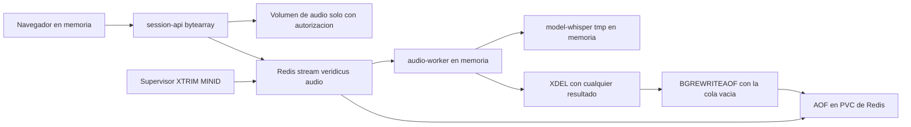

# Diseño de seguridad — U9 voice

**Revisión 2 (2026-11-22): segunda pasada por el cambio 01 (DT27), la adenda 02 y el NFR Requirements
revisión 2.** Sustituye a la revisión 1 del 2026-10-03, que queda en el historial de Git.
- **Qué cambia.** La síntesis ya no pronuncia la pregunta sugerida (salió con el Paquete de Contexto de
  Traspaso), sino la plantilla versionada con el tema de una aclaración aprobada de U8, compuesta y validada
  en `audio-worker`. Entran la autorización de voz, el audio conservado con autorización, la retirada del
  consentimiento y la frontera de código de los métodos de voz en el puerto de U11.
- **Numeración.** §1–§8 conservan número y tema. §9 (precisiones de la revisión 1) queda «Retirado» y su
  contenido pasa a §17. Lo nuevo empieza en §10. Las decisiones de diseño son DS1–DS14 (§15) y las
  precisiones, NFRD-U9-01 a NFRD-U9-16 (§17).
- **Preguntas.** Ninguna en esta pasada (segunda pasada de `nfr-design-questions.md`). P1 = A y P2 = A de
  la revisión 1 siguen.
- **Hallazgos de la revisión 1 de esta etapa.** R-01 se cierra en `reliability-design.md` §4; R-02 en §2 de
  este documento; R-03 lo cierran NFR-U9-07 y NFRD-U4-06; R-04 en §2; R-05 en `performance-design.md` §2.

**Insumos.**
- De esta unidad: `nfr-requirements/security-requirements.md` (security-requirements, amenazas T1–T21,
  tabla NFR-U9-01 a NFR-U9-09), `reliability-requirements.md` (reliability-requirements),
  `performance-requirements.md` (performance-requirements), `scalability-requirements.md`
  (scalability-requirements), `observability-requirements.md` (observability-requirements) y
  `tech-stack-decisions.md` (tech-stack-decisions, D1–D16).
- `functional-design/functional-spec.md` (functional-spec: §1, F1–F8, §3, §6, E1–E32, FD-U9-01 a
  FD-U9-14), `functional-design/rules.md` (BR1–BR9) y `functional-design/entities.md`.
- C1, C5, C8, C13, C14, C15, C16 y C25 de `inception/contract-design/contract-summary.md`
  (contract-summary) y `inception/domain-design/components.md` (SpeechProcessing, InterviewSession).
- NFR Design de hoy: U1 (ruta interna en `contracts/api/speech-internal.v1.yaml`, NFRD-U1-05, NFRD-U1-08,
  NFRD-U1-09), U2 (red, Redis §7.2, volúmenes §7.3, Ingress), U3 (formateador de logs, `ActorSystem`), U4
  (supervisor, `HoldReleaser`, `CancellationKeys`), U6 (lector `multipart` en memoria), U8
  (`is_observation_approved`) y U11 (puerto `ModelGateway`).
- Respuestas P1 = A y P2 = A de `nfr-design-questions.md`. Reglas AUTONOMIA-01..05 de `team.md` y
  prohibiciones de `project.md`.

Niveles de prueba de `team.md`; cada control tiene su control negativo. Los comandos son los de
`tech-stack-decisions.md` §5. Ninguna prueba de los niveles 0 y 1 usa GPU, modelos reales ni micrófono.

## 1. Frontera de la unidad (AUTONOMIA-04; NFR1.1, NFR1.2, NFR1.3)

| Componente | Dónde corre | Qué datos cruzan su frontera | Destinos permitidos |
|---|---|---|---|
| AnalystConsole (grabación, «Escuchar audio») | Navegador del analista (fuera del clúster) | Audio crudo hacia `session-api` por C1 (HTTPS, mismo origen); WAV de la aclaración de vuelta | Solo ConsoleApi |
| ConsoleApi e InterviewSession (API de `session-api`) | Dentro del clúster | Audio en memoria hacia Redis y, con autorización, al volumen de audio; tema hacia `audio-worker` | PostgreSQL, Redis, volumen `veridicus-audio`, `audio-worker` (puerto interno) |
| Ingesta y supervisor (trabajador de `session-api`) | Dentro | Texto transcrito hacia PostgreSQL y C2 | PostgreSQL, Redis |
| Redis (`veridicus:audio`, `veridicus:transcripts`, claves de cancelación y de entrega doble) | Dentro (PVC de U2) | Audio en base64 hasta `XDEL` o recorte; texto hasta `XDEL`; claves solo con IDs | — |
| SpeechProcessing (`audio-worker`) | Dentro; etiqueta de datos sin anonimizar | Audio hacia `model-whisper`; frase compuesta hacia `model-tts` | Redis 6379, `model-whisper` 8080, `model-tts` 8080, DNS |
| `ModelGateway.transcribe` / `.synthesize` y su adaptador local | `libs/model_gateway/`, en el proceso de `audio-worker` | Solo URL internas | Los dos servidores de voz |
| `model-whisper`, `model-tts` | Dentro, pods de U2 sin salida | Reciben audio o texto; `/tmp` en memoria; no registran cuerpos | Ninguno |

**Ningún componente de U9 llama fuera del clúster**, así que no aplica el anonimizador (U10). Lo comprueban
tres controles independientes: la red (U2), la validación de URL al arrancar y al construir el adaptador, y
la frontera de código de §14.

| Control | Dónde se aplica | Verificación y umbral |
|---|---|---|
| Salida denegada de `audio-worker` (NFR1.1) | Chart de U2: etiqueta de datos sin anonimizar, `veridicus-default-deny` y reglas de salida de la tabla; entrada solo desde `session-api` (puerto de síntesis) y Prometheus (`/metrics`, NFRD-U2-03) | Kyverno CLI de nivel 0 con controles negativos (pod sin etiqueta, salida a `0.0.0.0/0`); manual antes de la sustentación: `curl -m 5 https://example.org` desde el pod termina con código ≠ 0 |
| URL internas (NFR1.2) | Validador común de `libs/model_gateway` (forma de NFR-U1-06) sobre `VERIDICUS_WHISPER_URL`, `VERIDICUS_TTS_URL` y `VERIDICUS_SPEECH_URL`, al construir la configuración y otra vez al construir `SpeechLocalAdapter` | Nivel 0: una prueba por forma rechazada (IP pública, dominio externo, `localhost` fuera de pruebas) y su control positivo; el log nombra el ajuste sin su valor |
| Sin voz de terceros en la consola (NFR1.3) | ESLint `no-restricted-globals` y `no-restricted-properties` sobre `speechSynthesis`, `SpeechSynthesisUtterance`, `SpeechRecognition` y `webkitSpeechRecognition`; el cliente solo usa rutas relativas | Nivel 0: un archivo de control con `speechSynthesis.speak` hace fallar el *lint* |

## 2. Ciclo de vida del audio crudo (NFR10.2–NFR10.5; P1 = A, P2 = A; cierra R-02 y R-04)



<!-- Texto alternativo: el audio vive en la memoria del navegador, pasa a un bytearray de session-api y, solo con autorización, a un archivo del volumen de audio. Se publica en la cola de Redis y audio-worker lo lee en memoria y lo manda a Whisper, cuyo tmp está en memoria. La única copia en disco no autorizada es el AOF del PVC de Redis. audio-worker borra el mensaje con XDEL tras cualquier resultado y pide la reescritura del AOF con la cola vacía; si audio-worker no está, el supervisor de session-api recorta la cola por MINID. -->

| Lugar | Cuánto vive el audio | Control | Verificación |
|---|---|---|---|
| Navegador | Hasta enviar o descartar | Solo en memoria; `URL.revokeObjectURL` al enviar, descartar y al terminar de sonar el WAV de «Escuchar audio»; `MediaStreamTrack.stop()` al detener, a los 120 s y al salir de M4; ningún almacenamiento persistente (NFR10.5) | Vitest de `stop()` y `revokeObjectURL`; Playwright de nivel 3: los cuatro almacenamientos sin audio y 0 pistas activas |
| API de `session-api` | La duración de la petición | Lector `multipart` en memoria compartido (`session_api/shared/multipart_memory.py`, U6, NFRD-U6-10) con su propio tope; nunca `UploadFile`, `request.form()` ni `SpooledTemporaryFile`; Ingress `veridicus-voice` sin guardar el cuerpo (U2) | Nivel 1: con `tempfile.*` y la apertura en escritura parcheados para fallar, una subida de 5 MB sin autorización responde `202` y el directorio temporal queda sin archivos nuevos; nivel 0: la ruta no declara `UploadFile` ni `Form` |
| Volumen de audio | Solo con `autoriza_conservar_audio`, hasta la retención | §12 | §12 |
| `audio-worker` | Un procesamiento | Sin volúmenes escribibles salvo `/tmp` en memoria; raíz de solo lectura; envía `bytes` a `httpx` (multipart en memoria) | Política `memory-only-tmp` de U2 con su control negativo |
| `model-whisper`, `model-tts` | Una petición | `/tmp` `emptyDir` `medium: Memory` con `sizeLimit`; nivel de log sin cuerpos (U2) | Política de nivel 0 sobre el render |
| *Streams* de Redis | Hasta el `XDEL` o el recorte | `XACK` + `XDEL` con **cualquier** resultado (`reliability-design.md` §2); ingesta con `XDEL` de cada `TranscriptResult`; fallidos con esquema estricto de U1 (solo IDs, `attempt` y `code`) y `MAXLEN ~ 1000`. **Recorte independiente del consumidor (cierra R-02):** en cada vuelta (15 s) el supervisor ejecuta `XTRIM veridicus:audio MINID <ahora − voice_key_ttl_s>` | Nivel 1 por resultado: `XLEN` de los dos *streams* = 0 y los fallidos sin la cadena centinela. Nivel 1 con `audio-worker` apagado y reloj controlado: tras `voice_deadline_at` + 120 s + una vuelta, 0 mensajes en `veridicus:audio` y el turno en `error` |
| AOF de Redis | Hasta la reescritura | `save ""` y `auto-aof-rewrite-percentage 100` / `16mb` (U2 §7.2, cota de NFR10.4); `AofRewriteRequester` (P2 = A, abajo); `BGREWRITEAOF` sin renombrar (U2 §7.2) | Nivel 1 (abajo) |

**Por qué el recorte es seguro.** Un mensaje con más de `voice_key_ttl_s` (1 920 s) tiene, como mucho,
`voice_deadline_at` = encolado + 1 800 s, así que su turno ya venció (NFR3.7) y el trabajador lo habría
terminado sin llamar a Whisper. Los ID de Redis son la hora del `XADD` en milisegundos; el recorte es exacto
(`=`), no aproximado. Un ID borrado que siga en la lista de pendientes lo devuelve `XAUTOCLAIM` como borrado
y el trabajador solo lo confirma.

**`AofRewriteRequester` (P2 = A).** Componente de `audio-worker`, llamado tras cada `XDEL` de audio y en cada
vuelta del bucle:
- Marca «sucio» al borrar un audio. Si la cola está vacía (`XLEN` = 0 y 0 pendientes en el grupo) y pasaron
  ≥ `VERIDICUS_AOF_REWRITE_MIN_INTERVAL_SECONDS` (60) desde la última petición, envía `BGREWRITEAOF`.
- «Ya hay una reescritura en curso» no es error: sigue sucio y reintenta en la siguiente ventana. Otro error
  deja `WARNING` con `code` y reintenta. Nunca bloquea la transcripción.
- Al arrancar o reconectar con Redis queda sucio.

```python
def after_delete_or_tick(self, now):
    if not self.dirty or now - self.last_request < self.min_interval or not self.queue_empty():
        return
    try:
        self.redis.bgrewriteaof()
        self.dirty, self.last_request = False, now
    except ResponseError as exc:
        self.last_request = now
        self.metrics.rewrite(outcome=classify(exc))   # in_progress o error
```

**Cotas que resultan.**
- Con el consumidor sano: un audio ya procesado sale del AOF en ≈ 2 minutos tras quedar vacía la cola.
- Con tráfico continuo o el consumidor caído: la cota de NFR10.4 (el AOF crece ≥ 16 MB y el doble de su
  tamaño tras la última reescritura). En memoria de Redis, el recorte por `MINID` lo limita a 1 920 s más
  una vuelta del supervisor.

**Pruebas (cierra R-04).** El AOF guarda el audio en base64, así que el centinela de 64 bytes se busca en
sus **tres alineaciones** base64 (desplazamientos 0, 1 y 2, sin los caracteres de borde), con un `grep` de
las tres cadenas en `appendonlydir`. Redis real configurado como U2:
1. Tras confirmar un audio con el centinela, alguna de las tres formas aparece (documenta el riesgo; si no
   aparece, la prueba falla, para que no pase en vacío).
2. **Ventana de P2 = A:** sin llamar a `BGREWRITEAOF` desde la prueba, con la cola vacía, las tres formas
   aparecen 0 veces en ≤ 120 s.
3. **Cota de NFR10.4:** con el `AofRewriteRequester` apagado, tras escribir y borrar mensajes hasta pasar la
   cota, `INFO persistence` muestra una reescritura más en ≤ 10 s y el centinela aparece 0 veces.

Nivel 0 del componente con reloj y Redis *fake*: ventana, cola no vacía, «en curso», otro error y reconexión
(100 % de ramas, NFR13.2 ampliado en `logical-components.md` §5).

## 3. Validación de la subida (NFR10.1, NFR10.23; P1 = A)

Orden fijo de `POST /sessions/{id}/voice-turns`. Nada se escribe antes del paso 7 y nada se publica antes
del paso 9:

1. `GuardedRoute` (U3, U5): rol `analista`, dueño de la sesión (ADR-009) y `X-CSRF-Token` (NFR10.7).
2. **Tope por cabecera.** `Content-Length` > `voice_body_max_bytes` (6 016 384 = `audio_max_bytes` + 16 384,
   NFRD-U9-03) → `413` `limits.exceeded` sin leer.
3. **Guardias previas, sin bloqueo** (transacción corta de lectura): las de BR2.2 en su orden y luego
   `session.voice_not_authorized` (NFR10.23). Un rechazo no lee el cuerpo.
4. **Lectura en memoria** con el lector compartido de U6, tope `voice_body_max_bytes`: al pasarlo deja de
   leer → `413`. Solo dos partes: `audio` (`bytearray`) y `client_request_id` (UUID); otra parte o una
   repetida → `422`. Sin conexión a la base abierta durante la lectura (mismo criterio que NFRD-U12-01).
5. **Duplicado** (BR2.4): si (`session_id`, `client_request_id`) existe, responde el turno ya creado sin
   escribir nada más.
6. **Contenido** (`AudioValidator`, 100 % de ramas, D7): `audio_format` `wav` o `mp3`; cabecera real
   (`RIFF`/`WAVE` con `fmt` PCM; tramas MPEG o `ID3`), sin fiarse de `Content-Type`; tamaño ≤
   `audio_max_bytes` → si no, `413`; duración **medida sobre el audio** (muestras reales del bloque `data`;
   suma de todas las tramas MP3, también de tasa variable; más de 64 KiB que no son tramas → `422`) ≤
   `audio_max_seconds` → si no, `413`; hablante `ENT` o `TEST`. El motivo es un enum (`size`, `format`,
   `header`, `duration`) en el log, nunca un eco del contenido.
7. **Audio conservado**, solo con la autorización (§12): archivo antes que fila.
8. **Transacción con bloqueo** (orden sesión → ronda, `change_cursor.bump` primero): se **repiten** las
   guardias de BR2.2 y BR8.1 (autoridad «bajo el bloqueo» de NFR10.23); `turn_count + 1 ≤
   transcript_max_turns` (NFRD-U4-17); se insertan `Turn`, `VoiceTurnState` con `voice_deadline_at`
   (`performance-design.md` §3) y, si aplica, `TurnAudio`. Si la segunda comprobación rechaza, se borra el
   archivo del paso 7 y se responde con el mismo `409`.
9. Tras `COMMIT`, `XADD` de `AudioToTranscribe` y `202`.

Verificación de nivel 1: 10 MB, MP3 con extensión WAV, WAV de 121 s, WAV con cabecera de 60 s y 130 s
reales, MP3 de tasa variable de 130 s con cabecera Xing de 60 s (E31), PNG renombrado y cuerpo vacío → `413`
o `422` según la tabla de NFR10.12, 0 filas, 0 archivos y `XLEN veridicus:audio` sin cambio; con 10 MB la
memoria del proceso crece ≤ 20 MiB. Una prueba por guardia de NFR10.23 con una sesión que cumple las
anteriores, y una carrera (retirada entre el paso 3 y el 8) que termina en `409` con 0 filas y 0 archivos.

## 4. Autorización y ruta interna (NFR10.7, NFR10.8, NFR10.9)

| Ruta | Control | Verificación |
|---|---|---|
| `POST /sessions/{id}/voice-turns` | `x-veridicus-roles: [analista]`, `x-veridicus-owner-only: true` y anti-CSRF (§3 paso 1) | Nivel 1: otro analista, `admin`, `investigador`, identidad de servicio y POST sin anti-CSRF → `403`, 0 filas, 0 archivos, 0 `XADD` |
| `GET /conductor-observations/{id}/audio` | Mismos rol y dueño (dueño de la sesión de la aclaración). En una transacción de lectura: la sesión de la aclaración, `is_observation_approved` de U8 (`None` → `404` `conductor_observation.not_found`; `False` → `409` `conductor_observation.not_approved`), el estado de la sesión en el orden de BR2.2 (BR5.7) y el `tema` (NFRD-U9-12). Solo después llama a `audio-worker`. Respuesta con `Cache-Control: no-store` (NFRD-U9-15) | Nivel 1: los `403`, `404` y `409` con 0 llamadas al TTS *fake*; nivel 0: el ciclo de vida completo de una aclaración que nadie escucha deja 0 llamadas; «Escuchar audio» solo con `approved` y deshabilitado durante una petición |
| `POST /internal/v1/speech` (`contracts/api/speech-internal.v1.yaml`, NFRD-U1-08) | Puerto interno distinto del de métricas; `Authorization: Bearer` comparado con `hmac.compare_digest` contra `VERIDICUS_SPEECH_TOKEN` (Secret por referencia, ≥ 32 bytes) → si no, `401` sin llamar al TTS; cuerpo Pydantic estricto `{observation_id, tema, template_version}` (`extra="forbid"`) → si no, `422`; composición y validación de §10; respuesta `audio/wav` ≤ `speech_audio_max_bytes`; entrada de red solo desde `session-api` | Nivel 1: sin token, token erróneo, un campo de más y `text` en lugar de `tema`; nivel 0: política de red con su control negativo |

`session-api` lee la respuesta de la ruta interna por trozos y deja de leer al pasar
`speech_audio_max_bytes` → `503` `speech.unavailable`. Un `422` con `rule_id` se traduce a `409`
`speech.text_rejected`; un `401` (token mal configurado) a `503` `speech.unavailable` con `ERROR`.

AUTONOMIA-03: nada llega a la persona entrevistada sin la decisión humana registrada por U8 y sin una
pulsación explícita del dueño.

## 5. Modelos fijados e integridad (NFR10.10, NFR10.11, NFR11.1)

- `deploy/models.lock` (U2) lleva Whisper `base` CTranslate2 int8 (`model.bin`, `config.json`,
  `tokenizer.json`, `vocabulary.*`) y la voz Piper `es_*` (`.onnx`, `.onnx.json`) con revisión y `sha256`; el
  `initContainer` de U2 los verifica. Prueba de nivel 0 sobre el *lock*: sin `.pt`, `.pkl` ni pesos de
  PyTorch, sin `trust_remote_code` y voz con prefijo `es_` (también NFR14.3).
- `audio-worker` arranca solo si `VERIDICUS_WHISPER_MODEL_SHA256` es igual al `sha256` de `model.bin` en
  `models.lock` (NFR10.21) y pone ese valor como `model_digest` en cada `TranscriptResult` con texto; la
  ingesta lo guarda en `VoiceTurnState.model_digest` (nivel 1).
- No existe ruta de C1 que cambie el texto de un turno (prueba sobre el OpenAPI). Todo turno de voz muestra
  «Turno por voz (transcripción automática)» (Vitest y nivel 3). Un turno de voz en `error` no tiene
  corrida ni reintento; la consola ofrece «Grabar de nuevo» y «Escribir el turno».
- **Rastro (NFR11.1).** Migración de U9 en B9 (`Job` aparte, su propio PR): `VoiceTurnState` y
  `RunPublicationHold` con disparadores `BEFORE UPDATE` que rechazan revertir `voice_status`, reescribir
  `voice_error_code`, `transcribed_at`, `model_digest`, `released_at` u `outcome`, y que solo dejan crecer
  `waiting_on_turn_n` (NFRD-U9-02). `TurnAudio` es `history`. `actor_system` usa el `DOMAIN` de U3 con
  `audio-worker` (NFRD-U3-05) para la ingesta y `run-supervisor` para el vencimiento. Prueba común de U3 con
  las tres tablas y un `UPDATE` que intenta revertir cada columna.

## 6. Logs, métricas y errores sin datos sensibles (NFR10.6, NFR10.12)

- El formateador de `libs/` (U3) admite los campos de NFR10.6 con su tipo (NFRD-U9-09): UUID (`session_id`,
  `turn_id`, `observation_id`, `message_id`, `audio_id`), entero (`attempt`, `byte_size`), número
  (`audio_seconds`, duraciones) y enum (`audio_format`, `reason`, `rule_id`, `code`). Un campo sin tipo
  declarado se descarta. Nunca bytes, base64, texto transcrito, tema, frase compuesta ni ruta absoluta del
  archivo conservado. Las excepciones de `httpx`, Redis, `wave` y el lector de tramas se registran solo con
  `exc_type` y `code`.
- El manejador único de Problem Details de `libs/` nunca devuelve el `input` de Pydantic ni el mensaje de una
  excepción de terceros. Los `code` de U9 son los de NFR10.12, con `detail` del catálogo de U1; `speech.*`
  entran por el PR de U1 de FD-U9-02.
- Etiquetas de métricas solo de enum (`observability-design.md` §2).
- **Verificación de nivel 1 con cuatro centinelas** (bytes en el audio *fake*, cadena en la transcripción del
  Whisper *fake*, cadena en el tema y cadena en el texto rechazado por §10): 0 apariciones en los logs de
  `session-api` y `audio-worker`, también los de error, y en el cuerpo de cada 4xx/5xx; una prueba por
  `code`. Manual antes de la sustentación: los logs de `model-whisper` y `model-tts` no contienen la frase
  centinela del clip.

## 7. Inyección dictada y datos sintéticos (NFR5.1, NFR12.1)

- **Inyección (NFR5.1).** El texto transcrito entra a la tubería de U4 exactamente como un turno escrito; U9
  no añade ningún campo a la entrada de C6. Prueba de nivel 1: con el Whisper *fake* devolviendo el texto de
  inyección del Escenario A, la entrada de C6 de la corrida del turno de voz es idéntica byte a byte (salvo
  IDs y fechas) a la de un turno escrito con el mismo texto en otra sesión igual. La resistencia de fondo es
  la de U11.
- **Audio sintético (NFR12.1).** `evaluation/voice/generate.py` genera los clips con la voz Piper fijada a
  partir de turnos del conjunto sintético de U11 y de textos sintéticos marcados. `scripts/check-synthetic-audio.sh`
  (nivel 0) falla si un `.wav` o `.mp3` del repositorio no figura en `evaluation/voice/manifest.json` con su
  `sha256` y su texto de origen. El clip de calentamiento de la imagen también figura ahí.

## 8. Amenazas y controles

| Amenaza | Controles de este diseño |
|---|---|
| T1 Salida a internet | §1 (red, URL internas), §14 (sin anonimizador ni su cliente) |
| T2 Voz de terceros en el navegador | §1 (ESLint) |
| T3 Audio en disco o en el navegador | §2 (lector en memoria, `/tmp` en memoria, almacenamientos vacíos), §12 |
| T4 Audio en los *streams* | §2 (`XDEL` con cualquier resultado, recorte por `MINID`, fallidos sin contenido) |
| T5 Audio en el AOF | §2 (`AofRewriteRequester`, cota de NFR10.4) |
| T6 Datos en logs o errores | §6 |
| T7 Sesión ajena, `admin` o `investigador` | §4 |
| T8 Aclaración no aprobada | §4 |
| T9 Ruta interna suplantada | §4 (Bearer en tiempo constante, red, cuerpo estricto) |
| T10 Archivo enorme o disfrazado | §3 |
| T11 Modelo alterado | §5 |
| T12 Texto corregido | §5 |
| T13 Alucinación | `reliability-design.md` §8 (VAD); texto vacío es error |
| T14 Inyección dictada | §7 |
| T15 Modelo desconocido | §5 (`model_digest`) |
| T16 Inundar la cola | Riesgo aceptado; `veridicus_audio_queue_depth` y `maxmemory` (`scalability-design.md` §3) |
| T17 TTS con otro texto | §10 |
| T18 Grabar sin consentimiento o sin autorización | §3 (guardias previas y repetidas bajo bloqueo) |
| T19 Audio conservado leído o sin borrar | §12, §14 |
| T20 Audio en cola tras la retirada | §13 |
| T21 Camino externo desde los métodos de voz | §14 |

## 9. Precisiones de la revisión 1 · Retirado

Su contenido pasa a §17: cada fila de la revisión 1 queda allí como «Superado» o «Hecho».

## 10. Frase de voz (NFR10.22; BR5.5, BR5.6, VE-09)

- **Plantilla.** `contracts/integrity/clarification-speech.v1.yaml` (FD-U9-05, U1): `version` y `template`
  con un único `{tema}`. `audio-worker` la carga al arrancar desde la imagen (`VERIDICUS_SPEECH_TEMPLATE`);
  si falta, la versión no es válida o no tiene exactamente un `{tema}`, no arranca (NFR10.21).
- **Módulo puro** `services/audio-worker/.../domain/speech_text.py` (100 % de ramas, NFR13.2). Compone
  sustituyendo `{tema}` y valida en este orden, sin llamar al TTS si algo falla:

| Orden | Regla | `rule_id` |
|---|---|---|
| 1 | `template_version` igual a la cargada | `template_version` |
| 2 | Regla de DT23: no menciona la contradicción, no dice «antes dijo» ni sus variantes (lista versionada en la misma plantilla) y no contiene una cita (delimitadores «» ni comillas) | `dt23` |
| 3 | `scan(texto, literal_sources=[])` de `libs/integrity_policy` (C8): ningún término | `vocabulary` |
| 4 | Longitud ≤ `speech_text_max_chars` (400) | `length` |

- Un rechazo responde `422` con el `rule_id` de la lista cerrada de U1 y registra solo `observation_id` y
  `rule_id`; ConsoleApi responde `409` `speech.text_rejected`.
- Pruebas de nivel 0: una por regla con su control negativo, más E28, contando 0 llamadas al TTS *fake*, y
  una que compara el texto entregado al TTS *fake* con plantilla + tema.

## 11. Consentimiento y autorización de voz (NFR10.23; BR2.2, BR8.1, VE-06)

Las guardias se evalúan dos veces (§3 pasos 3 y 8): la primera evita leer 6 MB para nada; la segunda, bajo
el bloqueo de la sesión, es la que decide. Orden: `session.consent_missing`, `session.blocked`,
`session.consent_withdrawn`, `session.terminated`, `session.finalized`, `session.closed_to_new_turns`,
`session.suspended` y `session.voice_not_authorized`; en pausa se acepta (BR9.7). La función de guardias es
la misma para los dos pasos y vive en `interview/domain/voice_guards.py` (100 % de ramas). Con
`authorizes_voice: false`, el turno escrito sigue aceptándose (E13, E14).

## 12. Audio conservado (NFR10.24, NFR10.27, NFR11.2; BR8.2–BR8.6, VE-08, VE-12)

| Aspecto | Diseño |
|---|---|
| Existencia | Solo con `autoriza_conservar_audio` copiada en `VoiceTurnState.audio_retained` |
| Lugar | PVC `veridicus-audio` (U2, NFRD-U2-15), montado solo por `session-api` y el `Job` de retención; `VERIDICUS_AUDIO_DIR/audio/` con modo `0700` creado por el proceso; archivos `0600` nombrados por `audio_id` |
| Escritura | `TurnAudioStore.write`: `os.open` con `O_CREAT`, `O_EXCL` y `O_WRONLY` sobre `.<audio_id>.tmp` en el mismo directorio, escritura desde el `memoryview` del `bytearray` con `sha256` incremental, `fsync`, `os.replace` a `audio_id` y `fsync` del directorio. *Timeout* de 5 s (NFR10.13) |
| Cuota | `audio_store_max_bytes` medida por el proceso: al arrancar suma los tamaños; cada escritura y cada borrado de retención ajustan un contador bajo un `threading.Lock`; si la escritura lo pasaría → `503` `analysis.system` sin turno (NFR8.12). La métrica `veridicus_audio_store_bytes` lo publica |
| Fallos | Escritura fallida o cuota → `503` sin turno; transacción fallida → se borra el archivo; `XADD` fallido → turno en `error` con `analysis.system` y el archivo queda para la retención (NFR10.27) |
| Huérfanos | Al arrancar, `TurnAudioSweeper` borra los archivos sin fila con más de 10 minutos y los `.tmp`; registra solo `audio_id` |
| Nadie lo lee | Ninguna ruta de C1 lo expone (prueba sobre el OpenAPI); import-linter: `audio-worker` y los módulos de ConsoleApi no importan `interview.adapters.turn_audio_store`, salvo el puerto de escritura que usa la ruta de voz (§14) |
| Borrado | Solo el `Job` de retención, por `purge_session`: archivo antes que fila; el acta lleva `audio_id` y `sha256` (FD-U9-09, prueba de U13 con reloj simulado) |
| Base de datos | `veridicus_app` sin `UPDATE` sobre el texto de un turno ya escrito ni `DELETE` sobre `Turn`, `VoiceTurnState`, `TurnAudio` y `RunPublicationHold`; solo `veridicus_retention` borra (NFR11.2, prueba de nivel 1 con los dos usuarios) |
| Cifrado en reposo | No (riesgo aceptado de security-requirements §5) |

Pruebas de nivel 1 de NFR10.27 con fallo inyectado en cada paso (escritura, `fsync`, `os.replace`,
transacción, `XADD`), comparando el `sha256` del archivo con el del audio enviado, también con una
transcripción fallida.

## 13. Retirada del consentimiento (NFR10.25; BR9.5, BR9.6, VE-10 (a))

- **En la transacción de la retirada** (código de U6 que llama a la función de cancelación de
  InterviewSession de U4; U9 la amplía en B9, NFRD-U9-08): los `VoiceTurnState` en `transcribing` pasan a
  `error` con `session.consent_withdrawn` y las esperas se cancelan (`outcome = cancelled`).
- **Tras `COMMIT`**, `CancellationKeys` (U4) escribe `veridicus:voice-cancelled:{session_id}` con TTL
  `voice_key_ttl_s` (1 920 s) junto a la clave de corridas. Si Redis falla, la transición se mantiene y la
  clave se reescribe como la de U4 (al reconectar y en cada vuelta del `SessionSupervisor` de U6) para toda
  retirada con menos de `voice_key_ttl_s`.
- **En `audio-worker`**, `audio_lifecycle` consulta la clave antes de cada llamada a Whisper (`EXISTS`, 0,5 s).
  Si existe, o si la consulta falla, confirma y borra el mensaje sin llamar ni publicar (fallo cerrado: un
  error de Redis cuenta como cancelado, igual que `semantic-agent` en U6 §11).
- **En la ingesta**, un resultado de una llamada que ya había salido encuentra el turno en `error` y se
  descarta sin guardar el texto (BR4.3).
- Pruebas de nivel 1: dos audios en cola y retirada → 0 llamadas al Whisper *fake* y los dos mensajes
  borrados (E25); resultado tardío descartado (E26); Redis reiniciado tras la retirada → la clave vuelve a
  existir. 100 % de ramas en la decisión del trabajador.

## 14. Fronteras de código (NFR1.4, NFR13.3)

Contratos de import-linter, cada uno con un import sembrado como control negativo:

| Contrato | Tipo | Módulos |
|---|---|---|
| Voz sin camino externo | `forbidden` | `libs.model_gateway.adapters.speech_local` no importa `libs.anonymizer` ni `libs.model_gateway.adapters.anonymizer_http` |
| `audio-worker` sin anonimizador ni audio conservado | `forbidden` | `audio_worker` no importa `libs.anonymizer` ni `session_api` |
| ConsoleApi sin lectura del audio conservado | `forbidden` | `session_api.console` no importa `session_api.interview.adapters.turn_audio_store`; la ruta de voz solo usa el puerto `TurnAudioWriter` |
| Capas de `audio-worker` | `layers` | `worker`/`api` → `application` → `domain`; `domain` sin E/S |

Además: el lockfile de `audio-worker` no contiene `libs-anonymizer`, `sys.modules` no lo tiene tras arrancar
y el pod no recibe el Secret `veridicus-provider-keys` (tabla de consumidores de U2). `audio-worker` declara su
dependencia contra un `Protocol` con solo `transcribe` y `synthesize` (D13).

## 15. Decisiones de diseño y alternativas

| # | Estado | Decisión | Alternativas descartadas | Consecuencias |
|---|---|---|---|---|
| DS1 | cambia | Lectura de la subida en memoria con el lector compartido de U6 (P1 = A) | Lector propio de U9 (revisión 1); `UploadFile` con umbral subido | Un solo lector probado para U6, U9 y U12; a cambio, B9 depende de que B7 lo haya entregado |
| DS2 | se mantiene | `AofRewriteRequester` con la cola vacía, como mucho cada 60 s (P2 = A) | Solo la cota por tamaño (NFR10.4); tarea periódica de 10 min | El audio sale del AOF en ≈ 2 min con el consumidor sano; a cambio, reescrituras más frecuentes en un AOF pequeño |
| DS3 | nuevo | Recorte por `MINID` desde el supervisor de `session-api` | `XDEL` por `message_id` guardado en la fila; TTL por mensaje (Redis no lo tiene) | El audio no depende del consumidor para salir de memoria; sin columna nueva; a cambio, la cota es de 1 920 s y no de segundos |
| DS4 | nuevo | Guardias dos veces: antes de leer y bajo el bloqueo | Solo bajo el bloqueo (lee 6 MB con la sesión bloqueada); solo antes (carrera con la retirada) | No hay bloqueo durante la lectura y la retirada siempre gana; a cambio, una función llamada dos veces |
| DS5 | nuevo | Composición y validación de la frase en `audio-worker`, módulo puro | Validar en `session-api` | Quien pronuncia comprueba lo que pronuncia (D15) |
| DS6 | nuevo | Fallo cerrado en la clave de retirada: un `EXISTS` que falla cuenta como cancelado | Llamar a Whisper si Redis no responde | Ningún audio de una sesión con retirada llega a Whisper; a cambio, un corte de Redis hace fallar transcripciones (que igual fallarían al publicar) |
| DS7 | nuevo | Archivo antes que fila con `O_EXCL`, `fsync` y `os.replace` | Fila antes que archivo; escribir en la transacción | Nunca hay fila sin archivo; a cambio, el barrido de huérfanos |
| DS8 | nuevo | Cuota propia por contador del proceso | `kubelet_volume_stats` (Minikube no lo publica, `project.md`) | Funciona en Minikube; a cambio, un contador que se rehace al arrancar |
| DS9 | nuevo | Frontera de código por import-linter más lockfile | Solo la `NetworkPolicy` | Defensa en profundidad sin modo común con la red |
| DS10 | nuevo | `Cache-Control: no-store` en el audio de la aclaración | Sin cabecera | El navegador no guarda el WAV (NFR10.5) |
| DS11 | nuevo | Bearer interno comparado en tiempo constante, sin TLS interno | mTLS | Riesgo aceptado (security-requirements §5); la red solo admite `session-api` |
| DS12 | nuevo | `ModelGateway` de voz contra un `Protocol` de dos métodos | Importar el puerto entero de U11 | `audio-worker` no ve `generate` ni el enrutador comercial |
| DS13 | nuevo | Liberación de esperas en la transacción que resuelve el turno, con el `HoldReleaser` de U4 como red de seguridad y un solo módulo | Solo el `HoldReleaser` (contradice BR9.2 y NFR10.26) | Liberación inmediata y una sola lógica; `reliability-design.md` §9 |
| DS14 | nuevo | Clave de entrega doble después de publicar, en el `MULTI` de cierre (NFR10.14) | Antes de publicar (BR3.6 literal) | Ningún resultado se pierde; a cambio, una segunda llamada a Whisper dentro del clúster tras un corte, que la ingesta descarta |

## 16. Correspondencia con AUTONOMIA

| Regla | Qué aporta este diseño | Secciones |
|---|---|---|
| AUTONOMIA-01 | Red, modelos, volúmenes, migración (`Job` aparte) y cifras de C25 entran por PR; la verificación manual con `curl` es de lectura | §1, §5, §17 |
| AUTONOMIA-02 | Cada control nombra su prueba y su umbral; comandos en `tech-stack-decisions.md` §5 | §1–§14 |
| AUTONOMIA-03 | Solo la aclaración aprobada, por pulsación del dueño, con plantilla y sin vocabulario prohibido; la transcripción es entrada rotulada que no se reescribe | §4, §5, §10 |
| AUTONOMIA-04 | Frontera por componente, salida denegada, URL internas, frontera de código, audio solo en memoria salvo autorización, recorte y reescritura del AOF, retirada con fallo cerrado | §1, §2, §12–§14 |
| AUTONOMIA-05 | No aplica directamente: el turno transcrito entra en la misma corrida que uno escrito | §7 |

## 17. Precisiones a artefactos ya aprobados (NFRD-U9-xx)

No edité ningún artefacto aprobado (regla de `project.md`). En la aprobación decides cuáles se llevan al
original, cada una en su propio commit. Ninguna sale de una pregunta: todas salen de las fuentes o de
hallazgos que un experto cierra. Ninguna deja salir del clúster algo que hoy no sale. Las filas «Petición»
son para otra unidad y no se dan por aplicadas.

| ID | Estado | Artefacto aprobado | Precisión | Origen |
|---|---|---|---|---|
| — (rev. 1) | Superado | `tech-stack-decisions.md` D7 y §4 (`python-multipart` propio) | Lo sustituye el lector compartido de U6 (DS1) | NFRD-U6-10 |
| — (rev. 1) | Superado | Chart de U2 (`readOnlyRootFilesystem` y `/tmp` en memoria en `session-api`) | Lo cubre la política `memory-only-tmp` y el patrón sin disco de U2 | NFR Design de U2 §6 |
| — (rev. 1) | Superado | NFR10.4 y §5 (T5), cota en el tiempo | NFR10.4 revisión 2 fija la cota por tamaño; la ventana de P2 = A sigue como diseño en §2 | NFR10.4 |
| — (rev. 1) | Hecho | NFR Design de U2 §7 (`BGREWRITEAOF` sin renombrar) | U2 §7.2 solo renombra `FLUSHALL`, `FLUSHDB`, `DEBUG` y `CONFIG` | NFR Design de U2 |
| — (rev. 1) | Superado | Lista blanca de U3 con `question_id` | La sustituye NFRD-U9-09 | Cambio 01 |
| — (rev. 1) | Superado | C1 `GET /questions/{id}/audio` con `no-store` | La sustituye NFRD-U9-15 | Cambio 01 |
| — (rev. 1) | Superado | `VERIDICUS_AOF_REWRITE_MIN_INTERVAL_SECONDS` | Sigue, ahora en NFRD-U9-06 | P2 = A |
| NFRD-U9-01 | Petición (U4) | NFR Design de U4 (`performance-design.md` §8, `HoldReleaser`) | La transacción que resuelve un turno de voz (ingesta, supervisor) libera las esperas, fija `deadline_at` y arma la entrada de C6 con `interview/domain/hold_release.py`, y publica tras `COMMIT` (BR9.2, NFR10.26). El `HoldReleaser` usa el mismo módulo como red de seguridad para esperas sin liberar cuyos turnos ya están resueltos. Una publicación fallida sigue NFRD-U4-02 (el supervisor cierra la corrida al vencer) | BR9.2; NFR10.26; NFR-U4-10 |
| NFRD-U9-02 | Propuesta | `functional-design/entities.md` (RunPublicationHold) | `waiting_on_turn_n` solo crece: si se resuelve el turno más antiguo y queda otro anterior en `transcribing`, pasa a ese. El disparador de NFR11.1 lo comprueba | BR9.1; F7 |
| NFRD-U9-03 | Propuesta | `contract-summary.md` (C25, C1) y U1 (catálogo) | Cifra nueva derivada `voice_body_max_bytes` = `audio_max_bytes` + 16 384 = 6 016 384 (`bytes`), que el `requestBody` de `POST /sessions/{id}/voice-turns` declara como `x-veridicus-max-bytes`, con `413`. Entra por PR de U1 antes de B9, como `import_body_max_bytes` de U6. El Ingress `veridicus-voice` (6 065 536) sigue siendo mayor | NFR10.1; §4.3 de U1; NFRD-U6-01 |
| NFRD-U9-04 | Propuesta | `functional-design/rules.md` (BR3.6) | «La clave se escribe justo antes de publicar» se lee como NFR10.14: se publica y luego, en el `MULTI` de cierre, `XACK`, `XDEL` y la clave con TTL `voice_key_ttl_s` (DS14) | NFR10.14 |
| NFRD-U9-05 | Petición (U4) | NFR Design de U4 (`reliability-design.md` §4, supervisor) | En cada vuelta, el supervisor ejecuta también `XTRIM veridicus:audio MINID <ahora − voice_key_ttl_s>` (DS3). El código lo escribe U9 en B9, como el vencimiento de NFRD-U4-06 | R-02 de la revisión 1 de esta etapa |
| NFRD-U9-06 | Propuesta | `observability-requirements.md` (§1, §2) y `tech-stack-decisions.md` (§2) | Con P2 = A: métrica `veridicus_aof_rewrite_requests_total{outcome}` (`requested`, `in_progress`, `error`), eventos `aof.rewrite_requested` (`INFO`) y `aof.rewrite_failed` (`WARNING`), y ajuste `VERIDICUS_AOF_REWRITE_MIN_INTERVAL_SECONDS` (60, entero entre 10 y 600; fuera de rango impide arrancar) | P2 = A |
| NFRD-U9-07 | Propuesta | `reliability-requirements.md` (NFR10.17) | `/healthz` de `audio-worker` usa un latido que distingue «esperando» de «procesando»: sano si el último latido tiene ≤ 45 s o si hay un mensaje en curso con `busy_until` (inicio + *timeout* efectivo de la llamada) + 15 s no vencido. El proceso no se mata a sí mismo | R-01 de la revisión 1 de esta etapa |
| NFRD-U9-08 | Petición (U4, U6) | NFR Design de U4 (función de cancelación de InterviewSession) y Functional Design de U6 (FD-U9-08) | La función de cancelación de corridas de la sesión que llaman las transiciones de U6 recibe el motivo (`pause`, `terminate`, `withdraw`, `block`). U9 la amplía en B9: cancela las esperas con `outcome = cancelled` y, con `withdraw`, pasa los turnos de voz en `transcribing` a `error` y pide a `CancellationKeys` la clave de voz. Así no aparece una arista voice → session-lifecycle | FD-U9-08; BR9.4, BR9.5, BR9.7; `unit-of-work-dependency.md` |
| NFRD-U9-09 | Petición (U3) | NFR Design de U3 (`observability-design.md` §1, formateador) | El formateador admite, con tipo, `session_id`, `turn_id`, `observation_id`, `message_id`, `audio_id` (UUID), `attempt`, `byte_size` (entero), `audio_seconds` (número), `audio_format`, `reason` y `rule_id` (enum) | NFR10.6; NFR15.2 |
| NFRD-U9-10 | Propuesta | `observability-requirements.md` (§2) y NFR-U9-08 | Las métricas de U9 van en `contracts/metrics/voice.v1.yaml` (no en C15), con `outcome` y `error_code` de la lista cerrada. `veridicus_run_hold_wait_seconds{outcome}` suma `cancelled` (pausa, terminación o bloqueo); `veridicus_turn_latency_seconds{origin}` sigue en C15 | NFRD-U1-05 |
| NFRD-U9-11 | Propuesta | `functional-design/rules.md` (BR4.1) y `reliability-requirements.md` (NFR10.20) | Si la ingesta llevaría `char_count` por encima de `transcript_max_chars`, el turno pasa a `error` con `analysis.invalid_output` y sin corrida, igual que un texto mayor que `turn_max_chars` | NFR10.20; NFRD-U4-17 |
| NFRD-U9-12 | Petición (U8) | NFR Design de U8 (`interview/application/ports.py`) | Junto a `is_observation_approved`, un método de lectura `observation_speech_view(observation_id)`, que devuelve `(session_id, tema, approved)` o `None`, en la misma transacción de lectura, para que la comprobación y el tema vengan de la misma instantánea | NFR10.8; BR5.1, BR5.5 |
| NFRD-U9-13 | Propuesta | `scalability-requirements.md` (NFR8.5) | La segunda petición de síntesis espera el semáforo como mucho `speech_route_timeout_s − tts_timeout_s − 1` (2 s) y después recibe `503` `speech.unavailable`; la relación se valida al arrancar | NFR8.5; NFR3.13 |
| NFRD-U9-14 | Propuesta | `functional-design/functional-spec.md` (F1 pasos 4–7) y NFR10.23 | Las guardias de BR2.2 y BR8.1 se evalúan antes de leer el cuerpo, sin bloqueo, y se repiten bajo el bloqueo de la sesión; el archivo conservado se escribe entre las dos y se borra si la segunda rechaza (DS4) | NFR10.23; NFRD-U12-01 |
| NFRD-U9-15 | Propuesta | `contract-summary.md` (C1, `/conductor-observations/{id}/audio`) | La respuesta `200 audio/wav` declara `Cache-Control: no-store` | NFR10.5 |
| NFRD-U9-16 | Petición (U2) | NFR Design de U2 (§2.1, entrada a `audio-worker`) | La regla de entrada del puerto de síntesis admite solo los pods de la API de `session-api`; el trabajador de `session-api` no llama a la síntesis | NFR10.9 |
