# Plan de Bolts — Veridicus (MVP)

**Revisión 2 (2026-11-09), segunda pasada por el cambio 01 (DT27) y la adenda 02.** Sustituye a la
revisión 1. Los ID B1–B9 conservan su número y su unidad; B10 deja de ser condicional y pasa a MUST;
B11–B13 son nuevos y toman el número de su unidad. La tarea previa P0.2 queda «Retirado».

**Insumos.** Unidades de `inception/units-generation/unit-of-work.md` (unit-of-work, revisión 2), grafo
de `unit-of-work-dependency.md` (unit-of-work-dependency) y mapa de historias de
`unit-of-work-story-map.md` (unit-of-work-story-map); requisitos de
`inception/requirements-analysis/requirements.md` y `requirements-adenda-02.md` (requirements); historias
de `inception/user-stories/stories.md` y `stories-adenda-02.md` (stories); pantallas de
`inception/refined-mockups/mockups.md` (mockups); componentes de `inception/domain-design/components.md`
(components); contratos de `inception/contract-design/contract-summary.md` (contract-summary); prácticas
de `inception/practices-discovery/team-practices.md` y `team.md` (team-practices); respuestas P1–P14 de
`delivery-planning-questions.md`.

## Qué es un Bolt aquí

Un **Bolt** es una pasada de construcción sobre una unidad de trabajo que termina en algo que corre y se
puede demostrar. Cada Bolt tiene una definición de terminado, una **hipótesis de confianza** (lo que su
entrega demuestra o refuta) y una demo esperada.

- **Entrada a `main` (P9 = B).** Un Bolt es **una unidad** y entra a `main` como **un PR con
  squash-merge**, es decir, un commit nombrado por el slug del Bolt, en una rama
  `<tipo>/<slug-del-bolt>`, con la salida de sus comandos de verificación como evidencia
  (team-practices; `org.md`). Los cambios posteriores a un contrato ya fusionado entran cada uno por su
  propio PR (U1).
- **Sin esqueleto andante.** Un *esqueleto andante* es la rebanada mínima integrada de punta a punta que
  se verifica con una ceremonia propia antes de seguir; el scope `classic` no la ejecuta
  (`skeleton: off`). Lo que sí fija `team.md` es el **orden de entrega**: la primera rebanada de valor es
  la biblioteca del analizador con su CLI, el anonimizador como módulo y un proveedor comercial (B1 →
  B10 → B11, P10 = A). Se verifica con la definición de terminado de B11, no con un punto de control
  especial.
- **`Approve Plan` solo lo elige el humano.** Construction genera el plan de tareas de cada unidad
  (Parte 1 de Code Generation); el humano lo revisa y, solo entonces, elige `Approve Plan` y se construye
  el Bolt con «Review each checkpoint» (`team.md`, Mandated; DT27 levantó el alto antes de la Parte 2).
- **El plan es la intención económica, no la ruta del flujo.** Construction recorre las unidades
  **etapa por etapa** (P8) en el orden del grafo aprobado; este documento no cambia ese grafo. El orden
  propuesto es un orden topológico válido (ver `risk-and-sequencing-rationale.md`).

## Resumen

| Orden | Bolt | Nombre | Unidad | Prioridad | Módulo del curso que lo pide | Depende de |
|---|---|---|---|---|---|---|
| 0 | — | Tarea previa P0.1 | — (GitHub) | MUST | Antes de cualquier desarrollo | — |
| 1 | B1 | Contratos | U1 contracts | MUST | — | P0.1 |
| 2 | B10 | Anonimizador | U10 anonymizer | MUST | 7 (anonimizador y Secrets) | B1 |
| 3 | B11 | Analizador de incoherencias | U11 incoherence-analyzer | MUST | — (sirve al TG) | B1, B10 |
| 4 | B2 | Acceso | U3 identity-access | MUST | — | B1 |
| 5 | B3 | Flujo de texto | U4 text-flow | MUST | 6 (cola asíncrona) | B1, B2, B11 |
| 6 | B4 | Plataforma en el clúster | U2 platform | MUST (+ SHOULD/COULD al final) | 6–7 (partes SHOULD/COULD: 8) | B1 |
| 7 | B5 | Revisión humana | U5 human-review | MUST | — | B3 |
| 8 | B6 | Reporte de revisión | U7 forensic-report | MUST | Sesión 16 (paso 5) | B5 |
| 9 | B12 | Reportes del investigador | U12 research-reports | MUST (+ US12.7 SHOULD) | — (sirve al TG) | B1, B2, B3 |
| 10 | B7 | Ciclo de vida de la sesión | U6 session-lifecycle | MUST (+ SHOULD/COULD) | — | B3 |
| 11 | B13 | Ética (demostración) | U13 ethics-governance | Demostración | — | B3, B5, B6 |
| — | **Corte** | Ningún Bolt de abajo empieza hasta que los de arriba cumplen su definición de terminado | | | | |
| 12 | B8 | Extras del asistente | U8 assistant-extras | SHOULD | Tras el corte | B3, B11 |
| 13 | B9 | Voz | U9 voice | SHOULD | Tras el corte | B3, B8, B11 |

```mermaid
graph LR
  P0["P0.1 Configuracion de GitHub"]
  B1["B1 Contratos (U1)"]
  B10["B10 Anonimizador (U10)"]
  B11["B11 Analizador (U11)"]
  B2["B2 Acceso (U3)"]
  B3["B3 Flujo de texto (U4)"]
  B4["B4 Plataforma (U2)"]
  B5["B5 Revision humana (U5)"]
  B6["B6 Reporte de revision (U7)"]
  B12["B12 Reportes del investigador (U12)"]
  B7["B7 Ciclo de vida (U6)"]
  B13["B13 Etica (U13)"]
  CUT{"Corte MUST"}
  B8["B8 Extras del asistente (U8)"]
  B9["B9 Voz (U9)"]
  P0 --> B1 --> B10 --> B11 --> B2 --> B3 --> B4 --> B5 --> B6 --> B12 --> B7 --> B13 --> CUT --> B8 --> B9
```

<!-- Text fallback: P0.1 Configuración de GitHub; luego B1 Contratos, B10 Anonimizador y B11 Analizador (primera rebanada de valor); después B2 Acceso, B3 Flujo de texto, B4 Plataforma, B5 Revisión humana, B6 Reporte de revisión (la demo de la sesión 16 queda completa), B12 Reportes del investigador, B7 Ciclo de vida y B13 Ética; luego la línea de corte de las MUST; por último B8 Extras del asistente y B9 Voz. -->

---

## Tareas previas (no son Bolts)

No pertenecen a ninguna unidad del grafo y bloquean el primer Bolt.

| Tarea | Qué entrega | Verificación | Origen |
|---|---|---|---|
| P0.1 Configuración de GitHub (autor + agente) | Protección de `main` también frente al administrador, comprobaciones de CI obligatorias, GHCR privado, *deploy key* de solo lectura, permisos de Actions y Dependabot | Un PR de prueba que la CI bloquea y un *push* directo a `main` que se rechaza; se adjuntan ambas salidas | team-practices (Way of Working) |
| P0.2 Golden Dataset · **Retirado** (P12 = A) | — | — | El escenario de control y el Hecho No Documentado salieron con el cambio 01. El conjunto sintético de contradicciones internas (US12.3, NFR4) se construye dentro de B11. |

---

## B1 — Contratos

- **Unidad:** U1 contracts (spec).
- **Historias:** ninguna propia; respalda criterios de US3.6, US8.3, US12.6, US13.3 y US15.4.
- **Orden interno** (unit-of-work-story-map): contrato común v1.0.0 (C6) → mensajes de corrida y
  resultado (C2, C3) → esquema del perfil y precios (C18, `contracts/profiles/`) y tipos de la llamada
  (`contracts/python/model_calls.py`, `contracts/model_calls/`) → catálogo de límites (C25) → vocabulario
  prohibido y aviso (C8) → esquema de la sugerencia (C7) → esquema del reporte de la CLI (C19) → OpenAPI
  de C1 → métricas (C15) y formato de fecha.
- **Definición de terminado:**
  1. Cada contrato en `contracts/` con versión semántica y *fixtures* válidos e inválidos; la suite de
     validación de nivel 0 en verde en CI.
  2. El contrato común rechaza un hallazgo al que le falte `hecho`, `tipo` (7 valores), `cita_a`,
     `cita_b` u `observaciones`, y uno con `estado: error` que traiga hallazgos (AUTONOMIA-05).
  3. Ningún esquema tiene campos de veracidad: un *fixture* con uno se rechaza (AUTONOMIA-03).
  4. Los códigos `anonimizador_no_disponible` e `incidente_anonimizacion` existen en el contrato común y
     en el catálogo de Problem Details (CD-01).
  5. El esquema del reporte de la CLI cierra con `pattern` cada cadena permitida, y un *fixture* con texto
     de testimonio se rechaza (CD-03, P12 de Contract Design).
- **Hipótesis de confianza:** los contratos bastan para que la biblioteca, el anonimizador y los
  servicios se construyan por separado sin renegociar formas de datos, y el contrato común es el mismo
  que usa la app `sistema` del TG.
- **Demo esperada:** la suite de contratos en CI rechaza los *fixtures* negativos (hallazgo incompleto,
  campo de veracidad, `error` con hallazgos, reporte con texto, versión mayor desconocida) y acepta los
  positivos.

## B10 — Anonimizador

- **Unidad:** U10 anonymizer (service). Antes era condicional (COULD); pasa a MUST con el cambio 01
  (DT18) y va antes de B11 porque el grafo lo exige (P10 = A).
- **Historias:** US11.3 → US11.5.
- **Definición de terminado:**
  1. Módulo de `libs/` (C20) con NER local, marcadores consistentes por llamada y restauración en
     memoria; 100 % de ramas (módulo guardia, NFR13).
  2. Prueba del *payload* saliente: ningún nombre ni identificador del conjunto sintético llega al
     adaptador del proveedor (AUTONOMIA-04).
  3. Prueba de fallo cerrado: si el anonimizador falla, no sale ninguna llamada y la corrida termina con
     `anonimizador_no_disponible`; una respuesta con `anonimizado: false` produce
     `incidente_anonimizacion` (CD-01).
  4. Proceso `anonymizer-proxy` (C21) con sus adaptadores nativos de los proveedores comerciales (C22,
     CD-04) y la lista de dominios con su prueba (US11.5); las claves solo se montan en este proceso.
  5. Niveles 0 y 1 en verde con cobertura ≥ 80 % de líneas.
- **Hipótesis de confianza:** se puede seudonimizar un testimonio sintético de forma que el proveedor
  externo razone sobre quién y dónde sin recibir ningún dato real, y fallar cerrado sin dejar escapar
  nada.
- **Demo esperada:** una transcripción sintética con nombres pasa por el módulo; se muestra el texto que
  saldría (solo marcadores) y la respuesta restaurada; con el anonimizador apagado, la llamada no sale y
  la corrida termina con el código del fallo cerrado.

## B11 — Analizador de incoherencias

- **Unidad:** U11 incoherence-analyzer (library, XL). Es la unidad más grande del plan y entra como un
  solo PR, aunque supere los 2 días de rama (P9 = B); su plan de tareas ordena el trabajo por capas para
  que la revisión sea por partes.
- **Historias:** US12.2 → US13.3 → US13.2 → US3.3 → US3.4 → US3.5 → US3.2 → US3.6 → US3.7 → US13.4 →
  US13.5 → US12.1 → US12.5 → US13.6 → US12.3 → US15.10 → US12.4 → US13.7 → US14.2 → US14.3.
- **Incluye** (P12 = A) el conjunto sintético de contradicciones internas de los 7 tipos, relatos
  coherentes y casos trampa en `evaluation/`, generado con un modelo comercial de una familia distinta a la
  del juez y a la del verificador, solo con datos sintéticos, y revisado a mano; su manifiesto declara la
  familia del generador (NFR5, Escenario B).
- **Definición de terminado:**
  1. La biblioteca corre sin Redis, Kubernetes ni base de datos (DT26); niveles 0 y 1 en verde con
     cobertura ≥ 80 % de líneas y 100 % de ramas en la verificación de citas (módulo guardia).
  2. Pruebas AUTONOMIA-05 citadas por ID: una cita alterada o en otro turno no sale; `estado: error`
     implica hallazgos vacíos; la cita seudonimizada se restaura antes de verificarse.
  3. Pruebas AUTONOMIA-04 desde el lado de ModelGateway: el *payload* saliente pasó por el anonimizador y,
     si este falla, no sale ninguna llamada; un perfil con destino externo sin anonimizador no arranca
     (US13.3).
  4. Evaluación de nivel 2 con la propia CLI sobre el conjunto sintético, con el perfil de la primera
     rebanada (un proveedor comercial y uno local, US13.6): 100 % de citas verificadas en lo emitido, 0 %
     de error de formato JSON, acuerdo entre 3 corridas, precisión y sensibilidad con los umbrales de NFR
     Requirements (NFR4) y Escenario A de NFR5; el reporte JSON va adjunto al PR.
  5. Los scripts `sbatch` y el paquete de entrada para ZINE (US14.2, US14.3) existen como artefactos
     revisables; los lanza el humano (AUTONOMIA-01). La corrida sobre las 10 entrevistas del piloto es
     prueba de humo fuera de Git, no medición.
- **Hipótesis de confianza:** con dos citas verificadas de forma determinista, el analizador encuentra
  contradicciones internas sembradas sin emitir hallazgos sin evidencia, con un proveedor comercial
  detrás del anonimizador y con un modelo local. Es la rebanada que sirve primero al TG.
- **Demo esperada:** `veridicus analyze` sobre una transcripción sintética con una contradicción sembrada
  devuelve un hallazgo con sus dos citas verificadas y el aviso; sobre un relato coherente devuelve 0
  hallazgos; `veridicus evaluate` produce el reporte JSON con versión del conjunto, `prompt_sha256`,
  perfil con su huella, modelos por llamada y métricas.

## B2 — Acceso

- **Unidad:** U3 identity-access (service).
- **Historias:** US8.1 → US8.2 → US8.4 → US8.3.
- **Pantallas:** M0 inicio de sesión y M6 usuarios (`mockups.md`).
- **Definición de terminado:**
  1. Inicio de sesión con cookie `HttpOnly`, `Secure`, `SameSite=Strict` y cabecera anti-CSRF (C1);
     mismo cuerpo de error para usuario inexistente y contraseña errónea.
  2. Matriz de roles de FR1.2, incluido el rol `investigador`, aplicada en ConsoleApi; ninguna ruta
     escribe perfiles, proveedores, *prompts* ni límites (US8.3).
  3. Convención común de auditoría (ADR-003) y su prueba de nivel 1 (sin `UPDATE`/`DELETE` en
     historiales) en verde (NFR11).
  4. Niveles 0 y 1 en verde con cobertura ≥ 80 % de líneas; suite `axe` sin violaciones en M0 y M6.
- **Hipótesis de confianza:** la base de autenticación, roles y auditoría alcanza para que las demás
  unidades solo añadan la autorización por dueño en sus rutas.
- **Demo esperada:** el `admin` crea un analista; el analista inicia sesión; un intento de modificar
  una fila de historial falla.

## B3 — Flujo de texto

- **Unidad:** U4 text-flow (sin tipo); entra como un solo PR (P9 = B).
- **Historias:** US13.1 → US15.4 → US2.1 → US2.2 → US3.1 → US12.5 (consola) → US15.5 → US5.5 → US5.6.
- **Pantallas:** M3 nueva sesión y M4 sesión con la tarjeta del hallazgo y sus dos citas (`mockups.md`).
- **Definición de terminado:**
  1. Niveles 0 y 1 en verde para `session-api`, `semantic-agent` y `frontend`, con PostgreSQL y Redis
     reales en contenedor y *fakes* del `ModelGateway`; cobertura ≥ 80 % de líneas.
  2. AnalysisWorker (C17) no publica ni guarda hallazgos de una corrida con error (US3.2) y, tras la
     retirada del consentimiento, no encola ni analiza ninguna corrida (VE-10 (a), CD-06).
  3. AUTONOMIA-03: escaneo de vocabulario prohibido en salida e interfaz que excluye las citas literales.
  4. Suite `axe` de la consola sin violaciones en las pantallas del Bolt (US5.6).
- **Hipótesis de confianza:** la biblioteca de B11 funciona igual envuelta en el trabajador de cola, y
  la consola sigue respondiendo mientras un análisis se procesa (NFR3).
- **Demo esperada:** el analista inicia sesión, registra el consentimiento, crea una sesión con el perfil
  elegido, escribe los turnos de una transcripción sintética con una contradicción sembrada y ve aparecer
  el hallazgo con sus dos citas y las observaciones mientras la consola sigue respondiendo. Todo con
  PostgreSQL y Redis en contenedores.

## B4 — Plataforma en el clúster

- **Unidad:** U2 platform (packaging).
- **Historias:** US9.4 → US9.3 → US9.1 → US11.6 → US9.5 → US9.2 (MUST); al final, US10.7, US10.8
  (SHOULD) y US11.4 (COULD).
- **Definición de terminado (parte MUST):**
  1. Chart y manifiestos en `deploy/` pasan `helm template` → `kubeconform` → Kyverno CLI en nivel 0,
     cada política con su control negativo.
  2. Comprobación estática de que ningún *workflow* ni *script* aplica cambios al clúster ni envía
     trabajos a ZINE (AUTONOMIA-01, US9.5).
  3. `NetworkPolicy` que niega la salida a internet a todos los pods salvo a `anonymizer-proxy`, que solo
     sale por 443 y DNS, con la lista blanca de CoreDNS (AUTONOMIA-04, US11.6), como artefacto revisable.
  4. `Secret` de las claves de los proveedores referenciado solo por `anonymizer-proxy`; los valores los
     crea el humano con un script revisable.
  5. El humano aplica a mano los artefactos ya fusionados (antes del módulo 8 no hay Argo CD) y
     `scripts/smoke.sh <url-base>` termina con código 0: salud 200 de cada servicio, una contradicción
     sembrada produce ≥ 1 hallazgo con dos citas en ≤ *N* s y un relato coherente produce 0 hallazgos
     (*N* lo fija NFR Requirements).
  6. Verificación manual de la `NetworkPolicy` en el clúster registrada como evidencia.
- **Definición de terminado (partes SHOULD/COULD, módulo 8):** `Application` de Argo CD con *deploy key*
  de solo lectura y *prune* desactivado sobre CloudNativePG y sus PVC; regla y panel de la razón de
  descartes en Prometheus/Grafana con la métrica que emite U5 (C15, CD-07); KEDA sobre la longitud de la
  cola. Ninguna bloquea el corte.
- **Hipótesis de confianza:** el flujo de texto de B3 corre igual en el clúster local, dentro de sus
  `requests`/`limits`, y la única salida a internet es el anonimizador.
- **Demo esperada:** la demo de B3 en el clúster local, con `scripts/smoke.sh` en verde y un intento de
  salida a internet desde el pod de `semantic-agent` bloqueado por la `NetworkPolicy`.

## B5 — Revisión humana

- **Unidad:** U5 human-review (service).
- **Historias:** US5.1 → US5.3 → US5.2 → US5.4.
- **Pantallas:** tarjeta del hallazgo en M4 (aceptar, editar, descartar) (`mockups.md`).
- **Definición de terminado:**
  1. Máquina de estados de la sugerencia (pendiente / aceptada / editada / descartada) con actor y hora
     y 100 % de ramas (AUTONOMIA-03, NFR13).
  2. Aceptar exige haber consultado las observaciones; editar exige reformulación propia y no toca los
     campos protegidos (las dos citas); descartar exige nota.
  3. Solo el dueño de la sesión cambia sus hallazgos; los demás ven en solo lectura (nivel 1).
  4. Decisiones de solo inserción verificadas por la prueba común de auditoría; métrica de descartes
     expuesta en `/metrics` (C15).
  5. Suite `axe` sin violaciones en la tarjeta.
- **Hipótesis de confianza:** el analista decide sobre cada sugerencia sin que el sistema emita nunca un
  juicio de veracidad, y «aceptar» obliga a leer las observaciones (sesgo de automatización, PRD S12).
- **Demo esperada:** sobre la sesión de B3, el analista abre las observaciones y acepta un hallazgo,
  edita otro con su propia redacción y descarta un tercero con nota; un segundo usuario ve la sesión en
  solo lectura.

## B6 — Reporte de revisión

- **Unidad:** U7 forensic-report (service; componente ReviewReport). El directorio conserva su nombre
  (`project.md`).
- **Historias:** US2.4 → US6.1 → US6.2 → US15.8 → US6.3.
- **Pantallas:** finalizar sesión y consolidación en M4 y M5 reporte consolidado (`mockups.md`).
- **Definición de terminado:**
  1. Consolidación con sus precondiciones (ninguna sugerencia pendiente), escaneo de vocabulario
     prohibido y SHA-256, con 100 % de ramas (AUTONOMIA-03).
  2. Dos consolidaciones simultáneas: una sola gana, probado en nivel 1.
  3. Descarga del reporte Markdown con el aviso de propósito limitado, verificación de integridad y
     corrección con versión nueva; exportación con marca de agua por el puerto `AccessLog` con un doble
     (US15.8; el registro real llega con B13).
  4. Las marcas de hora de «Finalizar sesión» y «Finalizar y Consolidar» permiten calcular el MTTV
     (NFR7).
- **Hipótesis de confianza:** el reporte final solo existe por una acción explícita del analista,
  registrada con quién y cuándo, y su integridad se puede comprobar después de descargarlo.
- **Demo esperada:** el analista finaliza la sesión, decide la última sugerencia pendiente, consolida y
  descarga el reporte; la verificación de integridad pasa y una corrección produce la versión 2 sin borrar
  la 1. **Con B6 queda completo el flujo de la sustentación** (PRD S13, pasos 1–5).

## B12 — Reportes del investigador

- **Unidad:** U12 research-reports (service). Nuevo en esta revisión.
- **Historias:** US12.6 (MUST) → US12.7 (SHOULD, al final).
- **Pantallas:** M8 reportes de corridas y evaluaciones (`mockups.md` §10).
- **Definición de terminado:**
  1. Subir un reporte de la CLI que cumple el esquema de U1 (C19) y consultarlo con el rol `investigador`.
  2. Un reporte que no cumple el esquema o que trae texto se rechaza con `422` y no se guarda (CD-03).
  3. Solo se guardan metadatos y cifras, nunca texto de transcripciones, hallazgos ni citas (NFR12),
     probado en nivel 1.
  4. Suite `axe` sin violaciones en M8.
- **Hipótesis de confianza:** el investigador del TG puede comparar corridas de la CLI (local o ZINE)
  sin que ningún testimonio entre a la base de datos.
- **Demo esperada:** el investigador sube el reporte de evaluación de B11 y ve sus cifras; un reporte
  manipulado con un campo de texto se rechaza.

## B7 — Ciclo de vida de la sesión

- **Unidad:** U6 session-lifecycle (service).
- **Historias:** US2.3 → US2.6 → US2.7 → US2.5 → US7.1 → US15.2 (MUST); US10.1 (SHOULD) y US11.2
  (COULD) al final.
- **Pantallas:** M1 lista de sesiones, pegar transcripción en M4 y M7 importar transcripción
  (`mockups.md`).
- **Definición de terminado:**
  1. La reanudación tras falta de latido no duplica turnos, hallazgos ni filas de historial, probado en
     nivel 1 con PostgreSQL y Redis reales.
  2. Importar una transcripción con turnos y páginas, y pegar un bloque, producen los mismos turnos que
     escribirlos uno a uno; el modo final corre sobre la sesión completa (US2.7).
  3. Pausar, terminar y retirar el consentimiento cancelan lo encolado con la clave de Redis de CD-06.
  4. NFR8: al menos 50 sesiones de texto del conjunto sintético, en tandas de 3 concurrentes y con el modo
     final, terminan sin `OOMKilled` ni *timeout* en ≥ 98 % de los casos en la máquina CPU; el reporte
     declara el perfil.
- **Hipótesis de confianza:** una sesión interrumpida se recupera sin perder ni duplicar trabajo, y la
  máquina CPU sostiene la carga de NFR8.
- **Demo esperada:** el analista importa una transcripción, cierra el navegador a mitad del análisis,
  vuelve desde la lista de sesiones y la encuentra reanudada sin duplicados.

## B13 — Ética (demostración)

- **Unidad:** U13 ethics-governance (service, demostración sin compuertas). Nuevo en esta revisión.
- **Historias:** US15.1 → US15.6 → US15.3 → US15.9 → US15.7.
- **Definición de terminado:**
  1. El adaptador real del puerto `AccessLog` (C23) sustituye al doble de B6, con una prueba de nivel 1 de
     que está conectado y que la exportación queda registrada (AC15.8.2).
  2. El reporte de problemas no copia el testimonio y se selecciona también por las sugerencias de la
     sesión (UG-01).
  3. El Job de retención es un artefacto revisable que lanza el humano (AUTONOMIA-01) y borra en el orden
     inverso de las referencias (C24), probado con reloj simulado.
  4. Ninguna demostración bloquea el uso de la consola.
- **Hipótesis de confianza:** las reglas éticas de la adenda 02 se pueden demostrar en la consola sin
  rebajar el analizador ni añadir compuertas.
- **Demo esperada:** el analista reconoce las reglas de uso, se ve quién abrió la sesión, se reporta un
  problema sin testimonio y el Job de retención borra una sesión vencida con su acta.

## Corte de las MUST

Ningún Bolt SHOULD empieza hasta que P0.1, B1, B10, B11, B2–B6, B12, B7 y B13 cumplen su definición de
terminado. Las partes SHOULD/COULD dentro de U2, U6 y U12 son las últimas tareas de esos Bolts y no
bloquean el corte.

**Si el calendario no alcanza (P13 = A)**, se recorta en este orden: B13 (demostración) → las partes
SHOULD/COULD de B4 y B7 → el alcance de B7. Nunca se recortan B1, B10, B11 ni la demo (B2–B6), y en ningún
caso se rebaja una prueba ni un umbral.

## B8 — Extras del asistente

- **Unidad:** U8 assistant-extras (service).
- **Historias:** US10.3 → US10.5.
- **Definición de terminado:**
  1. La aclaración neutra (`observaciones_conductor`) se valida en la biblioteca y pasa por el escáner de
     vocabulario prohibido; solo se usa tras la aprobación del analista.
  2. Permutación de las dos citas en el 100 % de las consultas *offline* y consistencia > 65 % al invertir
     el orden (NFR4, NFR5 Escenario C), con la medición del costo extra frente a NFR3 y NFR8.
- **Hipótesis de confianza:** confirmar cada hallazgo en ambos órdenes cabe en la máquina CPU sin romper
  la latencia ni NFR8.
- **Demo esperada:** en un turno con una contradicción, el analista ve una aclaración neutra, la aprueba
  y la usa; el hallazgo aparece confirmado en ambos órdenes.

## B9 — Voz

- **Unidad:** U9 voice (service).
- **Historias:** US10.2 → US10.4.
- **Definición de terminado:**
  1. Un turno grabado se transcribe con Whisper local en CPU en 8–12 s y sigue el mismo camino que un
     turno de texto (NFR3).
  2. El audio crudo no sale del clúster ni se guarda: `audio-worker` entra en la `NetworkPolicy` y el
     audio se borra del *stream* tras confirmarlo (C5); Whisper y TTS son siempre locales.
  3. La aclaración aprobada se escucha bajo demanda (TTS).
- **Hipótesis de confianza:** la voz se agrega sin cambiar el flujo de texto que ya funciona.
- **Demo esperada:** el analista graba un turno, ve la transcripción y el hallazgo como en un turno
  escrito, y escucha la aclaración aprobada.

## Precisiones para decidir en la aprobación

No se edita ningún artefacto aprobado (`project.md`). En la aprobación, el humano decide cuáles se llevan
al original, cada una en su propio commit.

| ID | Artefacto aprobado | Precisión propuesta | Resuelve | Origen |
|---|---|---|---|---|
| DP-01 | `contract-design/interaction-spec.md` (clave `research.upload_ok`) | El texto dice que el reporte con texto «se descartó», pero CD-03 decidió rechazarlo con `422`: la clave debe describir solo la subida aceptada, y el rechazo usa el mensaje del `422` | B12, Functional Design de U12 | Lectura de esta etapa frente a CD-03 |
| DP-02 | `project.md` (`## Corrections`, regla aprendida en Delivery Planning) | La regla «El Golden Dataset y la configuración de GitHub se tratan como tareas previas al primer Bolt» queda superada en su primera mitad por P12 = A (el conjunto sintético se construye en B11). No se edita la memoria a mano: se propone como aprendizaje en el cierre de esta etapa. «Plataforma justo después del flujo de texto» y «Sin WSJF formal» siguen vigentes | Esta etapa | P11, P12 |
