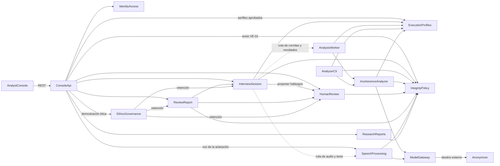

# Componentes del dominio — Veridicus (MVP)

**Revisión 2 (2026-11-06), segunda pasada por el cambio 01 (DT27) y la adenda 02.** Sustituye a la
revisión 1 del 2026-10-02. Los componentes que salen quedan en la tabla «Componentes retirados» con su
nombre, sin renumerar nada. Ajustada el mismo día con los hallazgos R-01 a R-05 de la revisión de
arquitectura: orden de borrado de la retención, ProblemReport en la retención, aviso servido por
ConsoleApi, incidente de anonimización en la biblioteca y DD-06 separada.

**Insumos.**
- Requisitos: `inception/requirements-analysis/requirements.md` (requirements, revisión 2: FR1–FR16 y
  NFR1–NFR15; FR2, FR5, FR11.1 y NFR9 retirados) y `requirements-adenda-02.md` (VE-01 a VE-17, con las
  decisiones A-1 a A-4).
- Historias: `inception/user-stories/stories.md` (stories, revisión 2: épicas 2–14) y
  `stories-adenda-02.md` (US15.1–US15.10).
- Prácticas: `inception/practices-discovery/team-practices.md` (team-practices).
- Pantallas: `inception/refined-mockups/` (M0–M8).
- Otros documentos: `docs/iteracion2.md` §2.4 y el reporte de `docs/validacion-zine/`, cuya decisión es
  «Diseñar con limitaciones registradas».
- Respuestas: P1–P5 (primera pasada) y P6–P12 con el Seguimiento 1 (segunda pasada) de
  `domain-design-questions.md`.
- Proyecto greenfield: no hay arquitectura previa.

**Alcance.** Esta etapa fija tres cosas:
- los bloques lógicos de software que se escriben (componentes);
- qué componente es dueño de cada dato;
- cómo se llaman los componentes entre sí.

Lo demás se decide en otras etapas:
- la agrupación en servicios desplegables y si la biblioteca es una unidad propia, en Units Generation;
- los tipos de dato, las validaciones y las cardinalidades, en Functional Design;
- los nombres de campo del contrato común v1.0.0, en Contract Design;
- los patrones de NFR, en NFR Design.

Bases de datos, colas, proveedores y modelos son dependencias externas, no componentes.

**Alcance ético (P10 y Seguimiento 1 = A).** El protocolo ético se aplica en dos niveles:
- **El analizador cumple las reglas éticas del TG sin rebaja.** Esta es la única definición (UG-04): el
  analizador son IncoherenceAnalyzer y AnalyzerCli (la biblioteca y la CLI), el Anonymizer y el
  AnalysisWorker que la envuelve. Las VE que siguen MUST (DD-07) se cumplen sin rebaja en el componente que
  las contiene, aunque no sea parte del analizador (p. ej., VE-08 en SpeechProcessing, VE-13 en
  ReviewReport). Las reglas del analizador son: el vocabulario prohibido; el aviso de que los hallazgos
  son para revisar la coherencia y no son prueba; el bloqueo sin consentimiento (A-4); el anonimizador
  con su incidente (VE-14); la validación de las aclaraciones neutras (VE-05); y la métrica de sesgo
  (VE-17).
- **En la consola, el resto de la adenda es una demostración.** Comprende el reconocimiento cada 90 días,
  el registro de acceso, la retención con acta y el reporte de problemas. Vive en un solo componente,
  `EthicsGovernance`, sin compuertas que bloqueen el uso. tg-veridicus es un proyecto de investigación
  y demostración, no de despliegue.

La tabla «Precisiones para decidir en la aprobación» propone qué cambia en la adenda aprobada.

## Catálogo (fuente de verdad)

```yaml
components:
  - name: AnalystConsole
    summary: Consola web del analista, del administrador y del investigador (React + TypeScript).
    behaviour: >
      Presenta las pantallas M0–M8 de refined-mockups. No contiene reglas de negocio: deshabilita
      acciones con su motivo visible, pero toda regla la vuelve a aplicar ConsoleApi. Muestra en todas
      las pantallas la franja fija con el aviso de propósito limitado (VE-01), con el texto y la versión
      que le sirve ConsoleApi desde IntegrityPolicy; no guarda una copia propia (R-03). Repite la división de un bloque pegado en turnos con la misma
      especificación y los mismos ejemplos que el servidor, solo como vista previa (FR3.3). Codifica la
      voz a WAV mono de 16 kHz. Muestra, como demostración del protocolo, el diálogo de reconocimiento,
      el aviso de contenido al abrir una sesión y el recordatorio de pausa no modal (VE-04, VE-16), sin
      impedir el trabajo. Envía el latido de la sesión abierta y formatea fechas en hora de Colombia.
      Sus textos salen del catálogo de mensajes que pasa el escaneo de vocabulario prohibido.
    responsibilities:
      - Pantallas, estados visuales y accesibilidad WCAG 2.1 AA (US5.6)
      - Vista previa de la división de turnos (FR3.3)
      - Aviso de propósito limitado y avisos de bienestar (VE-01, VE-16)
      - Latido de la sesión abierta para detectar interrupciones (US7.1)
      - Catálogo de mensajes en español
    depends_on:
      - component: ConsoleApi
        interaction: Todas las lecturas y acciones de la consola
        style: sync
    dependents: []
    external_dependencies: []
    entities: []

  - name: ConsoleApi
    summary: Fachada HTTP única de la consola; autentica, autoriza, registra el acceso y traduce errores.
    behaviour: >
      Único punto de entrada desde el navegador (ADR-004). Exige token en toda ruta salvo inicio de
      sesión y salud. Aplica la matriz de tres roles de FR1.2 y la propiedad de la sesión antes de
      delegar (ADR-009): solo el dueño crea corridas, cambia hallazgos, consolida o corrige; `admin` y
      `investigador` nunca. Exportan el reporte el dueño y el `admin`; el `investigador`, no (A-3). Las
      rutas de reportes de la CLI son solo del `investigador` (FR13.5). No existe un rol ni una ruta para
      la persona entrevistada (VE-09). Registra en EthicsGovernance cada apertura de sesión, hallazgo o
      reporte y cada exportación con su SHA-256 (VE-11, A-3). No expone ninguna ruta que escriba
      perfiles, proveedores, prompts, precios ni límites (FR9.2). Sirve a la consola el texto versionado
      del aviso de VE-01 y su versión, leídos de IntegrityPolicy en ejecución: la consola y el reporte
      muestran la misma versión, y una prueba lo comprueba (R-03). Traduce la jerarquía única de
      excepciones a Problem Details (RFC 9457) con `code` estable y `detail` en español.
    responsibilities:
      - Autenticación por token y autorización por rol y por dueño de sesión
      - Entrega a la consola del texto versionado del aviso de VE-01 (R-03)
      - Registro de acceso y de exportación en cada lectura (VE-11, demostración)
      - Traducción de errores a Problem Details
      - Composición de vistas para la consola
    depends_on:
      - component: IdentityAccess
        interaction: Validar credenciales y token; gestionar usuarios
        style: sync
      - component: ExecutionProfiles
        interaction: Listar los perfiles aprobados y su indicación de proveedor comercial (FR14.5)
        style: sync
      - component: InterviewSession
        interaction: Crear sesiones con consentimiento y perfil, enviar o importar turnos, lanzar corridas, pausar, terminar, registrar la retirada del consentimiento (AC15.2.3), finalizar, latido, reanudar
        style: sync
      - component: HumanReview
        interaction: Registrar «observaciones desplegadas» y decisiones sobre sugerencias
        style: sync
      - component: ReviewReport
        interaction: Consolidar, exportar con marca de agua y corregir el reporte
        style: sync
      - component: SpeechProcessing
        interaction: Sintetizar en voz una aclaración aprobada (SHOULD)
        style: sync
      - component: ResearchReports
        interaction: Subir, listar, ver y comparar reportes de la CLI (rol investigador)
        style: sync
      - component: EthicsGovernance
        interaction: Reconocimientos, registro de acceso, reportes de problemas y retención (demostración)
        style: sync
      - component: IntegrityPolicy
        interaction: Leer el texto versionado del aviso de VE-01 y su versión para servirlos a la consola
        style: sync
    dependents:
      - component: AnalystConsole
        interaction: Todas las lecturas y acciones de la consola
    external_dependencies: []
    entities: []

  - name: IdentityAccess
    summary: Usuarios locales, tres roles y credenciales.
    behaviour: >
      Guarda contraseñas solo como hash de un algoritmo adaptativo con sal (FR1.1). Mismo estado y
      cuerpo para usuario inexistente y contraseña errónea. Un usuario desactivado recibe 401 aunque
      tenga token vigente. Exactamente tres roles: `analista`, `admin` e `investigador` (FR1.2).
    responsibilities:
      - Alta, desactivación y rol de usuarios
      - Verificación de credenciales y emisión y validación de tokens
      - Historial de cambios de usuario de solo inserción
    depends_on: []
    dependents:
      - component: ConsoleApi
        interaction: Validar credenciales y token; gestionar usuarios
    external_dependencies:
      - name: PostgreSQL
        kind: database
        purpose: Usuarios e historial de cambios
    entities:
      - name: User
        identifier: user_id
        attributes: [username, role, password_hash, active, created_by, created_at]
      - name: UserChange
        identifier: change_id
        attributes: [user_id, change, actor_user_id, at]
        references:
          - entity: User
            owned_by: IdentityAccess
            relationship: cada cambio pertenece a un usuario y lo hace otro usuario

  - name: ExecutionProfiles
    summary: Perfiles de ejecución aprobados por PR, su validación y su huella; sin estado.
    behaviour: >
      Lee el archivo versionado de perfiles y la tabla de precios (FR9.2, FR15.4). Un perfil fija, por
      papel (juez y verificador), proveedor, modelo, versión y parámetros, la permutación, el proveedor
      alterno y el modo fragmentado con su ventana (FR14.1). Valida igual para la biblioteca, la CLI, el
      trabajador y los servicios: un archivo inválido, un destino externo sin el anonimizador delante o
      una clave de API ausente impiden arrancar, o hacen terminar la CLI con código distinto de 0, antes
      de cualquier llamada (FR14.3). Rechaza la misma familia de modelos para juez y verificador en un
      perfil de evaluación. Un perfil de demostración la admite solo si lo declara, y entonces devuelve
      el aviso que muestran la consola y el reporte (FR14.4). Rechaza un perfil con destino externo
      cuando el bloque de consentimiento no autoriza la transferencia (A-4, VE-07). Calcula
      `config_sha256` de la configuración efectiva: misma configuración, misma huella (FR14.2). Los
      perfiles locales en CPU solo admiten el modo por lotes (validación en ZINE). Nunca escribe los
      archivos: solo cambian por PR.
    responsibilities:
      - Carga y validación de perfiles y de la tabla de precios
      - Huella config_sha256 de la configuración efectiva
      - Reglas de familias distintas, anonimizador obligatorio y consentimiento de transferencia
      - Lista de perfiles aprobados con su indicación de proveedor comercial
    depends_on: []
    dependents:
      - component: ConsoleApi
        interaction: Listar los perfiles aprobados y su indicación de proveedor comercial (FR14.5)
      - component: InterviewSession
        interaction: Validar el perfil elegido contra el consentimiento y fijar su configuración efectiva
      - component: AnalysisWorker
        interaction: Validar el archivo de perfiles al arrancar
      - component: IncoherenceAnalyzer
        interaction: Resolver y validar el perfil de una corrida antes de cualquier llamada
      - component: AnalyzerCli
        interaction: Validar el perfil pedido y sumar el costo con la tabla de precios
    external_dependencies:
      - name: Archivo versionado de perfiles y tabla de precios
        kind: other
        purpose: Configuración aprobada por PR
      - name: Kubernetes Secrets o variables de entorno
        kind: other
        purpose: Claves de API que los perfiles solo referencian (FR12.4)
    entities:
      - name: ExecutionProfile
        identifier: profile_name
        attributes: [purpose, judge, verifier, permutation, fallback_provider, fragmented, window, overlap, same_family_declared, external_destination, config_sha256]
      - name: PriceTable
        identifier: price_table_version
        attributes: [provider, model, input_token_price, output_token_price, currency]

  - name: InterviewSession
    summary: Sesión con su consentimiento, sus turnos, sus corridas y el registro de llamadas a modelos.
    behaviour: >
      Crear una sesión exige una entrevista, importada o guiada, uno de los perfiles aprobados y el
      registro del consentimiento. El registro es de la persona o la constancia de la autoridad que lo
      exime, con la versión del texto y las autorizaciones de transferencia y de voz. Ese registro es el
      bloque `consentimiento` del contrato común (A-4, VE-06). La sesión queda ligada al perfil y a su
      `config_sha256` toda su vida (FR3.1). Numera los turnos en orden, sin huecos ni duplicados, con
      hablante `ENT` o `TEST` (FR3.2). Divide un bloque pegado con la especificación versionada (FR3.3).
      Valida e importa una transcripción del contrato. Una transcripción sin bloque de consentimiento se
      rechaza completa, y una importada nace cerrada a turnos nuevos (FR3.6). Encola una corrida
      incremental por envío y el modo final por botón, sin bloquear al analista (FR3.4, FR4.9). Dos
      lanzamientos simultáneos del modo final dan 202 y 409. Consume el mensaje de resultado de forma
      idempotente por ID de corrida (ADR-002) y lo valida contra el contrato. Guarda la corrida y sus
      llamadas, y pasa los hallazgos a HumanReview. Si la corrida vuelve con `codigo:
      anonymizer.incident` (lo decide IncoherenceAnalyzer, R-04), o una llamada a un proveedor comercial
      llega con `anonimizado: false`, bloquea la sesión con `anonymizer.incident`, rechaza corridas nuevas
      y registra el incidente (VE-14). «Pausar análisis» guarda los turnos sin encolar y cancela las
      corridas en cola sin llamar a modelos. «Terminar sesión» cancela y cierra la sesión a turnos
      nuevos. Tras la retirada del consentimiento, ningún turno posterior entra en una corrida (VE-10).
      Pasa la sesión a `suspendida` cuando falta el latido y conserva todo lo procesado (FR8). Borra lo
      suyo solo cuando se lo pide la retención (A-2). Conserva el audio de un turno solo con la
      autorización de voz (VE-08).
    responsibilities:
      - Ciclo de vida de la sesión (abierta, pausada, suspendida, finalizada, terminada, bloqueada, consolidada) e inicio de MTTV
      - Registro del consentimiento, su retirada y su paso al contrato (A-4)
      - Turnos, su numeración, división, importación y estado
      - Encolado de corridas incrementales y del modo final, y su cancelación
      - Ingesta idempotente de resultados; corridas y registro de llamadas de solo inserción (FR15.3)
      - Detección del incidente de anonimización y bloqueo de la sesión (VE-14)
      - Aclaraciones neutras recibidas y su decisión (SHOULD, FR10.3)
      - Borrado de sus datos a pedido del Job de retención (A-2)
    depends_on:
      - component: ExecutionProfiles
        interaction: Validar el perfil elegido contra el consentimiento y fijar su configuración efectiva
        style: sync
      - component: AnalysisWorker
        interaction: Pedir una corrida (incremental o final); el resultado vuelve por la cola de resultados
        style: async
      - component: SpeechProcessing
        interaction: Pedir la transcripción de un turno de voz; el texto vuelve por la cola (SHOULD)
        style: async
      - component: HumanReview
        interaction: Proponer los hallazgos de una corrida terminada
        style: sync
      - component: IntegrityPolicy
        interaction: Validar transcripciones importadas y mensajes de resultado contra el contrato común
        style: sync
    dependents:
      - component: ConsoleApi
        interaction: Crear sesiones con consentimiento y perfil, enviar o importar turnos, lanzar corridas, pausar, terminar, registrar la retirada del consentimiento (AC15.2.3), finalizar, latido, reanudar
      - component: ReviewReport
        interaction: Leer transcripción, corridas, registro de modelos y estado de la sesión
      - component: EthicsGovernance
        interaction: Borrar una sesión vencida y leer sus turnos para el aviso del reporte de problemas
    external_dependencies:
      - name: PostgreSQL
        kind: database
        purpose: Sesiones, consentimiento, turnos, corridas, llamadas e incidentes
      - name: Redis
        kind: queue
        purpose: Colas de corridas a analizar y de resultados
      - name: Volumen persistente
        kind: object-store
        purpose: Audio conservado con autorización (VE-08)
    entities:
      - name: InterviewSessionRecord
        identifier: session_id
        attributes: [owner_user_id, entrevista, origin, profile_name, config_sha256, effective_config, status, closed_to_new_turns, retention_days, retention_until, blocked_code, created_at, finalized_at, last_heartbeat_at]
        references:
          - entity: User
            owned_by: IdentityAccess
            relationship: cada sesión tiene un analista dueño
          - entity: ExecutionProfile
            owned_by: ExecutionProfiles
            relationship: cada sesión usa un solo perfil aprobado durante toda su vida
      - name: ConsentRecord
        identifier: consent_id
        attributes: [session_id, kind, text_version, authorizes_commercial_transfer, authorizes_voice, authorizes_audio_retention, mandate_evidence, recorded_by, recorded_at, withdrawn_at, withdrawn_by]
      - name: SessionStatusChange
        identifier: change_id
        attributes: [session_id, from_status, to_status, actor, at]
      - name: Turn
        identifier: turn_id
        attributes: [session_id, n, speaker, text, page, page_end, fold_state, origin, submitted_at]
      - name: TurnAudio
        identifier: audio_id
        attributes: [turn_id, storage_path, sha256, retained_until]
      - name: AnalysisRun
        identifier: run_id
        attributes: [session_id, mode, from_turn, to_turn, profile_name, config_sha256, prompt_sha256, analyzer_version, status, error_code, fragmented, window, overlap, anonymized, tokens_in, tokens_out, estimated_cost, requested_by, requested_at, finished_at]
        references:
          - entity: ExecutionProfile
            owned_by: ExecutionProfiles
            relationship: cada corrida guarda el perfil y la huella con que corrió
      - name: ModelCall
        identifier: call_id
        attributes: [run_id, role, provider, model, version, effort_or_quantization, engine, seed, tokens_in, tokens_out, used_fallback, anonymized, at]
      - name: DiscardedCandidate
        identifier: discard_id
        attributes: [run_id, reason, turn_a, turn_b]
      - name: AnonymizationIncident
        identifier: incident_id
        attributes: [session_id, run_id, call_id, code, detected_at]
      - name: ConductorObservation
        identifier: observation_id
        attributes: [run_id, session_id, topic, turns, status, discarded_by_rule, decided_by, decided_at]

  - name: AnalysisWorker
    summary: Envoltura delgada de cola (semantic-agent) que llama al núcleo del analizador; sin estado.
    behaviour: >
      Consume el mensaje de corrida y arma la entrada del contrato común con la transcripción, el modo,
      el tramo, el perfil y el bloque de consentimiento. Llama a IncoherenceAnalyzer igual que la CLI y
      publica la salida del contrato en la cola de resultados (ADR-002). No tiene usuario de base de
      datos. No arranca con un archivo de perfiles inválido (FR14.3). No añade reglas: todo lo que
      decide si un hallazgo sale está en el núcleo (FR13.1). Atiende una corrida a la vez.
    responsibilities:
      - Consumo de la cola de corridas y publicación de resultados
      - Arranque validado con los perfiles
    depends_on:
      - component: IncoherenceAnalyzer
        interaction: Analizar la transcripción del mensaje con el contrato común
        style: sync
      - component: ExecutionProfiles
        interaction: Validar el archivo de perfiles al arrancar
        style: sync
    dependents:
      - component: InterviewSession
        interaction: Pedir una corrida (incremental o final); el resultado vuelve por la cola de resultados
    external_dependencies:
      - name: Redis
        kind: queue
        purpose: Consumir corridas y publicar resultados
    entities: []

  - name: IncoherenceAnalyzer
    summary: Núcleo del analizador de incoherencias; biblioteca de Python que implementa el contrato común.
    behaviour: >
      Implementa el contrato común (FR4.1) sin depender de Redis, Kubernetes ni base de datos (FR13.1,
      import-linter). Antes de cualquier llamada rechaza una transcripción sin bloque `consentimiento`,
      salvo `origen: sintetico`, y un perfil con destino externo que el bloque no autoriza (A-4). Pide al
      juez los hallazgos candidatos con el testimonio como JSON dentro del mensaje y el prompt del sistema
      de solo lectura con su `prompt_sha256` (FR4.6). Cada candidato pasa por el verificador del perfil,
      y por la permutación cuando está activa (FR4.5, FR10.5); el verificador local solo lee las citas.
      Luego verifica de forma determinista cada cita contra su turno con la regla del piloto, sobre el
      texto ya restaurado por el anonimizador (FR4.4). Esa verificación es un módulo guardia con 100 % de
      ramas. Rechaza el hallazgo al que le falte `hecho`, `tipo` (7 valores), `cita_a`, `cita_b` u
      `observaciones` (FR4.3). Un candidato descartado queda en el registro de la corrida con su motivo.
      En modo incremental solo devuelve contradicciones con una cita en un turno igual o posterior a
      `desde_turno`. Con modelos locales fragmenta por ventanas con solapamiento y lo declara en la
      salida (FR4.8). Cualquier falla deja `estado: error` con `codigo` estable y `hallazgos` vacío,
      nunca un resultado parcial (FR4.2). Valida las aclaraciones neutras con la regla de DT23 (VE-05):
      descarta la que menciona la contradicción, dice «antes dijo» o cita un turno. Escanea las
      observaciones con el vocabulario prohibido. Usa el proveedor alterno del perfil ante un bloqueo de
      contenido (FR15.2). Devuelve el registro de modelos de cada llamada (FR15.3). Si una respuesta de
      un destino externo trae `anonimizado: false`, aborta la corrida en ese punto: no hace más llamadas,
      deja `estado: error` con `codigo: anonymizer.incident` y `hallazgos` vacío (AUTONOMIA-05), y anota
      el incidente en el registro de la corrida solo con IDs, sin texto (VE-14, R-04). La regla vive aquí
      una sola vez para la CLI y el producto, con su prueba de nivel 0 sobre un fake del ModelGateway.
    responsibilities:
      - Contrato común (modo final e incremental) y su salida
      - Corte de la corrida ante una llamada externa sin anonimizar (VE-14, R-04)
      - Juez, verificador, permutación y modo fragmentado
      - Verificación determinista de las dos citas (AUTONOMIA-05), módulo guardia con 100 % de ramas
      - Bloqueo sin consentimiento y control de la transferencia (A-4)
      - Validación de aclaraciones neutras (VE-05) y escaneo de las observaciones (VE-02)
      - Registro de modelos y motivos de descarte de cada corrida
    depends_on:
      - component: ModelGateway
        interaction: Llamar al juez y al verificador con papel, mensajes y esquema
        style: sync
      - component: ExecutionProfiles
        interaction: Resolver y validar el perfil de una corrida antes de cualquier llamada
        style: sync
      - component: IntegrityPolicy
        interaction: Esquemas del contrato y del hallazgo, vocabulario prohibido y regla de DT23
        style: sync
    dependents:
      - component: AnalysisWorker
        interaction: Analizar la transcripción del mensaje con el contrato común
      - component: AnalyzerCli
        interaction: Analizar cada transcripción del lote con el contrato común
    external_dependencies: []
    entities: []

  - name: AnalyzerCli
    summary: Línea de comandos por lotes y modo evaluación sobre el conjunto sintético.
    behaviour: >
      Analiza una transcripción o un directorio en el formato del contrato con un perfil dado, en modo
      final por defecto. Escribe un archivo de salida del contrato por entrevista en el directorio
      indicado (FR13.2). Termina con 0 si todas las corridas terminan, aunque alguna tenga `estado:
      error`, y con otro código ante un argumento, un archivo o un perfil inválido, antes de cualquier
      llamada (FR14.3). Si una corrida termina con `codigo: anonymizer.incident`, detiene el lote sin
      lanzar más corridas y termina con un código de salida propio, distinto de 0 y de los de argumentos
      inválidos (VE-14, R-04). El modo evaluación compara los hallazgos con las contradicciones esperadas del
      conjunto sintético y escribe un reporte JSON por secciones (FR13.3, NFR4). El reporte trae la
      versión del dataset, el hash del prompt, el perfil con su huella, los modelos por llamada, las
      métricas, el acuerdo entre 3 corridas, los tokens, el costo (FR15.4) y la tabla de hallazgos por
      tipo de hecho y por perfil (VE-17). Rechaza un conjunto sin las etiquetas de tipo de hecho y de
      perfil. Escribe las corridas sobre el corpus del piloto solo en un directorio ignorado por Git
      (FR13.4). Corre igual en la máquina local y en ZINE contra un servidor compatible con OpenAI
      (FR16). Nunca envía trabajos a ZINE: los `.sbatch` los lanza el humano (AUTONOMIA-01).
    responsibilities:
      - Ejecución por lotes y códigos de salida, incluido el del incidente de anonimización (R-04)
      - Modo evaluación, sus métricas y la tabla de sesgo (VE-17)
      - Directorios de salida fuera de Git para el corpus del piloto
    depends_on:
      - component: IncoherenceAnalyzer
        interaction: Analizar cada transcripción del lote con el contrato común
        style: sync
      - component: ExecutionProfiles
        interaction: Validar el perfil pedido y sumar el costo con la tabla de precios
        style: sync
      - component: IntegrityPolicy
        interaction: Validar las transcripciones de entrada y el esquema del reporte de evaluación
        style: sync
    dependents: []
    external_dependencies:
      - name: Sistema de archivos local o de ZINE
        kind: other
        purpose: Transcripciones de entrada, salidas por entrevista y reporte de evaluación
    entities: []

  - name: ModelGateway
    summary: Puerto único hacia los modelos (juez, verificador, Whisper, TTS).
    behaviour: >
      Todas las llamadas a modelos pasan por este puerto (ADR-005). Expone `generate(papel, mensajes,
      esquema)` con adaptadores nativos para Anthropic, Google y OpenAI y uno compatible con OpenAI para
      modelos locales (FR15.1). Fuerza la salida JSON con `json_schema` y el razonamiento apagado en los
      locales (validación en ZINE). Antes de todo destino externo llama a Anonymizer, y si este falla la
      llamada no sale (FR11.3). Traduce el bloqueo de contenido, el tiempo agotado y el error del
      proveedor a errores tipados (FR15.2). Toda llamada lleva timeout explícito y devuelve su registro,
      con el campo `anonimizado` (FR15.3, VE-14). Los fakes deterministas de los niveles 0 y 1 se enchufan
      aquí (team-practices).
    responsibilities:
      - Contrato estable de llamada a modelos, errores tipados y timeouts
      - Adaptadores de proveedores comerciales y del servidor local
      - Paso obligado por Anonymizer ante un destino externo (AUTONOMIA-04)
    depends_on:
      - component: Anonymizer
        interaction: Seudonimizar, enviar al proveedor externo y restaurar la respuesta
        style: sync
    dependents:
      - component: IncoherenceAnalyzer
        interaction: Llamar al juez y al verificador con papel, mensajes y esquema
      - component: SpeechProcessing
        interaction: Llamadas a Whisper y al TTS locales
    external_dependencies:
      - name: Servidor local compatible con OpenAI (vLLM, llama.cpp u Ollama)
        kind: other
        purpose: Juez y verificador locales
      - name: Whisper ligero y TTS locales
        kind: other
        purpose: Voz a texto y texto a voz (SHOULD)
    entities: []

  - name: Anonymizer
    summary: Seudonimización y restauración delante de todo proveedor externo; falla cerrado.
    behaviour: >
      Corre siempre dentro del clúster, como el pod anonymizer-proxy, y en el mismo proceso cuando lo usa
      la CLI (DT18). Detecta nombres, lugares y números de expediente con NER local más reglas. Pone
      marcas coherentes en toda la entrevista y guarda la tabla de correspondencia solo en memoria, nunca
      en logs ni en disco (FR11.3). Restaura las citas de la respuesta y marca como inválido el hallazgo
      cuya marca alteró el modelo. Impone la lista de dominios de los proveedores configurados y rechaza
      cualquier otro destino (FR11.4). Si falla, no sale ninguna llamada y la corrida termina con el
      código del anonimizador. Es el único componente con salida a internet (FR12.3). Un perfil todo
      local no lo usa.
    responsibilities:
      - Seudonimización, tabla en memoria y restauración de citas
      - Detección de marcas alteradas
      - Lista de dominios permitidos y fallo cerrado
    depends_on: []
    dependents:
      - component: ModelGateway
        interaction: Seudonimizar, enviar al proveedor externo y restaurar la respuesta
    external_dependencies:
      - name: APIs de Anthropic, Google y OpenAI
        kind: third-party-api
        purpose: Juez y verificador comerciales, solo con texto seudonimizado
      - name: Modelo NER local
        kind: other
        purpose: Detección de entidades sensibles dentro del clúster
    entities: []

  - name: IntegrityPolicy
    summary: Reglas de integridad y esquemas compartidos, puros y sin estado.
    behaviour: >
      Publica los esquemas versionados del contrato común (entrada con bloque `consentimiento`, salida y
      hallazgo), con additionalProperties false y sin campos de veracidad, y el del reporte de evaluación.
      Lee de contracts/ la lista de vocabulario prohibido, ampliada por VE-02, y escanea por palabra
      completa, sin distinguir mayúsculas ni tildes. Excluye las dos citas literales, el texto del
      analista y la cadena versionada del aviso de VE-01 (A-1, FR6.4). Guarda esa cadena del aviso y la
      prueba de que contiene la frase base. Valida las aclaraciones neutras con la regla de DT23 (VE-05).
      Lee el catálogo único de límites. Cada regla tiene su control negativo.
    responsibilities:
      - Escaneo de vocabulario prohibido (AUTONOMIA-03, VE-02)
      - Esquemas del contrato común, del hallazgo y del reporte de evaluación
      - Texto versionado del aviso de propósito limitado (VE-01)
      - Regla de DT23 para aclaraciones neutras (VE-05)
    depends_on: []
    dependents:
      - component: ConsoleApi
        interaction: Leer el texto versionado del aviso de VE-01 y su versión para servirlos a la consola
      - component: InterviewSession
        interaction: Validar transcripciones importadas y mensajes de resultado contra el contrato común
      - component: IncoherenceAnalyzer
        interaction: Esquemas del contrato y del hallazgo, vocabulario prohibido y regla de DT23
      - component: AnalyzerCli
        interaction: Validar las transcripciones de entrada y el esquema del reporte de evaluación
      - component: HumanReview
        interaction: Validar los campos obligatorios del hallazgo antes de guardarlo
      - component: ReviewReport
        interaction: Escaneo de vocabulario del reporte y texto del aviso
      - component: SpeechProcessing
        interaction: Validar que el texto a sintetizar es una aclaración que cumple DT23
      - component: ResearchReports
        interaction: Validar el esquema del reporte subido
    external_dependencies: []
    entities: []

  - name: HumanReview
    summary: Sugerencias de revisión y las decisiones humanas sobre ellas.
    behaviour: >
      Guarda un hallazgo solo con sus campos obligatorios (FR4.3, AUTONOMIA-05). Une los hallazgos del
      modo incremental y del final sin duplicar: es el mismo hallazgo si coincide el par no ordenado de
      (turno, cita normalizada en espacios), y si ya estaba decidido conserva su estado y su historial
      (FR4.9). Toda sugerencia nace `pendiente`. Las decisiones pertenecen a una ronda de revisión
      (ADR-007). Aceptar o editar exige el evento «observaciones desplegadas» del mismo usuario (FR6.2).
      Descartar exige nota (FR6.3). Editar es la reformulación propia del analista y nunca toca hecho,
      tipo, citas ni observaciones (FR6.1). Dentro de una ronda abierta se puede cambiar entre aceptada,
      editada y descartada, nunca volver a pendiente. Una ronda consolidada no admite cambios (409). Cada
      decisión es una fila nueva con actor y hora, de solo inserción. Una ronda de corrección no guarda
      la versión del reporte de la que parte: la deduce ReviewReport, que es la ReportVersion de la ronda
      bloqueada anterior. Así HumanReview no referencia ninguna entidad de ReviewReport (R-01). Borra lo
      suyo solo cuando se lo pide la retención (A-2).
    responsibilities:
      - Sugerencias de revisión, su validación y su unión sin duplicados
      - Máquina de estados de la decisión (AUTONOMIA-03), módulo guardia con 100 % de ramas
      - Rondas de revisión, su bloqueo y la apertura de una ronda de corrección
      - Registro de «observaciones desplegadas»
    depends_on:
      - component: IntegrityPolicy
        interaction: Validar los campos obligatorios del hallazgo antes de guardarlo
        style: sync
    dependents:
      - component: ConsoleApi
        interaction: Registrar «observaciones desplegadas» y decisiones sobre sugerencias
      - component: InterviewSession
        interaction: Proponer los hallazgos de una corrida terminada
      - component: ReviewReport
        interaction: Leer decisiones, bloquear una ronda y abrir una ronda de corrección
      - component: EthicsGovernance
        interaction: Borrar las sugerencias y decisiones de una sesión vencida
    external_dependencies:
      - name: PostgreSQL
        kind: database
        purpose: Sugerencias, rondas, decisiones y despliegues de observaciones (solo inserción)
    entities:
      - name: ReviewSuggestion
        identifier: suggestion_id
        attributes: [session_id, first_run_id, hecho, tipo, cita_a, cita_b, observaciones, actos, quote_warnings, pair_key, created_at]
        references:
          - entity: InterviewSessionRecord
            owned_by: InterviewSession
            relationship: cada sugerencia pertenece a una sesión
          - entity: AnalysisRun
            owned_by: InterviewSession
            relationship: cada sugerencia sale por primera vez de una corrida
          - entity: Turn
            owned_by: InterviewSession
            relationship: cada cita apunta a un turno de la sesión
      - name: ReviewRound
        identifier: round_id
        attributes: [session_id, number, status, opened_by, opened_at, closed_at]
        references:
          - entity: InterviewSessionRecord
            owned_by: InterviewSession
            relationship: cada ronda pertenece a una sesión
      - name: ReviewDecision
        identifier: decision_id
        attributes: [round_id, suggestion_id, previous_state, state, note, reformulation, actor_user_id, at]
        references:
          - entity: User
            owned_by: IdentityAccess
            relationship: cada decisión la toma un analista
      - name: ObservationsView
        identifier: view_id
        attributes: [suggestion_id, user_id, viewed_at]
        references:
          - entity: User
            owned_by: IdentityAccess
            relationship: cada despliegue lo hace un usuario

  - name: ReviewReport
    summary: Consolidación del reporte de revisión, sus versiones inmutables y su exportación con marca de agua (antes ForensicReport).
    behaviour: >
      Consolida solo si se cumplen tres condiciones (FR7.1): la sesión está finalizada o terminada, el
      último modo final lanzado terminó y la ronda no tiene sugerencias pendientes ni análisis en cola o
      en proceso. Un modo final o un tramo en `error` no bloquean. Genera el Markdown con el contenido de
      FR7.2, el aviso de VE-01 en la cabecera y al final de cada sección (A-1), el perfil, las huellas y
      el registro de modelos. Lo escanea con el vocabulario prohibido y calcula y registra su SHA-256 en
      el volumen persistente (FR7.3). Bloquea la ronda en la misma transacción: de dos consolidaciones
      simultáneas solo una gana. «Corregir reporte» abre (o retoma) la única ronda de corrección.
      Consolidarla crea una versión nueva que referencia a la anterior, que se conserva intacta mientras
      dure la retención (FR7.5, A-2). Cada exportación es un artefacto propio (VE-13, A-3). Lleva una
      marca visible con usuario y hora en la cabecera y en cada página, y en la cabecera el SHA-256 de la
      versión consolidada. Registra el SHA-256 del archivo exportado. Borra lo suyo solo cuando se lo pide
      la retención (A-2).
    responsibilities:
      - Precondiciones y ejecución de la consolidación (AUTONOMIA-03), módulo guardia con 100 % de ramas
      - Generación del reporte con el aviso, su SHA-256 y su almacenamiento
      - Versiones del reporte y corrección
      - Exportación con marca de agua y hash por exportación (A-3)
    depends_on:
      - component: InterviewSession
        interaction: Leer transcripción, corridas, registro de modelos y estado de la sesión
        style: sync
      - component: HumanReview
        interaction: Leer decisiones, bloquear una ronda y abrir una ronda de corrección
        style: sync
      - component: IntegrityPolicy
        interaction: Escaneo de vocabulario del reporte y texto del aviso
        style: sync
    dependents:
      - component: ConsoleApi
        interaction: Consolidar, exportar con marca de agua y corregir el reporte
      - component: EthicsGovernance
        interaction: Borrar las versiones y archivos de una sesión vencida y entregar sus SHA-256 al acta
    external_dependencies:
      - name: PostgreSQL
        kind: database
        purpose: Versiones y exportaciones del reporte (solo inserción)
      - name: Volumen persistente
        kind: object-store
        purpose: Archivos Markdown de los reportes consolidados
    entities:
      - name: ReportVersion
        identifier: report_version_id
        attributes: [session_id, round_id, version_number, sha256, storage_path, consolidated_by, consolidated_at, supersedes_version_id]
        references:
          - entity: InterviewSessionRecord
            owned_by: InterviewSession
            relationship: cada versión pertenece a una sesión
          - entity: ReviewRound
            owned_by: HumanReview
            relationship: cada versión consolida exactamente una ronda
          - entity: User
            owned_by: IdentityAccess
            relationship: cada versión la consolida un analista
      - name: ReportExport
        identifier: export_id
        attributes: [report_version_id, exported_by, exported_at, export_sha256]
        references:
          - entity: User
            owned_by: IdentityAccess
            relationship: cada exportación la hace un analista dueño o un admin

  - name: SpeechProcessing
    summary: Transcripción de turnos de voz y síntesis de una aclaración aprobada (SHOULD).
    behaviour: >
      Transcribe con Whisper en CPU dentro del clúster y publica el texto en la cola. El audio crudo no
      sale del clúster. Sin autorización de conservarlo, el audio no queda en el volumen ni en la cola
      tras confirmar la transcripción (VE-08). Sintetiza en voz solo cuando el analista pulsa «Escuchar
      audio» y solo una aclaración aprobada que cumple la regla de DT23; cualquier otro texto se rechaza
      sin sintetizar (VE-09).
    responsibilities:
      - Transcripción asíncrona de un turno de voz
      - Síntesis de voz por demanda, limitada a aclaraciones validadas
    depends_on:
      - component: ModelGateway
        interaction: Llamadas a Whisper y al TTS locales
        style: sync
      - component: IntegrityPolicy
        interaction: Validar que el texto a sintetizar es una aclaración que cumple DT23
        style: sync
    dependents:
      - component: ConsoleApi
        interaction: Sintetizar en voz una aclaración aprobada (SHOULD)
      - component: InterviewSession
        interaction: Pedir la transcripción de un turno de voz; el texto vuelve por la cola (SHOULD)
    external_dependencies:
      - name: Redis
        kind: queue
        purpose: Consumir audios y publicar transcripciones
    entities: []

  - name: ResearchReports
    summary: Reportes de corrida y de evaluación de la CLI que sube el investigador; solo metadatos y cifras.
    behaviour: >
      Valida el JSON subido contra su esquema. Guarda solo esta información: perfil, `config_sha256`,
      `prompt_sha256`, versiones del analizador y del conjunto, registro de modelos, tokens, costo,
      métricas y la tabla de sesgo de VE-17 (FR13.5). Descarta antes de guardar todo texto de
      transcripciones, hallazgos o citas, y nunca lo escribe en una columna ni en un log (NFR12). Lista
      los reportes, muestra el detalle y compara dos (US12.7). No lanza análisis. Sus datos no tienen
      testimonio, así que la retención no los toca.
    responsibilities:
      - Validación y guarda de cifras de reportes de la CLI
      - Lista, detalle y comparación de dos reportes
    depends_on:
      - component: IntegrityPolicy
        interaction: Validar el esquema del reporte subido
        style: sync
    dependents:
      - component: ConsoleApi
        interaction: Subir, listar, ver y comparar reportes de la CLI (rol investigador)
    external_dependencies:
      - name: PostgreSQL
        kind: database
        purpose: Metadatos y cifras de los reportes
    entities:
      - name: ResearchReport
        identifier: research_report_id
        attributes: [kind, profile_name, config_sha256, prompt_sha256, analyzer_version, dataset_version, model_log, tokens_in, tokens_out, estimated_cost, metrics, bias_table, source_sha256, uploaded_by, uploaded_at]
        references:
          - entity: User
            owned_by: IdentityAccess
            relationship: cada reporte lo sube un investigador

  - name: EthicsGovernance
    summary: Demostración del protocolo ético en la consola (reconocimiento, acceso, problemas, retención).
    behaviour: >
      Demostración sin compuertas que bloqueen el uso (P10, Seguimiento 1 = A). Registra el
      reconocimiento del analista con su versión del texto y avisa cuando tiene más de 90 días o el texto
      cambió por PR, sin rechazar la apertura de sesiones (VE-04). Guarda el registro de acceso sin texto,
      de solo inserción, con lo que ConsoleApi le envía, incluido el SHA-256 de cada exportación (VE-11,
      A-3). Guarda los reportes de problemas con su categoría, los IDs y la nota (VE-15). Avisa, sin
      rechazar, si la nota contiene 8 o más palabras seguidas de un turno de la sesión. Ejecuta la
      retención como un Job aparte con su propio usuario de base de datos, el único con `DELETE`, que el
      humano lanza (A-2, AUTONOMIA-01). El Job borra una sesión vencida en este orden, el inverso de las
      referencias (R-01, R-02):
      (1) sus propios ProblemReport de la sesión, cuya nota puede traer testimonio (DD-04);
      (2) en ReviewReport, ReportExport y luego ReportVersion de la más nueva a la más antigua, por
      `supersedes_version_id`, con sus archivos;
      (3) en HumanReview, ObservationsView, ReviewDecision, ReviewSuggestion y ReviewRound;
      (4) en InterviewSession, todo lo de la sesión y por último InterviewSessionRecord.
      Deja el acta con los IDs, los SHA-256 de los reportes borrados, la hora y la regla. De una sesión
      borrada sobreviven solo el acta y el registro de acceso: no tienen texto y guardan los IDs sin
      clave foránea. La prueba con reloj simulado (AC15.7.2) comprueba que, tras el Job, no queda ninguna
      fila de la sesión fuera de esas dos tablas, incluidos los ProblemReport.
    responsibilities:
      - Reconocimiento del analista y su vigencia (VE-04, demostración)
      - Registro de acceso y de exportaciones (VE-11, demostración)
      - Reportes de problemas con aviso de testimonio (VE-15, demostración)
      - Job de retención en orden de referencias, con ProblemReport primero, y acta de borrado (VE-12, A-2, demostración)
    depends_on:
      - component: InterviewSession
        interaction: Borrar una sesión vencida y leer sus turnos para el aviso del reporte de problemas
        style: sync
      - component: HumanReview
        interaction: Borrar las sugerencias y decisiones de una sesión vencida
        style: sync
      - component: ReviewReport
        interaction: Borrar las versiones y archivos de una sesión vencida y entregar sus SHA-256 al acta
        style: sync
    dependents:
      - component: ConsoleApi
        interaction: Reconocimientos, registro de acceso, reportes de problemas y retención (demostración)
    external_dependencies:
      - name: PostgreSQL
        kind: database
        purpose: Reconocimientos, registro de acceso, reportes de problemas y actas (solo inserción)
    entities:
      - name: AnalystAcknowledgement
        identifier: acknowledgement_id
        attributes: [user_id, text_version, at]
        references:
          - entity: User
            owned_by: IdentityAccess
            relationship: cada reconocimiento lo hace un analista
      - name: AccessLogEntry
        identifier: entry_id
        attributes: [user_id, resource_type, resource_id, export_sha256, at]
        references:
          - entity: User
            owned_by: IdentityAccess
            relationship: cada acceso lo hace un usuario
      - name: ProblemReport
        identifier: problem_report_id
        attributes: [category, session_id, suggestion_id, note, testimony_warning, reported_by, reported_at]
        references:
          - entity: InterviewSessionRecord
            owned_by: InterviewSession
            relationship: un reporte puede referirse a una sesión
          - entity: ReviewSuggestion
            owned_by: HumanReview
            relationship: un reporte puede referirse a un hallazgo
      - name: RetentionAct
        identifier: act_id
        attributes: [deleted_session_id, deleted_ids, deleted_report_sha256s, rule, executed_at]
```

## Diagrama de componentes



**Texto equivalente.**
- **Consola.** La consola solo habla con ConsoleApi. ConsoleApi delega en IdentityAccess,
  ExecutionProfiles, InterviewSession, HumanReview, ReviewReport, SpeechProcessing, ResearchReports y
  EthicsGovernance, y lee de IntegrityPolicy el texto del aviso de VE-01 que muestra la consola.
- **Producto.** InterviewSession pide corridas a AnalysisWorker y transcripciones a SpeechProcessing por
  colas (líneas punteadas). Valida perfiles con ExecutionProfiles y mensajes con IntegrityPolicy, y
  entrega los hallazgos a HumanReview. AnalysisWorker llama a IncoherenceAnalyzer.
- **Línea de comandos.** AnalyzerCli llama a IncoherenceAnalyzer directamente, sin colas ni base de
  datos.
- **Llamadas a modelos.** IncoherenceAnalyzer llama a los modelos por ModelGateway. ModelGateway pasa
  por Anonymizer ante todo destino externo.
- **Reporte.** ReviewReport lee de InterviewSession y HumanReview.
- **Retención.** EthicsGovernance borra primero sus ProblemReport y luego pide a ReviewReport,
  HumanReview e InterviewSession, en ese orden, que borren lo suyo.
- **Sin ciclos.** El grafo no tiene ciclos. El resultado de una corrida viaja por la cola de resultados
  como respuesta de la misma interacción, no como una llamada de vuelta (ADR-002). El registro de acceso
  lo escribe ConsoleApi, no ReviewReport, para no cerrar un ciclo con la retención (ADR-016).

## Resumen de componentes

| Componente | Propósito | Depende de | Dependientes | Entidades propias |
|---|---|---|---|---|
| AnalystConsole | Consola web | ConsoleApi | — | — |
| ConsoleApi | Fachada única, autenticación, autorización, acceso, aviso, errores | IdentityAccess, ExecutionProfiles, InterviewSession, HumanReview, ReviewReport, SpeechProcessing, ResearchReports, EthicsGovernance, IntegrityPolicy | AnalystConsole | — |
| IdentityAccess | Usuarios, tres roles, credenciales | — | ConsoleApi | User, UserChange |
| ExecutionProfiles | Perfiles aprobados por PR, validación y huella | — | ConsoleApi, InterviewSession, AnalysisWorker, IncoherenceAnalyzer, AnalyzerCli | ExecutionProfile, PriceTable |
| InterviewSession | Sesión, consentimiento, turnos, corridas y llamadas | ExecutionProfiles, AnalysisWorker, SpeechProcessing, HumanReview, IntegrityPolicy | ConsoleApi, ReviewReport, EthicsGovernance | InterviewSessionRecord, ConsentRecord, SessionStatusChange, Turn, TurnAudio, AnalysisRun, ModelCall, DiscardedCandidate, AnonymizationIncident, ConductorObservation |
| AnalysisWorker | Envoltura de cola del analizador | IncoherenceAnalyzer, ExecutionProfiles | InterviewSession | — |
| IncoherenceAnalyzer | Núcleo del analizador (contrato común) | ModelGateway, ExecutionProfiles, IntegrityPolicy | AnalysisWorker, AnalyzerCli | — |
| AnalyzerCli | Lotes y modo evaluación | IncoherenceAnalyzer, ExecutionProfiles, IntegrityPolicy | — | — |
| ModelGateway | Puerto único hacia los modelos | Anonymizer | IncoherenceAnalyzer, SpeechProcessing | — |
| Anonymizer | Seudonimización delante de destinos externos | — | ModelGateway | — |
| IntegrityPolicy | Vocabulario, aviso, esquemas, regla de DT23 | — | ConsoleApi, InterviewSession, IncoherenceAnalyzer, AnalyzerCli, HumanReview, ReviewReport, SpeechProcessing, ResearchReports | — |
| HumanReview | Sugerencias y decisiones humanas | IntegrityPolicy | ConsoleApi, InterviewSession, ReviewReport, EthicsGovernance | ReviewSuggestion, ReviewRound, ReviewDecision, ObservationsView |
| ReviewReport | Consolidación, versiones y exportación | InterviewSession, HumanReview, IntegrityPolicy | ConsoleApi, EthicsGovernance | ReportVersion, ReportExport |
| SpeechProcessing | Voz a texto y texto a voz (SHOULD) | ModelGateway, IntegrityPolicy | ConsoleApi, InterviewSession | — |
| ResearchReports | Cifras de reportes de la CLI | IntegrityPolicy | ConsoleApi | ResearchReport |
| EthicsGovernance | Demostración del protocolo ético | InterviewSession, HumanReview, ReviewReport | ConsoleApi | AnalystAcknowledgement, AccessLogEntry, ProblemReport, RetentionAct |

## Componentes retirados

| Componente (revisión 1) | Estado | Lo sustituye |
|---|---|---|
| TruthFrame | **Retirado** (cambio 01, DT24): sin escenario de control, pasajes, `pgvector` ni umbral | La verificación de las dos citas contra la propia transcripción (IncoherenceAnalyzer) |
| SemanticEvaluation | **Retirado** (cambio 01): la guardia del umbral, la CoT interrumpida y el Paquete de Contexto de Traspaso salen | IncoherenceAnalyzer (reglas) y AnalysisWorker (envoltura de cola, FR13.1) |
| ForensicReport | **Renombrado** a ReviewReport (P12, VE-03; glosario «reporte de revisión» → `review_report`) | ReviewReport |

Entidades retiradas: Scenario, ScenarioVersion, Passage, TurnEvaluation, HandoffPackage,
SuggestedQuestion y CotView. CotView pasa a ObservationsView, porque desde el cambio 01 se despliegan las
observaciones del hallazgo y no una CoT (FR6.2).

## Propiedad de las entidades

| Entidad | Componente dueño | Identificador | Atributos | Referencias |
|---|---|---|---|---|
| User | IdentityAccess | user_id | username, role, password_hash, active, created_by, created_at | — |
| UserChange | IdentityAccess | change_id | user_id, change, actor_user_id, at | User |
| ExecutionProfile | ExecutionProfiles | profile_name | purpose, judge, verifier, permutation, fallback_provider, fragmented, window, overlap, same_family_declared, external_destination, config_sha256 | — |
| PriceTable | ExecutionProfiles | price_table_version | provider, model, input_token_price, output_token_price, currency | — |
| InterviewSessionRecord | InterviewSession | session_id | owner_user_id, entrevista, origin, profile_name, config_sha256, effective_config, status, closed_to_new_turns, retention_days, retention_until, blocked_code, created_at, finalized_at, last_heartbeat_at | User, ExecutionProfile |
| ConsentRecord | InterviewSession | consent_id | session_id, kind, text_version, authorizes_commercial_transfer, authorizes_voice, authorizes_audio_retention, mandate_evidence, recorded_by, recorded_at, withdrawn_at, withdrawn_by | — |
| SessionStatusChange | InterviewSession | change_id | session_id, from_status, to_status, actor, at | — |
| Turn | InterviewSession | turn_id | session_id, n, speaker, text, page, page_end, fold_state, origin, submitted_at | — |
| TurnAudio | InterviewSession | audio_id | turn_id, storage_path, sha256, retained_until | — |
| AnalysisRun | InterviewSession | run_id | session_id, mode, from_turn, to_turn, profile_name, config_sha256, prompt_sha256, analyzer_version, status, error_code, fragmented, window, overlap, anonymized, tokens_in, tokens_out, estimated_cost, requested_by, requested_at, finished_at | ExecutionProfile |
| ModelCall | InterviewSession | call_id | run_id, role, provider, model, version, effort_or_quantization, engine, seed, tokens_in, tokens_out, used_fallback, anonymized, at | — |
| DiscardedCandidate | InterviewSession | discard_id | run_id, reason, turn_a, turn_b | — |
| AnonymizationIncident | InterviewSession | incident_id | session_id, run_id, call_id, code, detected_at | — |
| ConductorObservation | InterviewSession | observation_id | run_id, session_id, topic, turns, status, discarded_by_rule, decided_by, decided_at | — |
| ReviewSuggestion | HumanReview | suggestion_id | session_id, first_run_id, hecho, tipo, cita_a, cita_b, observaciones, actos, quote_warnings, pair_key, created_at | InterviewSessionRecord, AnalysisRun, Turn |
| ReviewRound | HumanReview | round_id | session_id, number, status, opened_by, opened_at, closed_at | InterviewSessionRecord |
| ReviewDecision | HumanReview | decision_id | round_id, suggestion_id, previous_state, state, note, reformulation, actor_user_id, at | User |
| ObservationsView | HumanReview | view_id | suggestion_id, user_id, viewed_at | User |
| ReportVersion | ReviewReport | report_version_id | session_id, round_id, version_number, sha256, storage_path, consolidated_by, consolidated_at, supersedes_version_id | InterviewSessionRecord, ReviewRound, User |
| ReportExport | ReviewReport | export_id | report_version_id, exported_by, exported_at, export_sha256 | User |
| ResearchReport | ResearchReports | research_report_id | kind, profile_name, config_sha256, prompt_sha256, analyzer_version, dataset_version, model_log, tokens_in, tokens_out, estimated_cost, metrics, bias_table, source_sha256, uploaded_by, uploaded_at | User |
| AnalystAcknowledgement | EthicsGovernance | acknowledgement_id | user_id, text_version, at | User |
| AccessLogEntry | EthicsGovernance | entry_id | user_id, resource_type, resource_id, export_sha256, at | User |
| ProblemReport | EthicsGovernance | problem_report_id | category, session_id, suggestion_id, note, testimony_warning, reported_by, reported_at | InterviewSessionRecord, ReviewSuggestion |
| RetentionAct | EthicsGovernance | act_id | deleted_session_id, deleted_ids, deleted_report_sha256s, rule, executed_at | — |

**Historiales de solo inserción (ADR-003).** Son UserChange, SessionStatusChange, ModelCall,
AnonymizationIncident, ReviewDecision, ObservationsView, ReportVersion, ReportExport,
AnalystAcknowledgement, AccessLogEntry y RetentionAct. Todos siguen la convención común: actor y hora no
nulos y sin `UPDATE` ni `DELETE` para el usuario de la aplicación (NFR11, FR1.3).

**Única excepción: el Job de retención (A-2).** Tiene su propio usuario y es el único con `DELETE`.
Borra en el orden inverso de las referencias: ProblemReport, ReportExport, ReportVersion,
ObservationsView, ReviewDecision, ReviewSuggestion, ReviewRound y los datos de InterviewSession (R-01,
R-02). De una sesión borrada sobreviven solo RetentionAct y AccessLogEntry, que no tienen texto y
guardan los IDs sin clave foránea. ProblemReport no es de solo inserción y se borra con la sesión.

**Lo que no es entidad:**
- Los perfiles, los prompts y la tabla de precios no tienen historial propio: su rastro es el historial
  de git del PR (FR9.2), y cada sesión y cada corrida guardan su `config_sha256`.
- La tabla de correspondencia del Anonymizer tampoco es entidad: vive solo en memoria.

## Dependencias externas

| Componente | Dependencia | Tipo | Propósito |
|---|---|---|---|
| IdentityAccess | PostgreSQL | database | Usuarios e historial |
| ExecutionProfiles | Archivo versionado de perfiles y precios | other | Configuración aprobada por PR |
| ExecutionProfiles | Secrets o variables de entorno | other | Claves de API referenciadas |
| InterviewSession | PostgreSQL | database | Sesiones, consentimiento, turnos, corridas, llamadas, incidentes |
| InterviewSession | Redis | queue | Colas de corridas y de resultados |
| InterviewSession | Volumen persistente | object-store | Audio conservado con autorización |
| AnalysisWorker | Redis | queue | Consumir corridas y publicar resultados |
| AnalyzerCli | Sistema de archivos local o de ZINE | other | Entradas, salidas y reporte de evaluación |
| ModelGateway | Servidor local compatible con OpenAI | other | Juez y verificador locales |
| ModelGateway | Whisper y TTS locales | other | Voz (SHOULD) |
| Anonymizer | APIs de Anthropic, Google y OpenAI | third-party-api | Juez y verificador comerciales con texto seudonimizado |
| Anonymizer | Modelo NER local | other | Detección de entidades |
| HumanReview | PostgreSQL | database | Sugerencias, rondas, decisiones |
| ReviewReport | PostgreSQL | database | Versiones y exportaciones |
| ReviewReport | Volumen persistente | object-store | Archivos de reporte |
| SpeechProcessing | Redis | queue | Audios y transcripciones |
| ResearchReports | PostgreSQL | database | Cifras de reportes de la CLI |
| EthicsGovernance | PostgreSQL | database | Reconocimientos, acceso, problemas, actas |

## Frontera del clúster (AUTONOMIA-04)

Todos los componentes del producto corren **dentro** del clúster local. **Solo Anonymizer cruza la
frontera**, y solo con texto seudonimizado hacia los dominios de la lista (FR11.4, FR12.3).
AnalyzerCli corre **fuera** del clúster: en la máquina local o en ZINE, con sus propias reglas. La tabla
sirve a Infrastructure Design para la `NetworkPolicy` de salida denegada (US9.1, US11.6) y para la
etiqueta de clasificación de datos.

| Componente | Dónde corre | Datos sin anonimizar que maneja | ¿Cruza la frontera? |
|---|---|---|---|
| AnalystConsole | Navegador del analista, servido desde el clúster | Testimonio, hallazgos, reportes (en pantalla) | No: solo habla con ConsoleApi |
| ConsoleApi | Clúster | Testimonio, hallazgos, reportes | No |
| IdentityAccess | Clúster | Usuarios (sin datos del proceso) | No |
| ExecutionProfiles | Biblioteca en cada proceso que la usa | Ninguno (configuración y referencias a Secrets) | No |
| InterviewSession | Clúster | Testimonio, consentimiento, corridas, audio autorizado | No |
| AnalysisWorker | Clúster | Testimonio (mensaje de corrida) | No |
| IncoherenceAnalyzer | Biblioteca dentro de AnalysisWorker o de AnalyzerCli | Testimonio | No por sí misma: todo lo que sale va por ModelGateway |
| AnalyzerCli | Máquina local (sintéticos y corpus del piloto, con resultados fuera de Git) o ZINE (solo corpus público y sintéticos, FR16.2) | Testimonio del corpus del piloto (solo en la máquina local) | Solo por Anonymizer en el mismo proceso hacia un proveedor comercial; en ZINE, solo modelos locales |
| ModelGateway | Biblioteca en cada proceso que llama a modelos | Todo lo que se envía a un modelo | No hacia destinos locales; hacia uno externo, solo a través de Anonymizer |
| Anonymizer | Clúster (pod anonymizer-proxy) o el proceso de la CLI | Testimonio antes de seudonimizar y tabla de correspondencia (solo en memoria) | **Sí**: texto seudonimizado, solo por 443 y DNS, solo a los dominios de la lista; si falla, nada sale |
| IntegrityPolicy | Biblioteca en cada proceso que la usa | Textos que escanea | No |
| HumanReview | Clúster | Hechos, citas, observaciones | No |
| ReviewReport | Clúster | Reporte completo y exportaciones | No (la exportación la descarga un usuario autorizado) |
| SpeechProcessing | Clúster | Audio crudo y su transcripción | No |
| ResearchReports | Clúster | Ninguno: solo cifras (NFR12) | No |
| EthicsGovernance | Clúster (consola y Job de retención) | Notas de reportes de problemas, que pueden traer testimonio (DD-04) y se borran con la sesión | No |

## Precisiones para decidir en la aprobación

No se edita ningún artefacto aprobado (regla de `project.md`). Estas filas proponen cambios. En la
aprobación, el humano decide cuáles se llevan al original, cada una en su propio commit.

| ID | Artefacto aprobado | Precisión propuesta | Origen |
|---|---|---|---|
| DD-01 | `requirements-adenda-02.md` (VE-04), `stories-adenda-02.md` (AC15.1.3, AC15.1.4) | VE-04 baja de MUST a **demostración**: el diálogo se muestra y el reconocimiento se registra, pero el `403` `ethics.acknowledgement_required` no se implementa como compuerta; vencido o con texto nuevo, la consola avisa | P10, Seguimiento 1 = A |
| DD-02 | `requirements-adenda-02.md` (VE-11), US15.6 | VE-11 pasa a **demostración** en EthicsGovernance; los criterios AC15.6.1 y AC15.6.2 no cambian, porque el registro no es una compuerta | P10, Seguimiento 1 = A |
| DD-03 | `requirements-adenda-02.md` (VE-12, A-2), US15.7 | VE-12 pasa a **demostración**: el Job de retención y su acta se construyen y se prueban con reloj simulado (AC15.7.2). En el clúster lo lanza el humano como artefacto revisable (AUTONOMIA-01), no lo programa el sistema. El máximo de 90 días queda como validación de entrada (AC15.7.1, AC15.7.3) | P10, Seguimiento 1 = A |
| DD-04 | `requirements-adenda-02.md` (VE-15), AC15.3.3 | VE-15 pasa a **demostración**: una nota con 8 o más palabras seguidas de un turno muestra un aviso y guarda `testimony_warning`, en vez de responder `422` `problem_report.contains_testimony` | P10, Seguimiento 1 = A |
| DD-05 | `requirements-adenda-02.md` (VE-16), US15.9 | VE-16 pasa a **demostración** en AnalystConsole; sus criterios no cambian, porque ya eran avisos que no bloquean | P10, Seguimiento 1 = A |
| DD-06 | `requirements-adenda-02.md` (VE-10), US15.2 | Se propone **mantener** VE-10 en InterviewSession. Tiene dos partes. **(a) MUST en cualquier caso**, como principio del analizador (A-4): tras la retirada del consentimiento no se encola ni se analiza ninguna corrida nueva, y ningún turno posterior entra en una corrida. **(b) Lo que dejaría de ser obligatorio si el humano baja VE-10 a demostración:** los estados `pausada` y `terminada` con su registro de quién y cuándo (SessionStatusChange), y la cancelación de las corridas en cola al pausar o terminar. Esa parte pasaría a EthicsGovernance como demostración, sin compuertas. El humano decide en la aprobación | Interpretación de esta etapa; R-05 |
| DD-07 | `requirements-adenda-02.md` (VE-01, VE-02, VE-03, VE-05, VE-06, VE-07, VE-08, VE-09, VE-13, VE-14, VE-17) | Siguen **MUST sin rebaja**: son reglas del analizador o de su salida, que se rige por los principios del TG | P10, Seguimiento 1 = A |
| DD-08 | `requirements.md` (FR6.4; NFR11 y FR7.5; FR7.3, FR7.4 y FR1; FR3.6, FR13.2 y FR14.3) | Llevar las decisiones A-1 a A-4 de la adenda 02 a `requirements.md`, como pide su §5, cada una en su propio commit | Adenda 02 §5 |
| DD-09 | `stories.md` (US6.x), `team.md` (glosario) | «ForensicReport» pasa a **ReviewReport** y el glosario a «reporte de revisión» → `review_report`; Units Generation revisa el slug de U7 | P12, VE-03 |
| DD-10 | `docs/iteracion2.md` §2.4 | El trabajador `semantic-agent` aparece en el catálogo como **AnalysisWorker**, y la verificación de citas vive dentro de IncoherenceAnalyzer, no como componente aparte | P6, FR13.1 |

**Decisión en la aprobación (2026-11-07).** El humano aprobó la etapa y llevó a sus originales DD-01 a
DD-06, DD-08 (un commit por cada decisión A-1 a A-4), DD-09 y DD-10, cada una en su propio commit. DD-07 no
cambia nada. La tabla queda como registro del origen. Los cinco hallazgos Minor de la revisión 3
(`reviews/review-03.md`) quedan anotados para las etapas siguientes.

## Justificación

| Componente | Por qué es un bloque aparte |
|---|---|
| AnalystConsole | Otra tecnología (TypeScript) y otro ritmo de cambio (pantallas). |
| ConsoleApi | Concentra autenticación, autorización, registro de acceso y traducción de errores en un solo lugar (ADR-004, ADR-009). |
| IdentityAccess | Datos propios (usuarios y credenciales) con reglas de seguridad que no comparten las demás. |
| ExecutionProfiles | La misma validación la necesitan cuatro consumidores y debe dar el mismo resultado en todos (ADR-012). |
| InterviewSession | Ritmo alto de cambio (turnos, colas, reanudación) y dueño de lo que produce cada corrida (ADR-013). |
| AnalysisWorker | Envoltura sin reglas, con su propio perfil de recursos y sin acceso a la base (FR13.1, ADR-002). |
| IncoherenceAnalyzer | Biblioteca sin infraestructura que comparten el producto y el TG (DT26, ADR-010). |
| AnalyzerCli | Otro entorno (máquina local y ZINE) y otra razón de cambio (métricas de evaluación) (ADR-010). |
| ModelGateway | Un solo punto de control para lo que sale hacia un modelo (ADR-005). |
| Anonymizer | Reglas propias, único con salida a internet y fallo cerrado (ADR-011). |
| IntegrityPolicy | Reglas compartidas que no deben duplicarse ni divergir entre componentes (ADR-008). |
| HumanReview | Máquina de estados guardia de AUTONOMIA-03, que cambia por razones distintas a la sesión (ADR-001). |
| ReviewReport | Consolidación guardia e inmutabilidad del reporte, con su propio almacenamiento (ADR-001, ADR-015). |
| SpeechProcessing | Funciones SHOULD con modelos pesados propios; se añade solo cuando el flujo de texto funciona. |
| ResearchReports | Otro rol, otros datos (solo cifras) y una regla propia de no guardar texto (ADR-014). |
| EthicsGovernance | Demostración del protocolo, separada para que su alcance no contamine las guardias del analizador (ADR-016). |

**Alternativas rechazadas.**
- **Partición del núcleo (P1).** Hubo dos alternativas, detalladas en ADR-001:
  - Dos componentes: no se eligió porque mezclaba dos módulos guardia en un solo bloque.
  - Un único `Session`: no se eligió porque concentraba todos los cambios y todas las reglas.
- **Biblioteca (P6).** Hubo dos alternativas, detalladas en ADR-010:
  - Un solo componente con la CLI dentro.
  - La verificación de citas como componente aparte.
- **Anonimizador (P7).** Hubo dos alternativas, detalladas en ADR-011:
  - Un adaptador dentro de ModelGateway.
  - Que lo orquestara el núcleo.
- **Perfiles (P8).** Podían vivir dentro del núcleo o dentro de ModelGateway (ADR-012).
- **Corridas (P9).** Hubo una alternativa: un `RunLedger` aparte (ADR-013).
- **Reportes de la CLI (P11).** Podían vivir dentro del reporte de revisión o dentro de la CLI (ADR-014).
- **Protocolo ético (P10, Seguimiento 1).** Hubo tres alternativas, detalladas en ADR-016:
  - Todas las VE como MUST, en `EthicsGovernance` más `DataRetention`.
  - Solo el analizador, sin componente en la consola.
  - Repartir las VE en los componentes existentes.
