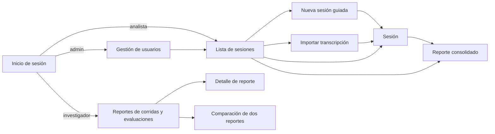

# Maquetas refinadas — Veridicus (consola del analizador de incoherencias, MVP)

**Revisión 2 — cambio 01 (DT27, 2026-11-03).** Esta versión reemplaza la aprobada el 02/10/2026; la
anterior queda en el historial de Git. Las pantallas que siguen conservan su ID; la que sale (M2,
Escenarios de control) queda marcada **Retirada** y las nuevas toman M7 y M8, para no romper referencias.

**Insumos.** Historias de `inception/user-stories/stories.md` (stories, revisión 2) y personas de
`personas.md`; requisitos de `inception/requirements-analysis/requirements.md` (requirements, revisión 2
con las precisiones de User Stories); prácticas de
`inception/practices-discovery/team-practices.md` (team-practices), corregidas por el cambio 01 en
`team.md`; respuestas de `refined-mockups-questions.md` (P1–P5 de la primera pasada; P6–P11 y los
seguimientos 7 y 8 de la segunda). No hay bocetos de Ideation: el scope `classic` omite esa fase, así que
`wireframes` y `user-flow` no existen y estas maquetas se diseñan directamente desde las historias y los
requisitos, sin inventar el contenido de esos artefactos ausentes.

**Fidelidad.** Media-alta: estructura, jerarquía, textos visibles reales y todos los estados de cada
pantalla. El aspecto visual final lo fijan los *tokens* de `design-system-mapping.md`. Los textos entre
«» son la redacción visible que fijan las historias o que propone esta etapa, y viven en el catálogo de
mensajes en español (`interaction-spec.md` §6). Los ejemplos de testimonio son **sintéticos**.

## Decisiones de esta etapa

| Pregunta | Decisión |
|---|---|
| P1 Componentes | Primitivas accesibles sin estilo (Radix UI) + capa propia de componentes con *tokens* CSS; sin tema de terceros. |
| P2 Pantalla de sesión | Dos columnas: transcripción a la izquierda y panel de hallazgos a la derecha, con las observaciones plegadas en cada tarjeta; la entrada de turnos queda fija abajo a la izquierda en las sesiones guiadas. *(Revisión 2: la CoT pasa a «observaciones» y se retira el panel del Paquete de Traspaso.)* |
| P3 Tamaños | Escritorio: diseño principal ≥ 1280 px; usable sin pérdida de funciones hasta 1024 px (las dos columnas pasan a pestañas); sin diseño para teléfono ni tableta. |
| P4 Colores de estado | Ámbar para las sugerencias de revisión y un tratamiento propio para los errores del sistema (borde gris oscuro, icono y texto); siempre icono + texto. Son *tokens* configurables por PR. *(Revisión 2: se retira el rojo del Hecho No Documentado.)* |
| P5 Fechas | Hora de Colombia (`America/Bogota`), `DD/MM/AAAA HH:mm` de 24 h en interfaz y reporte; el reporte añade la hora UTC en las marcas de consolidación. |
| P6 Importación | **Pantalla aparte «Importar transcripción» (M7)**, con su propio botón en la lista de sesiones; incluye la vista previa y la elección del perfil. |
| P7 Dos citas | La tarjeta muestra las dos citas completas, cada una con su turno anterior y el siguiente, y los botones «Ir a la cita A» e «Ir a la cita B»; la transcripción no se divide. |
| P8 Modo final | Franja fija encima del panel de hallazgos con el estado, el progreso y «Lanzar modo final» / «Relanzar modo final»; debajo, el desplegable «Corridas». |
| P9 Panel de hallazgos | Pendientes primero y, dentro de cada grupo, por el turno de la cita A; filtros por estado, tipo y origen; resumen de conteos por estado. |
| P10 Investigador | **Consola básica de solo consulta para el Investigador del TG (M8)**; la línea de comandos sigue para todo lo demás y su experiencia se diseña en Functional Design de su unidad. |
| P11 Lienzo visual | Se actualiza en esta etapa, antes de la aprobación (`maqueta-visual.md`). |
| Seg. 7 Alcance de M8 | Solo consulta: el investigador sube el reporte JSON de una corrida o una evaluación (CLI o ZINE); la consola muestra perfil, huellas, registro de modelos, *tokens*, costo y métricas, y compara dos reportes lado a lado. No lanza análisis. |
| Seg. 8 Rol | Rol nuevo `investigador`: solo ve M8; no crea sesiones, no ve transcripciones de sesiones y no cambia hallazgos ni usuarios. |

## Precisiones a artefactos ya aprobados

Las respuestas P10 y los seguimientos 7 y 8 añaden una consola y un rol que ningún artefacto aprobado
recoge. Siguiendo la regla del proyecto, no se editan aquí: se registran para que el humano decida en
la aprobación si se actualiza cada original, cada uno en su propio commit.

| Decisión | Artefacto aprobado que precisa | Origen |
|---|---|---|
| Rol nuevo `investigador`, con una columna propia en la matriz de permisos: puede subir y leer reportes de corridas y evaluaciones; no puede crear sesiones, leer transcripciones ni hallazgos de sesiones, cambiar estados, consolidar ni gestionar usuarios. FR1.2 dice hoy «exactamente dos roles». | `requirements.md` FR1.2 (matriz de roles); `stories.md` AC8.1.1 (destino al iniciar sesión: el `investigador` llega a M8), US8.2 (roles que el `admin` puede crear: también `investigador`) y AC2.1.4 (el `investigador`, como el `admin`, recibe `403` al crear sesiones e importar y no ve «Nueva sesión») | Seguimiento 8 |
| Consola de solo consulta del investigador: subir un reporte JSON de corrida o de evaluación, validarlo contra su esquema, guardar **solo metadatos y cifras** (perfil, `config_sha256`, `prompt_sha256`, versión del analizador y del conjunto, registro de modelos, *tokens*, costo y métricas), listarlos y comparar dos. Nunca guarda texto de transcripciones, hallazgos ni citas, para que un reporte del corpus del piloto no deje testimonio en la base (NFR12). | `requirements.md` (requisito nuevo, propuesto como FR13.5); `stories.md` (historias nuevas, propuestas US12.6 «Subir y consultar un reporte» y US12.7 «Comparar dos reportes», con los criterios de abajo); `personas.md` P4 («Rol en la aplicación: ninguno»); AC8.1.1 (destino del `investigador` al iniciar sesión: M8); US8.2 (el `admin` también crea usuarios `investigador`); AC2.1.4 (el `investigador` tampoco ve «Nueva sesión» ni «Importar transcripción» y recibe `403`) | Respuesta 10 y seguimiento 7 |
| El botón de importación vive en la lista de sesiones y abre una pantalla propia (M7), no en «Nueva sesión». | Ninguno: US2.6 no fija dónde se importa. Se anota para trazabilidad. | Respuesta 6 |
| Regla única de anuncios en vivo: `aria-live` anuncia cambios de **corrida** (inicio, etapa, fin o error de una corrida incremental o del modo final, con el progreso «ventana N de M» como mucho una vez cada 30 s), el contador de pendientes y la sesión suspendida; nunca el estado de cada turno, que se lee al enfocarlo. Así AC10.1.1 («cada cambio se anuncia») se lee por corrida y no por turno, y no choca con AC5.6.5. Además de la lista de AC5.6.5 se anuncian el resultado de validar un archivo (M7, M8) y «SHA-256 copiado», porque son respuesta directa a una acción del usuario. | `stories.md` AC10.1.1 y AC5.6.5 (precisión de lectura, sin cambiar su texto) | Revisión 02, R-09 |
| Por debajo de 1024 px no hay diseño propio (P3, decisión del humano en la primera pasada): se muestra el aviso. Esto es una excepción declarada a WCAG 1.4.10 (reajuste a 320 px CSS) y limita P-6 (zoom al 200 %) a 1280 px con zoom ≤ 150 % sin pérdida de funciones; al 200 % el contenido sigue legible pero cae al aviso. La accesibilidad es SHOULD (US5.6). | `stories.md` US5.6 (alcance de AA) | P3; revisión 02, R-12 |

**Criterios propuestos para US12.6 y US12.7** (si el humano las aprueba, entran a `stories.md` en su propio commit):

- **AC12.6.1** Given un reporte JSON válido que incluye en un hallazgo el texto *canary* «CANARIO-7f3a», When el investigador lo sube, Then la respuesta es `201`, se ve «Reporte subido. Se guardaron solo metadatos y cifras; el texto de transcripciones, hallazgos y citas se descartó», y una búsqueda de «CANARIO-7f3a» en todas las columnas de texto y en los logs capturados da 0 coincidencias. `[N1]`
- **AC12.6.2** Given el mismo archivo subido dos veces (mismo SHA-256), When se sube la segunda, Then `409` con «Este reporte ya está subido» y 0 filas nuevas. `[N1]`
- **AC12.6.3** Given un usuario `analista` o `admin`, When llama a cualquier ruta de reportes de investigación, Then `403`; y en la interfaz no ve «Reportes». `[N1]` + `[N0]` Vitest
- **AC12.6.4** Given un reporte al que le falta una métrica, When abro su detalle, Then esa métrica dice «No informado», nunca 0. `[N0]` Vitest
- **AC12.7.1** Given 0, 1 o 3 reportes marcados, When miro «Comparar seleccionados», Then está deshabilitado (enfocable) con «Marca dos reportes para compararlos»; con exactamente 2 se habilita. `[N0]` Vitest
- **AC12.7.2** Given dos reportes de conjuntos distintos, When los comparo, Then solo se comparan metadatos y leo «Conjuntos distintos: las métricas no son comparables». `[N0]` Vitest
- **AC12.7.3** Given dos reportes comparables, When los comparo, Then cada fila marca «=» o «≠» en texto y las diferencias numéricas llevan su signo. `[N0]` Vitest

---

## 1. Mapa de pantallas y navegación

Navegación de concentrador: la lista de sesiones es el inicio del `analista`, la gestión de usuarios el
del `admin` (AC8.1.1) y la lista de reportes el del `investigador`. Toda pantalla se alcanza en ≤ 2 clics
desde el inicio.



Texto equivalente: Inicio de sesión → (analista) Lista de sesiones → Nueva sesión guiada, Importar
transcripción, Sesión, Reporte consolidado. Inicio de sesión → (admin) Gestión de usuarios → Lista de
sesiones, Sesión y Reporte en solo lectura (FR1.2). Inicio de
sesión → (investigador) Reportes de corridas y evaluaciones → Detalle, Comparación. El `admin` y el
`investigador` no ven «Nueva sesión» ni «Importar transcripción» (AC2.1.4).

| ID | Pantalla | Historias | Rol |
|---|---|---|---|
| M0 | Inicio de sesión | US8.1 | todos |
| M1 | Lista de sesiones (+ aviso de reanudación) | US2.5, US7.1, US11.2 | analista; admin en solo lectura (sin «Nueva sesión» ni «Importar transcripción», AC2.1.4) |
| M2 | Escenarios de control · **Retirada** (cambio 01, épica 1) | — | — |
| M3 | Nueva sesión guiada | US2.1, US13.1 | analista |
| M4 | Sesión (dos columnas) | US2.1–US2.4, US2.7, US3.1, US3.2, US3.7, US5.1–US5.6, US10.1–US10.5, US13.1 | analista (dueño); solo lectura para los demás analistas y para el admin (FR1.2, AC5.4.3) |
| M5 | Reporte consolidado y versiones | US6.1–US6.3, US3.7, US13.1 | analista (dueño); solo lectura para los demás analistas y para el admin (FR1.2) |
| M6 | Gestión de usuarios | US8.2 | admin |
| M7 | Importar transcripción (nueva) | US2.6, US13.1 | analista |
| M8 | Reportes de corridas y evaluaciones (nueva) | US12.5, US13.2, US14.3 y las historias propuestas US12.6–US12.7 | investigador |

**Cabecera global** (todas las pantallas autenticadas): nombre del producto (enlace al inicio), los
enlaces del rol («Sesiones» para el analista, «Usuarios» y «Sesiones» para el admin, «Reportes» para el
investigador), usuario y rol, y «Cerrar sesión». Primer elemento enfocable: «Saltar al contenido».

---

## 2. M0 — Inicio de sesión (US8.1)

```
┌──────────────────────────────────────────────┐
│                 VERIDICUS                    │
│  Analizador de incoherencias del relato      │
│                                              │
│  Usuario      [______________________]       │
│  Contraseña   [______________________]       │
│                                              │
│  [ Iniciar sesión ]                          │
│                                              │
│  ⚠ Usuario o contraseña incorrectos.         │  ← mismo texto para usuario inexistente
│                                              │    y contraseña errónea (AC8.1.2)
└──────────────────────────────────────────────┘
```

| Estado | Qué se ve |
|---|---|
| Inicial | Formulario vacío; «Iniciar sesión» habilitado. |
| Cargando | Botón con «Entrando…» y deshabilitado. |
| Error de credenciales | «Usuario o contraseña incorrectos.» bajo el formulario, con icono; el foco va al mensaje. |
| Error del sistema | Tratamiento de error del sistema: «No se pudo conectar con el servidor. Intenta de nuevo.» |
| Entrada correcta | El analista llega a M1, el admin a M6 y el investigador a M8. |

---

## 3. M1 — Lista de sesiones (US2.5, US7.1)

```
┌ Cabecera ──────────────────────────────────────────────────────────────────────────────────┐
│ Sesiones                                  [ ⬆ Importar transcripción ]  [ + Nueva sesión ]  │
│ Filtro: (•) Todas  ( ) Solo las mías     Estado: [Todos ▾]                                  │
├────────────────────────────────────────────────────────────────────────────────────────────┤
│ Entrevista       Origen      Perfil            Dueño     Fecha (Colombia)   Estado          │
│ ENT-SINT-014     ⬆ Importada comercial-piloto  yo        03/11/2026 10:05   ◐ Abierta       │
│ ENT-SINT-009     ✎ Guiada    todo-local        yo        02/11/2026 16:40   ⏸ Suspendida    │
│ ENT-SINT-003     ✎ Guiada    comercial-piloto  a.perez   30/10/2026 16:12   ■ Finalizada    │
│ ENT-SINT-001     ⬆ Importada comercial-piloto  yo        29/10/2026 11:00   🔒 Consolidada  │
└────────────────────────────────────────────────────────────────────────────────────────────┘
```

- Cada fila es un enlace a M4 (o a M5 si está consolidada). Las sesiones de otros abren en solo lectura.
- El `admin` llega aquí desde «Sesiones» de su cabecera (FR1.2): ve todas las sesiones, sin «Nueva
  sesión» ni «Importar transcripción» (AC2.1.4), y M4 y M5 se le abren en solo lectura con el banner
  «Sesión de <usuario>. Solo lectura», sin acciones sobre hallazgos (AC5.4.3).
- Origen, perfil y estado llevan siempre texto (AC2.5.1, AC2.5.3, AC5.6.3); los iconos son decorativos.
- Tabla nativa (`<table>`), ordenada por fecha descendente.

| Estado | Qué se ve |
|---|---|
| Cargando | Esqueleto de 5 filas. |
| Vacío | «Aún no hay sesiones» y las acciones «Nueva sesión» e «Importar transcripción» (AC2.5.2). |
| Filtro sin resultados | «No hay sesiones con este filtro» y «Quitar filtros». |
| Error | Error del sistema: «No se pudo cargar la lista de sesiones.» + «Reintentar». |
| Poblado | Tabla; con > 25 filas, paginación «Mostrando 1–25 de N». |

**Aviso de reanudación (US7.1, AC7.1.2).** Si el analista tiene una sesión «Suspendida», al entrar
aparece un diálogo modal:

```
┌ Sesión interrumpida ───────────────────────────────────────────┐
│ Se detectó una interrupción inesperada en la sesión.           │
│ ¿Desea reanudar desde el último turno registrado?              │
│ ENT-SINT-009 · todo-local · 02/11/2026 16:40 · 7 turnos         │
│                                   [ Más tarde ]  [ Reanudar ]   │
└────────────────────────────────────────────────────────────────┘
```

«Más tarde» cierra el diálogo y la sesión sigue «Suspendida» en la lista. «Reanudar» abre M4 en el último
turno.

**Historial lateral (US11.2, COULD).** En M4, «Mis sesiones» abre un panel lateral izquierdo con las
sesiones del analista ordenadas por fecha y con su estado; no sustituye a M1.

---

## 4. M2 — Escenarios de control · **Retirada** (cambio 01)

El analizador ya no contrasta contra un marco de verdad externo (épica 1 retirada; FR2 retirado). El ID
no se reutiliza.

---

## 5. M3 — Nueva sesión guiada (US2.1, US13.1)

```
┌ Nueva sesión guiada ────────────────────────────────────────────────────────────┐
│ Entrevista  [ ENT-SINT-021_____________ ]                                        │
│                                                                                  │
│ Perfil de modelos                                                                │
│ El perfil no se puede cambiar después de crear la sesión.                        │
│  ( ) comercial-piloto                                                            │
│      Comercial: el texto sale seudonimizado del clúster                          │
│      ▸ Ver modelos por papel                                                     │
│  ( ) todo-local                                                                  │
│      Local: nada sale del clúster                                                │
│      ⓘ Análisis por ventanas: no busca contradicciones entre turnos separados     │
│        por más de 40 turnos                                                      │
│      ⓘ El modelo que propone cada contradicción y el que la confirma son de la   │
│        misma familia: la confirmación es menos independiente                     │
│      ▾ Ocultar modelos por papel                                                 │
│        Juez · local · qwen… (Q8_0)   Verificador · local · qwen… (Q8_0)          │
│                                                                                  │
│                         [ Cancelar ]  [ Crear sesión ]                           │
│                         Elige un perfil para crear la sesión                     │
└──────────────────────────────────────────────────────────────────────────────────┘
```

- Grupo de opciones (radio) con los perfiles **aprobados** y ninguno preseleccionado (AC13.1.1,
  AC13.1.4). Cada perfil lleva una línea en lenguaje llano y un desplegable con proveedor y modelo de cada
  papel. Las cifras (40 turnos) y los modelos son ilustrativos: los fija el archivo de perfiles.
- «Crear sesión» queda deshabilitado, pero enfocable, con su motivo visible hasta que se elija un perfil
  (AC13.1.4, AC5.6.4).
- No hay control para cambiar perfiles, proveedores, *prompts* ni límites (AC8.3.1).
- Al crear se abre M4 sin turnos, con «Aún no hay turnos. Escribe el primer turno o pega un bloque de
  turnos» en la columna de la transcripción (AC2.2.5).

| Estado | Qué se ve |
|---|---|
| Cargando perfiles | Esqueleto de dos opciones. |
| Sin perfiles aprobados | Error del sistema: «No hay perfiles aprobados. Pide al administrador que revise el archivo de perfiles.» Sin botón de crear. |
| Error al crear | Error del sistema junto a los botones; el formulario conserva lo elegido. |

---

## 6. M4 — Sesión (pantalla principal)

### 6.1 Distribución a ≥ 1280 px — sesión guiada

```
┌ Cabecera global ──────────────────────────────────────────────────────────────────────────────────┐
├ Cabecera de sesión ───────────────────────────────────────────────────────────────────────────────┤
│ ENT-SINT-021 · ✎ Guiada · ◐ Abierta · Inicio 03/11/2026 09:12                                     │
│ Perfil comercial-piloto · huella 3f9ac04be21c · Juez: comercial · Verificador: comercial ▸ Detalle │
│ [ Mis sesiones ] [ Pegar transcripción ] [ Finalizar sesión ] [ Consolidar reporte ]               │
│                                                Finaliza la sesión para consolidar                 │
├──────────────────────── 56 % ─────────────────────────┬──────────────── 44 % ────────────────────┤
│ TRANSCRIPCIÓN                                          │ ┌ Modo final ─────────────────────────┐  │
│                                                        │ │ ○ No lanzado · disponible al         │  │
│ Turno 1 · ENT                                          │ │   finalizar la sesión                │  │
│  «¿Puede contarnos qué pasó esa mañana?»               │ │ ▸ Corridas (3)                       │  │
│                                                        │ └──────────────────────────────────────┘  │
│ Turno 2 · TEST · ✓ Analizado                           │ HALLAZGOS · 1 pendiente                  │
│  «Llegamos al caserío al amanecer, éramos [A] cinco    │ 1 pendiente · 0 aceptadas · 0 editadas · │
│   familias…»                                           │ 0 descartadas                            │
│                                                        │ Estado [Todos ▾] Tipo [Todos ▾]          │
│ Turno 3 · ENT                                          │ Origen [Todos ▾]                         │
│  «¿Y cuántas personas llegaron?»                       │ ┌──────────────────────────────────────┐ │
│                                                        │ │ ◆ Sugerencia de revisión ·           │ │
│ Turno 4 · TEST · ✓ Analizado · 1 hallazgo              │ │   Contradicción en el relato         │ │
│  «…ya de noche, cuando llegamos, éramos [B] tres       │ │ <rótulo del tipo> · ◷ Pendiente ·    │ │
│   familias…»                                           │ │ Incremental                          │ │
│                                                        │ │ (tarjeta completa en §6.4)           │ │
│ Turno 5 · TEST · ⟳ Procesando · Analizando             │ └──────────────────────────────────────┘ │
│   contradicciones… 00:14                               │                                          │
│                                                        │ Aclaración sugerida · requiere tu        │
│ Turnos 6–8 · ⚠ Tramo no evaluado                       │ decisión (US10.3, SHOULD)                │
│  El servicio de modelos no respondió.                  │ Tema: «hora de llegada al caserío»       │
│  El analizador no pudo procesar este tramo.            │ [ Aprobar ] [ Descartar ]                │
│  Revisión manual requerida. Código: proveedor          │                                          │
│  [ Reintentar tramo ]                                  │                                          │
├────────────────────────────────────────────────────────┤                                          │
│ Turno 9   Hablante (•) TEST ( ) ENT                    │                                          │
│ [ Escribe el turno…                                ]   │                                          │
│ 0 / 4000 caracteres   [🎙 Grabar] [ Enviar turno ]  │                                          │
└────────────────────────────────────────────────────────┴──────────────────────────────────────────┘
```

- **Cabecera de sesión.** Entrevista, origen, estado, perfil, los primeros 12 caracteres de
  `config_sha256` y, por papel, si es comercial o local (AC2.1.1); «▸ Detalle» despliega proveedor y
  modelo de cada papel. Con un perfil local se añade la franja del modo fragmentado (§6.10); con un perfil
  de la misma familia, su aviso (AC13.1.2).
- **Columna izquierda.** Turnos en orden (`<ol>`), cada uno con número, hablante (`ENT` / `TEST`),
  página si la tiene y texto literal. Los turnos `TEST` analizados llevan su estado; los `ENT` no se
  analizan como testimonio, solo se muestran. La entrada de turnos queda fija abajo, con el hablante
  (`TEST` por defecto), el contador de caracteres (AC2.2.6) y «Enviar turno» deshabilitado (enfocable) con «Escribe el turno para
  enviarlo» mientras el texto esté vacío
  (AC2.2.5). Enviar no bloquea: el turno aparece «En cola» y el campo queda libre (AC2.2.2).
- **Tramos.** Cada envío es una corrida incremental (un turno o un bloque pegado). Si falla, el error se
  muestra una vez sobre el grupo de turnos del tramo, con la causa (AC3.2.5), el mensaje de FR4.2, el
  código y «Reintentar tramo» (AC3.2.2, AC3.2.3).
- **Columna derecha.** Franja del modo final (§6.8), resumen y filtros (§6.5) y tarjetas (§6.4). La
  aclaración sugerida (SHOULD) aparece al pie.
- **Hallazgo nuevo.** Se inserta en su lugar del orden sin ventana modal, sin sonido y sin mover el foco;
  el contador se actualiza y se anuncia en `aria-live="polite"` (AC3.1.3).

### 6.2 Distribución a ≥ 1280 px — sesión importada

```
┌ Cabecera de sesión ───────────────────────────────────────────────────────────────────────────────┐
│ ENT-SINT-014 · ⬆ Importada · cerrada a turnos nuevos · 312 turnos · págs. 1–48 · ◐ Abierta        │
│ Perfil comercial-piloto · huella 3f9ac04be21c · Juez: comercial · Verificador: comercial ▸ Detalle │
│ [ Mis sesiones ] [ Consolidar reporte ]   Lanza el modo final para consolidar                     │
├──────────────────────── 56 % ─────────────────────────┬──────────────── 44 % ────────────────────┤
│ TRANSCRIPCIÓN                                          │ ┌ Modo final ─────────────────────────┐  │
│ Turno 1 · ENT · pág. 1                                 │ │ ○ No lanzado                         │  │
│  «…»                                                   │ │ [ Lanzar modo final ]                │  │
│ Turno 2 · TEST · pág. 1                                │ │ ▸ Corridas (0)                       │  │
│  «…»                                                   │ └──────────────────────────────────────┘  │
│ Turno 3 · TEST · págs. 1–2 · ⋯ plegado                 │ HALLAZGOS                                │
│  «…»                                                   │ Aún no hay hallazgos. Lanza el modo      │
│ …                                                      │ final para analizar la transcripción     │
│                                                        │ completa.                                │
└────────────────────────────────────────────────────────┴──────────────────────────────────────────┘
```

- Una sesión importada no tiene entrada de turnos, «Pegar transcripción» ni «Finalizar sesión»: nace
  cerrada a turnos nuevos y sin corridas incrementales (AC2.6.1). Su único análisis es el modo final.
- Cada turno muestra página inicial y final si las tiene, y el estado `plegado` del contrato como texto
  («⋯ plegado»), con su explicación en lenguaje llano al enfocarlo (la redacción la fija Functional
  Design, AC3.1.4).
- Cientos de turnos: la lista se renderiza por bloques al desplazarse (el mecanismo lo fija Functional
  Design) sin romper la numeración ni el orden de lectura, y los cambios de estado se anuncian solo
  agregados (AC5.6.5).

### 6.3 Distribución entre 1024 y 1279 px

Las dos columnas pasan a pestañas «Transcripción» y «Hallazgos (N pendientes)»; la entrada de turnos
sigue fija abajo en «Transcripción», y la franja del modo final, arriba en «Hallazgos». «Ir a la cita A»
e «Ir a la cita B» cambian de pestaña y resaltan el turno. Por debajo de 1024 px se muestra «Veridicus
está diseñado para pantallas de escritorio (1024 px o más)», sin bloquear el contenido.

### 6.4 Estados del turno y del tramo (US2.2, US3.1, US3.2, US10.1)

| Estado | Icono + texto | Detalle |
|---|---|---|
| En cola | ◷ «En cola» | Gris neutro. |
| Procesando | ⟳ «Procesando» + etapa («Procesando audio…», «Analizando contradicciones…») + cronómetro | Se lee al enfocar el turno; el avance de la corrida (inicio, etapa, fin o error) se anuncia por corrida y no por turno (AC10.1.1 y AC5.6.5, regla de la tabla de precisiones). |
| Analizado sin hallazgos | ✓ «Analizado · sin sugerencias de revisión» | Distinto de «Procesando» y de «Error» (AC3.1.5). |
| Analizado con hallazgos | ✓ «Analizado» + enlace «N hallazgos» | Filtra el panel por ese turno. |
| Tramo no evaluado | ⚠ «Tramo no evaluado» sobre el grupo de turnos + causa + mensaje de FR4.2 + «Código: …» + «Reintentar tramo» | Tratamiento de error del sistema; disponible también en sesión finalizada (AC3.2.2, AC3.2.3, AC3.2.5). |
| Turno del entrevistador | Sin estado | Se muestra como contexto. |

### 6.5 Panel de hallazgos: orden, resumen y filtros (P9)

```
HALLAZGOS · 4 pendientes
4 pendientes · 6 aceptadas · 1 editada · 2 descartadas
Estado [Todos ▾]   Tipo [Todos ▾]   Origen [Incremental · Final ▾]   [ Quitar filtros ]
── Pendientes (4) ─────────────────────────
  tarjeta (cita A en turno 12)
  tarjeta (cita A en turno 57)
  …
── Decididos (9) ──────────────────────────
  tarjeta (cita A en turno 4) · ✓ Aceptada
  …
```

- Grupos «Pendientes» y «Decididos»; dentro de cada grupo, por el turno de la cita A y, a igualdad, por
  el de la cita B. Una decisión mueve la tarjeta de grupo sin mover el foco, que queda en el rótulo de
  estado de la tarjeta.
- Filtros: estado (pendiente, aceptada, editada, descartada), tipo (los 7 rótulos del contrato) y origen
  («Incremental» o «Final»). El resumen siempre cuenta toda la sesión, no solo lo filtrado.
- El enlace «Quedan N sugerencias pendientes» de la consolidación (AC6.1.1) lleva a la primera tarjeta
  pendiente y le da el foco.

| Estado | Qué se ve |
|---|---|
| Vacío, guiada | «Aún no hay hallazgos. Llegarán aquí mientras ingresas el testimonio». |
| Vacío, importada | «Aún no hay hallazgos. Lanza el modo final para analizar la transcripción completa». |
| Vacío tras el modo final | «El análisis no encontró contradicciones. Sin sugerencias de revisión» (AC6.1.8). |
| Filtro sin resultados | «Ningún hallazgo cumple estos filtros» + «Quitar filtros». |

### 6.6 Tarjeta del hallazgo (US3.1, US5.1–US5.3; P7)

```
┌──────────────────────────────────────────────────────────────────────┐
│ ◆ Sugerencia de revisión · Contradicción en el relato                │
│ <rótulo del tipo> · ◷ Pendiente · Final                               │
│ Hecho: número de familias que llegaron al caserío                     │
│                                                                      │
│ [A] Cita A · Turno 2 · TEST · pág. 1                  [ Ir a la cita A ]│
│     Turno 1 · ENT  «¿Puede contarnos qué pasó esa mañana?»            │
│   ▌ «Llegamos al caserío al amanecer, éramos cinco familias»          │
│     Turno 3 · ENT  «¿Y cuántas personas llegaron?»                    │
│                                                                      │
│ [B] Cita B · Turno 214 · TEST · pág. 33               [ Ir a la cita B ]│
│     Turno 213 · ENT «…»                                               │
│   ┆ «ya de noche, cuando llegamos, éramos tres familias»              │
│     Turno 215 · ENT «…»                                               │
│   ⓘ Cita en un turno del entrevistador            (solo si aplica)    │
│                                                                      │
│ ▸ Ver observaciones                                                   │
│ [ Aceptar ]  [ Editar ]  [ Descartar ]                                │
│ Despliega y lee las observaciones para habilitar esta acción          │
│ ⓘ La IA es un asistente de soporte. Su criterio como analista         │
│   prevalece.                                                          │
└──────────────────────────────────────────────────────────────────────┘
```

- **Las dos citas completas**, cada una con su marca «A» o «B» (además del color: barra continua para A,
  discontinua para B), su turno, su hablante y su página si la tiene, y el turno anterior y el siguiente
  como contexto atenuado (AC3.1.1). La cita se muestra entre «» y nunca se recorta; si el turno de
  contexto es largo, se muestran sus primeras 2 líneas con «…».
- **«Ir a la cita A» / «Ir a la cita B»** desplazan la transcripción hasta el turno, resaltan la cita con
  su marca y anuncian «Cita A, turno N» (AC3.1.2). En la transcripción, la cita resaltada tiene el
  botón «Volver al hallazgo», que devuelve el foco a la tarjeta.
- **Hallazgo seleccionado.** Al enfocar o pulsar la tarjeta, sus dos citas quedan marcadas a la vez en la
  transcripción con «A» y «B» (AC3.1.2); «Ir a la cita» solo desplaza y mueve el foco. Seleccionar otro
  hallazgo cambia las marcas.
- Una cita con « […] » muestra sus fragmentos en orden con « […] » visibles, tal como los verificó el
  analizador.
- Avisos de turno `ENT` o `plegado` con icono y texto (AC3.1.4).
- Sin grados de severidad ni puntajes (AC3.1.3, AC5.5.3).

| Estado del hallazgo | Rótulo | Acciones |
|---|---|---|
| Pendiente, observaciones plegadas | ◷ «Pendiente» | «Aceptar» y «Editar» deshabilitados (enfocables) con «Despliega y lee las observaciones para habilitar esta acción»; «Descartar» habilitado (AC5.1.1). |
| Pendiente, observaciones desplegadas | ◷ «Pendiente» | Las tres acciones habilitadas; desplegar registra «Observaciones consultadas» (AC5.1.2). |
| Aceptada | ✓ «Aceptada» o «Aceptada · con nota» + la nota | «Cambiar decisión» antes de consolidar (AC5.1.3, AC5.1.4). |
| Editada | ✎ «Editada» + reformulación del analista, quién y cuándo; el hallazgo de la IA sigue visible | «Cambiar decisión». |
| Descartada | ✕ «Descartada» + nota, quién y cuándo | «Cambiar decisión». |
| Bloqueada (consolidada) | 🔒 + estado final | Sin acciones (AC6.1.5). |
| Solo lectura (sesión ajena) | Estado | Sin acciones; banner «Sesión de <usuario>. Solo lectura» (AC5.4.2). |

**Aceptar.** Abre en línea «Nota (opcional)» y «Confirmar aceptación» / «Cancelar».

**Editar (US5.2).** Editor en línea a dos columnas dentro de la tarjeta: a la izquierda el hallazgo de la
IA en solo lectura (hecho, tipo, citas y observaciones); a la derecha «Tu reformulación» (obligatoria) y
«Nota (opcional)». «Guardar» queda deshabilitado con texto vacío o solo espacios, con «Escribe tu
reformulación para guardar» (AC5.2.1, AC5.2.3).

**Descartar (US5.3).** Abre en línea «¿Por qué descartas esta sugerencia?» (obligatorio). Confirmado
vacío: «Escribe por qué descartas esta sugerencia» junto al campo (AC5.3.1).

### 6.7 Pegar transcripción y finalizar sesión (US2.3, US2.4) — solo sesiones guiadas

**Pegar transcripción.** Diálogo con el área «Pega los turnos». «Continuar» muestra la vista previa: «Se
detectaron N turnos» y la lista (número, hablante y primeras líneas). Si se supera un límite: «El bloque
tiene N turnos; el máximo es M» (o su equivalente en caracteres) y «Confirmar» queda deshabilitado
con ese motivo (AC2.3.4). Acciones «Volver a editar», «Cancelar» (no crea turnos) y «Confirmar»
(AC2.3.1). Se encola una sola corrida para todo el bloque (AC2.3.3).

**Finalizar sesión.** Diálogo: «Después de finalizar no podrás agregar turnos», «Hay N corridas en
proceso; sus resultados se guardarán en la sesión», con «Cancelar» y «Finalizar» (AC2.4.1). Después, la
entrada de turnos se reemplaza por «Sesión finalizada · quedan N sugerencias pendientes» con «Ir a la
primera», y la franja del modo final ofrece «Lanzar modo final» (AC2.4.4).

### 6.8 Franja del modo final y corridas (US2.7, US10.1; P8)

```
┌ Modo final ───────────────────────────────────────────────────────┐
│ ⟳ Procesando · Analizando contradicciones… 03:42 · ventana 5 de 8  │
│ Lanzado por jreyes el 03/11/2026 10:20                              │
│ [ Relanzar modo final ]   El modo final ya está en proceso          │
│ ▾ Corridas (5)                                                      │
│   Final        #5  ⟳ Procesando        jreyes 10:20                 │
│   Final        #4  ⚠ Con error · tiempo_agotado   jreyes 10:02      │
│   Incremental  #3  ✓ Terminada · turnos 6–8 (reintento)             │
│   Incremental  #2  ⚠ Con error · proveedor · turnos 6–8             │
│   Incremental  #1  ✓ Terminada · turno 2                            │
└────────────────────────────────────────────────────────────────────┘
```

| Estado del modo final | Qué se ve | Acción |
|---|---|---|
| No disponible (guiada sin finalizar) | ○ «No lanzado · disponible al finalizar la sesión» | Ninguna; la API responde `409` (AC2.7.1). |
| No lanzado | ○ «No lanzado» | «Lanzar modo final». |
| En cola / Procesando | ◷ «Modo final en cola» / ⟳ «Modo final en proceso» + progreso (ventanas o llamadas, cronómetro) | «Relanzar modo final» deshabilitado con «El modo final ya está en proceso» (AC2.7.3, AC2.7.6). |
| Terminado | ✓ «Modo final terminado» + N hallazgos nuevos | «Relanzar modo final». |
| Con error | ⚠ «Modo final con error» + causa del código + «El analizador no pudo procesar la transcripción completa. Revisión manual requerida» | «Relanzar modo final» (AC2.7.4). |
| Sesión consolidada | 🔒 último estado | Ninguna (AC2.7.5). |

- Mientras el modo final procesa, la sesión sigue usable: se leen y deciden hallazgos (AC2.7.3).
- Los hallazgos que el modo final repite no se duplican; los ya decididos conservan su estado (AC2.7.2).
- **Corridas.** Desplegable con cada corrida (tipo, número, estado, código de error, tramo de turnos,
  quién la lanzó y cuándo). Los intentos anteriores del modo final en error quedan aquí (AC2.7.4,
  AC6.1.2). Es una lista de lectura; las acciones están en la franja y en los tramos.
- **Registro de modelos de una corrida (AC12.5.3).** Cada fila de «Corridas» es un botón que despliega,
  en solo lectura, la tabla de llamadas de esa corrida: papel, proveedor, modelo, versión,
  cuantización o esfuerzo, motor, llamadas, *tokens* de entrada y salida y costo estimado, con su total.
  Un modelo sin precio en la tabla dice «sin precio» (AC12.5.2); una corrida en cola dice «Aún no hay
  llamadas registradas». Nunca muestra texto enviado ni recibido.

```
│   Final  #4  ⚠ Con error · tiempo_agotado   jreyes 10:02   ▾          │
│   Papel        Proveedor  Modelo   Versión  Cuant./esf.  Motor  Llam.  Tokens ent./sal.  Costo │
│   juez         …          …        …        …            …      12     41 k / 3 k        US$ 0,21 │
│   verificador  …          …        …        …            …       6     15 k / 1 k        US$ 0,04 │
│   Total                                                       18     56 k / 4 k        US$ 0,25 │
```

### 6.9 Consolidación (US6.1)

«Consolidar reporte» está en la cabecera de sesión. Deshabilitado (enfocable), lista todos sus motivos en
este orden (AC6.1.1): «Finaliza la sesión para consolidar», «Lanza el modo final para consolidar», «Hay
análisis en proceso», «Quedan N sugerencias pendientes» (con enlace a la primera). Habilitado, abre el
diálogo, con el foco inicial en «Cancelar» (AC6.1.2):

```
┌ Consolidar el reporte ─────────────────────────────────────────────────┐
│ Sugerencias de revisión: 6 aceptadas · 1 editada · 2 descartadas        │
│ Tramos no evaluados: turnos 6–8 (proveedor)                             │
│ El último modo final terminó con error (tiempo_agotado).                │
│   El reporte no incluirá contradicciones entre pasajes distantes.       │
│   [ Volver y relanzar el modo final ]                                   │
│ Análisis por ventanas de 40 turnos (solapamiento de 8).  (si aplica)    │
│                                                                         │
│ Después de consolidar, la sesión queda bloqueada; una corrección        │
│ creará una versión nueva.                                               │
│                                           [ Cancelar ] [ Consolidar ]   │
└─────────────────────────────────────────────────────────────────────────┘
```

Si llega un hallazgo nuevo mientras el diálogo está abierto, «Consolidar» responde con el conflicto y el
diálogo muestra «Quedan N sugerencias pendientes» (AC6.1.9). Tras consolidar se abre M5.

### 6.10 Avisos del perfil (US3.7, US13.1)

- **Modo fragmentado** (perfil local): franja informativa bajo la cabecera de sesión, siempre visible y
  sin cerrar: «Análisis por ventanas de N turnos (solapamiento de M). No se buscaron contradicciones entre
  turnos separados por más de N turnos» (AC3.7.1). En la línea del perfil de la cabecera se lee además el
  texto corto de AC13.1.3: «Análisis por ventanas: no busca contradicciones entre turnos separados por más
  de N turnos».
- **Misma familia** (perfil de demostración que lo declara): «El modelo que propone cada contradicción y
  el que la confirma son de la misma familia: la confirmación es menos independiente» (AC13.1.2).
- Ambos usan el tratamiento informativo (icono ⓘ + texto), no el de error.

### 6.11 Voz y aclaraciones (US10.2–US10.4, SHOULD)

- **Grabar.** Junto a la entrada de turnos. Grabando: «● Grabando 00:07», anunciado, y «Detener y
  enviar». Sin permiso: «No hay acceso al micrófono. Puedes seguir escribiendo el turno» (AC10.2.3).
- **Aclaración sugerida.** Al pie del panel: «Aclaración sugerida · requiere tu decisión», con el tema y
  los turnos, nunca el texto de las citas (AC10.3.2, AC10.3.3); «Aprobar» y «Descartar». «Escuchar audio»
  solo aparece tras aprobar y solo suena al pulsarlo (AC10.4.1).

---

## 7. M5 — Reporte consolidado (US6.1–US6.3)

```
┌ Reporte · ENT-SINT-014 · Sesión del 03/11/2026 ────────────────────────────────┐
│ 🔒 Consolidado por jreyes el 03/11/2026 15:31 (20:31 UTC)                      │
│ SHA-256 3f9ac0…e21c (completo)       [ Copiar SHA-256 ] [ Descargar reporte ]  │
│ [ Corregir reporte ]                                                           │
│ Perfil comercial-piloto · huella 3f9ac04be21c · analizador 0.4.1               │
│ ⚠ Modo final no completado. Revisión manual requerida (tiempo_agotado) (si aplica)│
├────────────────────────────────────────────────────────────────────────────────┤
│ Versiones del reporte                                                          │
│  v2 · vigente · SHA-256 3f9a…e21c · jreyes · 03/11/2026 15:31                  │
│  v1           · SHA-256 91d0…7a3b · jreyes · 03/11/2026 15:02                  │
├────────────────────────────────────────────────────────────────────────────────┤
│ Vista previa del reporte (Markdown renderizado, solo lectura)                  │
└────────────────────────────────────────────────────────────────────────────────┘
```

- Quién y cuándo, el SHA-256 completo con «Copiar SHA-256» y «Descargar reporte» (AC6.1.4). Sin
  consolidar no se ofrece la descarga (AC6.2.2).
- La cabecera repite perfil, huella y versión del analizador; los avisos de modo fragmentado, de misma
  familia, «Tramo no evaluado» y «Modo final no completado» aparecen si aplican (AC6.1.3, AC3.7.1,
  AC13.1.2).
- **Corregir reporte (US6.3).** Abre M4 en «copia de trabajo» con el banner «Copia de trabajo de la
  versión N. Solo puedes cambiar estados y notas» y «Descartar copia». Transcripción y salida de la IA
  quedan en solo lectura (AC6.3.1). Pulsar otra vez «Corregir reporte» vuelve a la misma copia (AC6.3.2).
- La lista de versiones marca la vigente con el texto «vigente» (AC6.3.4).
- Las marcas de consolidación muestran hora de Colombia y, entre paréntesis, la hora UTC (P5).

---

## 8. M6 — Gestión de usuarios (US8.2)

```
┌ Usuarios ─────────────────────────────────────────────── [ + Crear usuario ] ┐
│ Usuario     Rol            Estado         Acciones                            │
│ jreyes      analista       ✓ Activo       [ Desactivar ]                      │
│ a.perez     analista       ✕ Desactivado  —                                   │
│ inv1        investigador   ✓ Activo       [ Desactivar ]                      │
│ admin1      admin          ✓ Activo       [ Desactivar ]                      │
└───────────────────────────────────────────────────────────────────────────────┘
```

- «Crear usuario» abre un diálogo: usuario, rol (`analista`, `admin` o `investigador`, este último
  sujeto a la precisión de FR1.2) y contraseña inicial.
- «Desactivar» pide confirmación: «El usuario no podrá entrar; sus acciones pasadas conservan su
  autoría».
- No hay ningún control de perfiles, proveedores, *prompts* ni límites (AC8.3.1).

---

## 9. M7 — Importar transcripción (US2.6, US13.1; P6)

```
┌ Importar transcripción ───────────────────────────────────────────────────────────┐
│ 1 · Archivo                                                                        │
│ Archivo JSON con el formato del contrato común (entrevista, origen «corpus» y      │
│ turnos con n, hablante, página, página final, texto y estado).                     │
│ [ Elegir archivo… ]  ENT-SINT-014.json · 412 KB                                    │
│                                                                                    │
│ Vista previa                                                                       │
│ Entrevista ENT-SINT-014 · 312 turnos (148 TEST · 164 ENT) · págs. 1–48 · 6 plegados │
│ Turno 1 · ENT · pág. 1   «¿Puede contarnos…»                                       │
│ Turno 2 · TEST · pág. 1  «Llegamos al caserío…»                                    │
│ …y 310 turnos más                                                                  │
│                                                                                    │
│ 2 · Perfil de modelos                                                              │
│ (mismo selector que M3, ningún perfil preseleccionado)                             │
│                                                                                    │
│ Se importarán 312 turnos (páginas 1–48), de ellos 164 del entrevistador y 6        │
│ plegados. La sesión no admitirá turnos nuevos                                      │
│                                            [ Cancelar ]  [ Importar ]              │
│                          Elige un perfil para crear la sesión                      │
└────────────────────────────────────────────────────────────────────────────────────┘
```

| Estado | Qué se ve |
|---|---|
| Inicial | Solo el paso 1; «Importar» deshabilitado (enfocable) con «Elige un archivo para continuar». |
| Archivo no JSON | «El archivo debe ser JSON con el formato del contrato común» (AC2.6.2, `415`). |
| Fuera del esquema | El primer problema y el total: «Turno 37: falta el hablante. Hay 3 problemas más»; la vista previa no aparece y no se crea nada (AC2.6.2). |
| Supera un límite | «La transcripción tiene N turnos; el máximo es M» (o su equivalente en caracteres o en caracteres por turno), con el botón deshabilitado por ese motivo (AC2.6.3). |
| Válido | Vista previa y paso 2. |
| Creando | «Importando N turnos…»; botones deshabilitados. |
| Error del servidor | Error del sistema; el archivo y el perfil siguen elegidos. |
| Creado | Abre M4 en la sesión importada (§6.2). |

- La vista previa la valida la consola contra el mismo esquema versionado del contrato que usa el
  servidor; la autoridad es el servidor, que repite la validación y responde con el mismo mensaje
  (AC2.6.2). Las cifras de los límites las fija NFR Requirements.
- El archivo no se guarda tal cual: se guardan los turnos de la sesión, como en cualquier sesión.

---

## 10. M8 — Reportes de corridas y evaluaciones (consola del investigador; P10, seg. 7)

Solo consulta. El investigador sube los reportes JSON que produce la CLI, en su máquina o en ZINE. La
consola guarda **solo metadatos y cifras**: si el JSON trae transcripción, hallazgos o citas, ese texto
se descarta antes de guardar y la pantalla lo dice (NFR12).

### 10.1 Lista

```
┌ Reportes de corridas y evaluaciones ─────────────────────── [ ⬆ Subir reporte JSON ] ┐
│ Tipo [Todos ▾]  Perfil [Todos ▾]  Origen [Todos ▾]        [ Comparar seleccionados ]  │
├──────────────────────────────────────────────────────────────────────────────────────┤
│ ☐ Tipo        Origen    Perfil            Huella        Conjunto     Fecha (Colombia)  │
│ ☑ Evaluación  CLI local comercial-piloto  3f9ac04be21c  sint-1.2.0   02/11/2026 18:10  │
│ ☑ Evaluación  ZINE      local-qwen-q8     a71c09e3d4f2  sint-1.2.0   02/11/2026 23:55  │
│ ☐ Corrida     ZINE      local-qwen-q8     a71c09e3d4f2  —            01/11/2026 04:12  │
└──────────────────────────────────────────────────────────────────────────────────────┘
```

| Estado | Qué se ve |
|---|---|
| Vacío | «Aún no hay reportes. Sube el JSON que produce la línea de comandos» + «Subir reporte JSON». |
| Comparar | «Comparar seleccionados» se habilita con exactamente 2 marcados; si no, queda deshabilitado con «Marca dos reportes para compararlos». |
| Error | Error del sistema + «Reintentar». |

**Subir reporte (diálogo).** Campo de archivo con la nota «JSON de una corrida o de una evaluación de la
línea de comandos». Resultados:
- Válido: «Reporte subido. Se guardaron solo metadatos y cifras; el texto de transcripciones, hallazgos
  y citas se descartó».
- Fuera del esquema: el primer problema y el total, como en M7.
- Sin modelo, cuantización, motor o versión: «Falta el campo <campo>», y no se guarda (AC14.3.1).
- Duplicado (mismo SHA-256 de archivo): «Este reporte ya está subido».

### 10.2 Detalle

```
┌ Evaluación · CLI local · 02/11/2026 18:10 ───────────────────────────────────────┐
│ Perfil comercial-piloto · config_sha256 3f9ac04be21c… [Copiar] · prompt 9d1e…     │
│ Analizador 0.4.1 · conjunto sintético sint-1.2.0 · subido por inv1                │
│ ⚠ Cuantización Q4_K_M: no válida para medir capacidades          (si aplica)      │
│ ⓘ Análisis por ventanas de 40 turnos (solapamiento de 8)           (si aplica)     │
├ Métricas ─────────────────────────────────────────────────────────────────────────┤
│ Citas verificadas en lo emitido    100 %                                           │
│ Error de formato JSON              0 %                                             │
│ Precisión · Sensibilidad           0,81 · 0,74                                     │
│ Acuerdo entre 3 corridas           0,88                                            │
│ Consistencia al invertir el orden  71 %                                            │
├ Registro de modelos ───────────────────────────────────────────────────────────────┤
│ Papel        Proveedor  Modelo        Versión  Cuant./esfuerzo Motor  Llamadas Tokens entrada/salida  Costo │
│ juez         …          …             …        …               …      120      410 k / 38 k   US$ 2,10 │
│ verificador  …          …             …        …               …       64      150 k / 9 k    US$ 0,40 │
│ Total                                                                    184      560 k / 47 k   US$ 2,50 │
└────────────────────────────────────────────────────────────────────────────────────┘
```

- Las métricas que el reporte no trae se muestran como «No informado», nunca como 0. Las que tienen
  umbral de NFR Requirements llevan «cumple» o «no cumple» en texto junto a la cifra.
- Un modelo sin precio en la tabla aparece como «sin precio» (AC12.5.2).
- Una corrida (no evaluación) muestra su estado, su código si falló, el modo y el número de hallazgos y
  de citas rechazadas, sin su texto.

### 10.3 Comparación de dos reportes

```
┌ Comparación ──────────────────────────────────────────────────────────────────────┐
│                       Reporte 1 (CLI local)        Reporte 2 (ZINE)        Diferencia│
│ Perfil                comercial-piloto             local-qwen-q8           ≠        │
│ config_sha256         3f9ac04be21c                 a71c09e3d4f2            ≠        │
│ Conjunto              sint-1.2.0                   sint-1.2.0              =        │
│ Precisión             0,81                         0,69                    −0,12    │
│ Sensibilidad          0,74                         0,70                    −0,04    │
│ Tokens totales        607 k                        1,9 M                   +1,3 M   │
│ Costo                 US$ 2,50                     sin precio              —        │
│ ⚠ Conjuntos distintos: las métricas no son comparables            (si aplica)      │
└────────────────────────────────────────────────────────────────────────────────────┘
```

- Las diferencias se marcan con «=» o «≠» en texto, no solo con color.
- Si los reportes son de conjuntos distintos o de tipos distintos, la comparación avisa que las métricas
  no son comparables y muestra solo los metadatos.

---

## 11. Cobertura de historias con interfaz

| Historia | Pantalla / componente |
|---|---|
| US1.1–US1.3 | **Retiradas**: M2 retirada |
| US2.1 | M3, cabecera de sesión de M4 |
| US2.2 | M4 §6.1, entrada de turnos |
| US2.3 | M4 §6.7 |
| US2.4 | M4 §6.7 |
| US2.5 | M1 |
| US2.6 | M7, M4 §6.2 |
| US2.7 | M4 §6.8 |
| US3.1 | M4 §6.6 |
| US3.2 | M4 §6.4 (tramo no evaluado), §6.8 (modo final con error) |
| US3.3–US3.6 | Sin interfaz propia (analizador); su resultado se ve en §6.6 |
| US3.7 | M4 §6.10, M5, M3 |
| US4.1–US4.3 | **Retiradas** |
| US5.1–US5.3 | M4 §6.6 |
| US5.4 | Banner y modo solo lectura en M1, M4 y M5, también para el admin |
| US5.5 | Catálogo de mensajes y rótulos de resultado (`interaction-spec.md` §6; `accessibility-checklist.md` §5) |
| US5.6 | `accessibility-checklist.md` |
| US6.1–US6.3 | M4 §6.9, M5 |
| US7.1 | M1, diálogo de reanudación |
| US8.1, US8.2 | M0, M6 |
| US8.3 | Ningún control de configuración en M3, M4, M6, M7 ni M8 |
| US8.4, US9.x | Sin interfaz (plataforma y auditoría) |
| US10.1–US10.4 | M4 §6.4, §6.8, §6.11 |
| US10.5 | Sin interfaz propia (permutación en el verificador) |
| US10.6 | **Retirada** |
| US10.7, US10.8 | Sin interfaz de la consola (Argo CD, Grafana) |
| US11.1 | **Retirada** |
| US11.2 | Historial lateral (M1 §3) |
| US11.3–US11.6 | Sin interfaz propia; su efecto visible es la causa del código del anonimizador (§6.4) |
| US12.1–US12.4 | Línea de comandos: su experiencia se diseña en Functional Design (P10) |
| US12.5 | M4 §6.8 (registro de modelos de cada corrida, AC12.5.3); M8 §10.2 (reporte subido); en la CLI, Functional Design |
| US13.1 | M3, M7, cabecera de M4, M5 |
| US13.2 | M8 (huella de cada reporte); cabecera de M4 |
| US13.3–US13.7 | Sin interfaz propia (validación de perfiles y proveedores) |
| US14.1 | Sin interfaz (medición en ZINE) |
| US14.2 | Sin interfaz (paquete de entrada) |
| US14.3 | M8 §10.1 (rechazo de un reporte sin modelo, cuantización, motor o versión) y §10.2 (aviso de cuantización) |
| US12.6, US12.7 (propuestas) | M8 §10.1–§10.3 |
