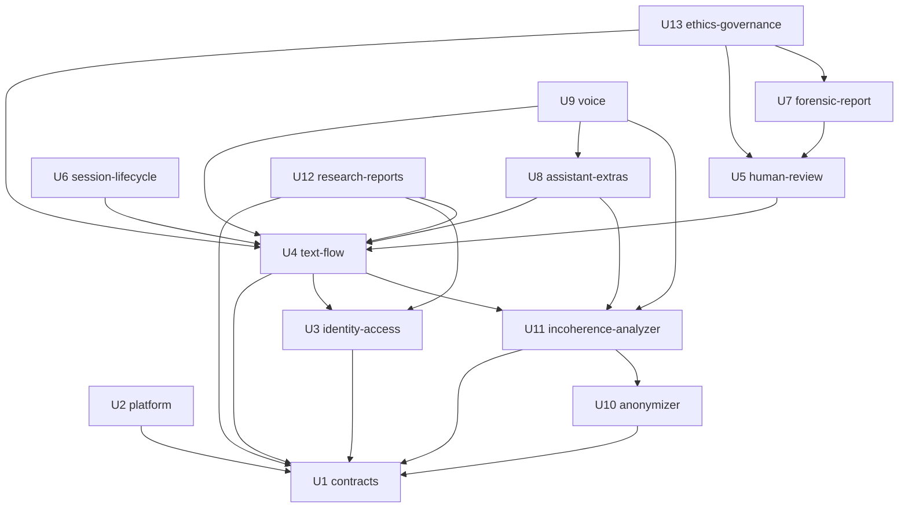

# Dependencias entre unidades — Veridicus

**Revisión 2 (2026-11-07), segunda pasada por el cambio 01 (DT27) y la adenda 02.** Sustituye a la
revisión 1. Ajustada el 2026-11-08 con los hallazgos R-02, R-03, R-06 y R-07 de la revisión 2.

**Insumos.** `unit-of-work.md` de esta etapa; dependencias entre componentes de
`inception/domain-design/components.md` (components, revisión 2); historias de
`inception/user-stories/stories.md` y `stories-adenda-02.md` (stories); requisitos de
`inception/requirements-analysis/requirements.md` (requirements).

Este documento describe la **topología**: qué unidad necesita a cuál. No fija un orden de entrega ni
una ruta crítica; eso lo decide Delivery Planning.

## Grafo de dependencias (fuente de verdad)

```yaml
units:
  - name: contracts
    kind: spec
    depends_on: []
  - name: platform
    kind: packaging
    depends_on: [contracts]
  - name: identity-access
    kind: service
    depends_on: [contracts]
  - name: anonymizer
    kind: service
    depends_on: [contracts]
  - name: incoherence-analyzer
    kind: library
    depends_on: [contracts, anonymizer]
  - name: text-flow
    depends_on: [contracts, identity-access, incoherence-analyzer]
  - name: human-review
    kind: service
    depends_on: [text-flow]
  - name: session-lifecycle
    kind: service
    depends_on: [text-flow]
  - name: forensic-report
    kind: service
    depends_on: [human-review]
  - name: assistant-extras
    kind: service
    depends_on: [text-flow, incoherence-analyzer]
  - name: voice
    kind: service
    depends_on: [text-flow, assistant-extras, incoherence-analyzer]
  - name: research-reports
    kind: service
    depends_on: [contracts, identity-access, text-flow]
  - name: ethics-governance
    kind: service
    depends_on: [text-flow, human-review, forensic-report]
```



Texto equivalente: las flechas van de la unidad que depende a la unidad de la que depende.
- `platform`, `identity-access` y `anonymizer` dependen solo de `contracts`.
- `incoherence-analyzer` depende de `contracts` y `anonymizer`.
- `text-flow` depende de `contracts`, `identity-access` e `incoherence-analyzer`.
- `human-review` y `session-lifecycle` dependen de `text-flow`; `forensic-report`, de `human-review`.
- `assistant-extras` depende de `text-flow` e `incoherence-analyzer`; `voice`, de `text-flow`,
  `assistant-extras` e `incoherence-analyzer`.
- `research-reports` depende de `contracts`, `identity-access` y `text-flow`.
- `ethics-governance` depende de `text-flow`, `human-review` y `forensic-report`.

El grafo no tiene ciclos.

## Por qué existe cada arista

| Unidad | Depende de | Motivo |
|---|---|---|
| platform | contracts | Las etiquetas de clasificación, la regla de descartes (US10.8) y el catálogo de límites leen nombres fijados en contratos. |
| identity-access | contracts | Catálogo de `code` de Problem Details y OpenAPI. |
| anonymizer | contracts | Códigos `anonymizer.incident` y del fallo cerrado, y el campo `anonimizado` del contrato común. |
| incoherence-analyzer | contracts | Contrato común v1.0.0, esquema del perfil, vocabulario prohibido, aviso y esquema del reporte de la CLI. |
| incoherence-analyzer | anonymizer | ModelGateway pasa por el Anonymizer ante todo destino externo (components); un perfil con destino externo no arranca sin él. |
| text-flow | contracts | Mensajes de corrida y resultado y OpenAPI. |
| text-flow | identity-access | Toda ruta exige token y rol (AC8.1.4); el actor de cada fila viene de aquí. |
| text-flow | incoherence-analyzer | AnalysisWorker envuelve la biblioteca (P11); la consola usa el escáner y el aviso. |
| human-review | text-flow | Decide sobre sugerencias que crea text-flow. |
| session-lifecycle | text-flow | Extiende las sesiones, los turnos y las corridas que crea text-flow. |
| forensic-report | human-review | Consolida rondas y decisiones; necesita que no queden pendientes. |
| assistant-extras | text-flow | Guarda y presenta las aclaraciones en las sesiones de text-flow. |
| assistant-extras | incoherence-analyzer | Valida `observaciones_conductor` y permuta el verificador dentro de la biblioteca. Es transitiva por text-flow; se hace explícita porque U8 toca el código de U11. |
| voice | text-flow | El turno transcrito sigue el camino del turno de texto. |
| voice | assistant-extras | El audio es de la aclaración aprobada (US10.4 depende de US10.3). |
| voice | incoherence-analyzer | SpeechProcessing llama a Whisper y TTS por ModelGateway, que es de U11. Es transitiva por text-flow; se hace explícita como en U8 (R-07 de la revisión 2). |
| research-reports | contracts | El reporte que se sube se valida contra el esquema del reporte de la CLI. |
| research-reports | identity-access | Rol `investigador` y token. |
| research-reports | text-flow | La consola del investigador (M8) se monta sobre la base de la consola y la suite `axe` de U4 (R-03 de la revisión 2). |
| ethics-governance | text-flow | La retención borra los datos de InterviewSession; el registro de acceso necesita las sesiones. |
| ethics-governance | human-review | La retención borra sugerencias, rondas, decisiones y vistas; ProblemReport referencia ReviewSuggestion. |
| ethics-governance | forensic-report | La retención borra versiones y exportaciones del reporte. |

`platform` no depende de ninguna unidad de aplicación: las pruebas de niveles 0 y 1 usan PostgreSQL y
Redis en contenedor (team.md), así que las unidades de aplicación se construyen sin el clúster; el
despliegue y la prueba de humo sí necesitan `platform`, y eso lo ordena Delivery Planning.
`incoherence-analyzer` y `anonymizer` tampoco necesitan el clúster: la CLI corre en la máquina local o en
ZINE.

## Puntos de integración

| Entre | Mecanismo | Contrato |
|---|---|---|
| frontend ↔ session-api (todas las unidades con pantalla) | REST síncrono, token | OpenAPI de ConsoleApi (U1) |
| session-api → semantic-agent (U4, U6, U8) | Cola Redis de corridas | Mensaje de corrida versionado (U1) |
| semantic-agent → session-api (U4, U8) | Cola Redis de resultados, consumo idempotente por corrida | Mensaje de resultado con el contrato común (U1) |
| semantic-agent → biblioteca (U4, U11) | Llamada en proceso | API pública de la biblioteca y contrato común (U1) |
| biblioteca → modelos locales (U11) | Puerto ModelGateway | Contrato del puerto; destino interno verificado al arrancar |
| biblioteca → `anonymizer-proxy` (U11, U10) | HTTP dentro del clúster | Contrato del puerto; con perfil externo, sin anonimizador no arranca |
| CLI → módulo del anonimizador (U11, U10) | Llamada en el mismo proceso | API del módulo en `libs/` |
| `anonymizer-proxy` → proveedores comerciales (U10) | HTTPS por 443, solo dominios de la lista | Texto seudonimizado; `NetworkPolicy` y CoreDNS (U2) |
| session-api → audio-worker → session-api (U9) | Colas Redis de audio y de transcripción | Mensajes de audio y texto (U1) |
| HumanReview ↔ ReviewReport ↔ EthicsGovernance (U5, U7, U13) | Llamada en proceso dentro de session-api | Interfaces de módulo vigiladas por import-linter |
| CLI → consola del investigador (U11, U12) | El humano sube el reporte JSON | Esquema del reporte de la CLI (U1) |
| Prometheus → métrica de descartes (U2, U4) | Métrica expuesta por session-api | Nombre de métrica (U1) |

Retirado de la revisión 1: la lectura de `pgvector` desde semantic-agent y el esquema de pasajes de
TruthFrame.

## Oportunidades de desarrollo en paralelo

Con el grafo anterior hay varios órdenes topológicos válidos. Grupos de unidades sin dependencia entre
sí:

- `platform`, `identity-access` y `anonymizer` (todas solo dependen de `contracts`).
- `research-reports` con `human-review`, `session-lifecycle` y `assistant-extras`.
- `human-review`, `session-lifecycle` y `assistant-extras` (todas dependen de `text-flow`).
- `forensic-report` con `session-lifecycle`, `assistant-extras` y `voice`.

Equipo de una persona con agentes (team.md): el paralelismo aquí es una propiedad del grafo, no una
recomendación de trabajar en varias unidades a la vez.

## Unidades sin dependencias de producto

`contracts`, `anonymizer` e `incoherence-analyzer` solo dependen entre sí; ninguna necesita sesiones,
colas, base de datos ni el clúster. El orden de entrega lo decide Delivery Planning con team.md.
