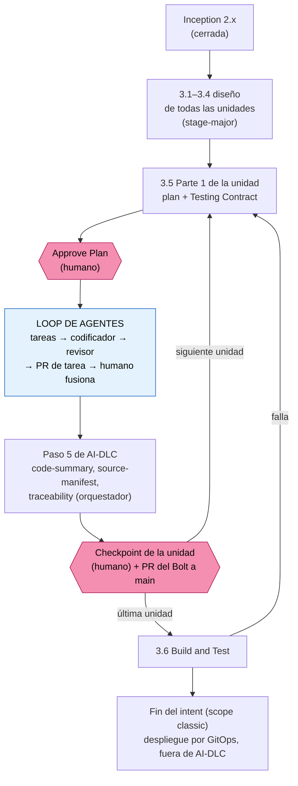

# Loop de agentes dentro de AI-DLC 2.10

Adaptación al TG de la metodología del profesor Luis Felipe Ariza Vesga (asignatura Tópicos Especiales en Informática, módulo 6: `topicos-especiales/modulo6/proyecto-final-loop-de-agentes.md` y `modulo6/agentes/`). La guía original se escribió para AI-DLC v1 (`aidlc-docs/`, `unidades-y-tareas.md`); aquí se traduce a la versión fijada en el TG, **AI-DLC 2.10.0** (`aidlc/spaces/default/intents/…`, Bolts, guardias por *hooks*). Decisión: DT30.

Sirve para las tres apps. La primera en usarlo es `veridicus` (cambio `cambios/veridicus-04_loop_de_agentes.md`); `sistema` y `codificacion` lo reciben con su propio cambio cuando lleguen a Construction.

## 1. Qué es y qué no es

El loop es una **técnica de ejecución dentro de la etapa 3.5 Code Generation, Parte 2**. Reemplaza un único paso de AI-DLC: el despacho del `aidlc-developer-agent` (paso 4 de `code-generation.md`). Todo lo demás sigue igual: las etapas, las compuertas, el estado y la auditoría son de AI-DLC.

- **No es una fase** ni una compuerta ni una entrada del estado. Nada del loop se escribe en `aidlc-state.md`.
- **No levanta ninguna compuerta de AI-DLC.** `Approve Plan` sigue siendo del humano, y en Construction se sigue con «Review each checkpoint».
- **No sustituye la revisión de AI-DLC.** El revisor de arquitectura de AI-DLC revisa el **plan** (Parte 1); el revisor del loop revisa el **diff de cada tarea** (Parte 2); Build and Test (3.6) verifica la **unidad** integrada; el humano fusiona.

## 2. Traducción de la guía (v1) a AI-DLC 2.10

| Guía del curso (AI-DLC v1) | En AI-DLC 2.10 (TG) |
|---|---|
| `unidades-y-tareas.md` (consolidado a mano en el módulo 5) | No existe. Las tareas salen de los pasos numerados del **`code-generation-plan.md` aprobado** de la unidad: `<intent>/construction/<unidad>/code-generation/code-generation-plan.md` |
| Grafo `aidlc-docs/inception/application-design/unit-of-work-dependency.md` | `<intent>/inception/units-generation/unit-of-work-dependency.md`, pero el **orden entre unidades lo pone AI-DLC** (Bolts, iteración *stage-major*, ejecución *serial*). Las olas del loop se arman **dentro de una unidad**, con pasos del plan que no dependen entre sí |
| `aidlc-docs/construction/plans/U0X-*-code-generation-plan.md` | La ruta de arriba, más `unit-test-instructions.md` en la misma carpeta |
| Criterios de aceptación con comando | Ya los exige AI-DLC: `Verificación: <comando>` en cada paso (en Veridicus, AUTONOMIA-02) y los comandos por unidad de `unit-test-instructions.md` |
| «Rojo primero» | Manda el **Testing Contract** embebido en el plan aprobado. Donde el contrato pide prueba primero (en Veridicus: guardias AUTONOMIA y contratos de datos), el rojo es esa prueba. En las demás capas, el rojo es correr el comando de verificación antes de implementar y registrar que falla; en retrabajo, reproducir el hallazgo antes de arreglarlo |
| El codificador es un subagente nuevo | Sustituye al `aidlc-developer-agent` en la Parte 2. El orquestador es la **sesión principal**, que también es el conductor de AI-DLC |
| Un PR por tarea, a `main` | Un PR por tarea **hacia la rama del Bolt**; el Bolt entra a `main` con su propio PR (*squash*), como pide `team.md`. El humano fusiona los dos |
| Worktrees en `../wt-U01-T01` | En `/workspace/.worktrees/U01-T01` (ignorado por Git): fuera de `/workspace` no hay volumen y se perdería al reiniciar el contenedor |

## 3. Cuándo se ejecuta



Texto alternativo: el loop corre una vez por unidad, entre `Approve Plan` y el paso 5 de Code Generation. Al cerrar la unidad, AI-DLC sigue con la siguiente; tras la última, con Build and Test. Si Build and Test falla y vuelve a 3.5, hay un plan nuevo que aprobar y el loop corre otra vez sobre las tareas de corrección.

## 4. Papeles y modelos

| Papel | Quién | Modelo | Herramientas | Nunca |
|---|---|---|---|---|
| Orquestador | La sesión principal (conductor de AI-DLC) con `agentes/orquestador.md` | `fable` (`/model fable`) | Todas | Escribir código de implementación, juzgar, fusionar |
| Codificador | Subagente `codificador` | `sonnet` | `Bash, Read, Edit, Write, Grep, Glob` | Escribir fuera de su worktree, fusionar |
| Revisor | Subagente `revisor` | `opus` | `Bash, Read, Grep, Glob` | Editar, fusionar, suavizar un veredicto |
| Humano | El investigador | — | GitHub | Delegar la fusión |

Si hay que recortar cuota, se recorta en el codificador, nunca en el revisor (guía, §3). Las cuotas de 5 h y 7 d son de la cuenta y se comparten con las demás sesiones (`plan-aidlc.md` §6).

## 5. Cómo se ejecuta

### 5.1 Una vez por app (lo pide su cambio)

1. Copiar `/insumos/app/loop/agentes/codificador.md` y `revisor.md` a `.claude/agents/`, y `orquestador.md` y `plantilla-tarea.md` a `docs/loop/`. Crear `docs/loop/tareas/`, `docs/loop/bitacoras/`, `docs/loop/revisiones/`, `docs/loop/CANDIDATAS.md` y `docs/loop/DECISIONES-LOOP.md`. Añadir `.worktrees/` a `.gitignore`.
2. Negar la fusión en la herramienta, no en el contrato: en `.claude/settings.local.json` (no versionado), `"permissions": {"deny": ["Bash(gh pr merge:*)"]}`. La protección de `main` ya rechaza el *push* directo.
3. Reiniciar Claude Code y comprobar con `/agents` que aparecen `codificador` y `revisor`.
4. Commit `chore(loop): agentes y carpetas del loop de agentes` (directo a `main`: es configuración y documentación).

### 5.2 En cada unidad

1. **Parte 1 (AI-DLC).** Al revisar el plan, además de la lista de `plan-aidlc.md` §7: cada paso (o grupo de pasos) tiene que poder ser una tarea con alcance dentro y fuera, y con comandos. Si no, `Request Changes`.
2. **`Approve Plan`** lo elige el humano. Si el conductor anuncia el despacho del `aidlc-developer-agent`, se le detiene antes.
3. **Abrir la Parte 2 como orquestador**, en sesión nueva (`/clear`, `/model fable`, `/aidlc`), con este encargo:

   ```text
   La Parte 2 de Code Generation de <unidad> se hace con el loop de agentes. Lee
   docs/loop/orquestador.md y actúa según ese contrato. No despaches aidlc-developer-agent.
   Plan aprobado: <ruta del code-generation-plan.md>. Instrucciones de prueba:
   <ruta de unit-test-instructions.md>. Primero crea la rama del Bolt y propón los archivos
   de tarea de la primera ola; no despaches hasta que yo los revise.
   ```

4. **Rama del Bolt.** El orquestador crea `<tipo>/<slug-del-bolt>` desde `main` y deja `/workspace` en ella: ahí aterriza el código fusionado, que es donde AI-DLC espera encontrarlo (sensores, `source-manifest.json`, Build and Test).
5. **Archivos de tarea.** El orquestador los redacta con `plantilla-tarea.md` a partir del plan, empezando por la primera ola (no todos de golpe). El humano los revisa contra la definición de lista; se commitean en la rama del Bolt antes de despachar (el codificador verifica su *hash*).
6. **La primera tarea, sola.** «Despacha U01-T01. Una sola tarea, quiero ver la ronda completa.» Se mira cada paso (tabla del §8 de la guía).
7. **Olas.** Después, olas de hasta tres tareas independientes de la misma unidad, cada una en su worktree.
8. **VERDE → PR de la tarea** contra la rama del Bolt, con la evidencia. **El humano lo fusiona** (en GitHub o con `! gh pr merge …`). El orquestador hace `git pull` en `/workspace`, marca las casillas del plan (no cambia su huella de aprobación) y retira el worktree.
9. **Cierre de la unidad.** Con todas las tareas fusionadas, el orquestador, como conductor, hace el paso 5 de AI-DLC (`code-summary.md`, `source-manifest.json`, `traceability.json`) y el reporte de la etapa. El humano aprueba el checkpoint de la unidad, el orquestador abre el PR del Bolt hacia `main` y **el humano lo fusiona** (*squash*). `/workspace` vuelve a `main`.

### 5.3 Reglas que no cambian

- Máximo tres codificadores en paralelo; si hay más de cinco PR esperando al humano, no se despacha trabajo nuevo (las rondas de retrabajo siguen).
- Cuatro rondas sobre la misma tarea: se para y se lleva al humano; no se baja el estándar del revisor.
- Todo se pasa por ruta, nunca pegando contenido.
- Las reglas de la app siguen mandando. En Veridicus: AUTONOMIA-01..05, nada de datos del piloto en el repositorio (público: tampoco en bitácoras ni revisiones), los `sbatch` y los `kubectl apply` los lanza el humano, y nunca «Continue automatically».

## 6. Puntos que se comprueban en la primera tarea

Salen de leer los *hooks* de AI-DLC 2.10 en el clon de Veridicus; no se han probado con el loop. La primera tarea, despachada sola, sirve para comprobarlos. Si alguno falla, se para y se anota en `DECISIONES-LOOP.md` y en el devlog del principal.

| # | Qué | Por qué podría fallar | Qué se espera |
|---|---|---|---|
| H1 | El guardia de aprobación del plan deja despachar al `codificador` y escribir en su worktree | Bloquea escrituras en Code Generation sin aprobación vigente | Con `Approve Plan` registrado, deja pasar (despacho de un subagente que no es el `aidlc-developer-agent`) |
| H2 | El *hook* de reglas por etapa añade las reglas de la etapa al despacho del codificador | Reescribe la entrada de todo `Task`/`Agent` | Aceptable (son las reglas AUTONOMIA); se mide su costo en tokens |
| H3 | `source-manifest.json` declara todo lo que cambió | AI-DLC bloquea el cierre si hay rutas cambiadas sin declarar | El orquestador declara también `docs/loop/` |
| H4 | Los worktrees en `.worktrees/` no ensucian el árbol | Si no estuvieran ignorados, aparecerían como cambios sin declarar | `.worktrees/` en `.gitignore` |
| H5 | El guardia de alcance del revisor de AI-DLC no toca al `revisor` del loop | Ese guardia actúa solo con un despacho de revisor de AI-DLC registrado | El `revisor` lee sin bloqueos |

## 7. Después de construir: ¿AI-DLC sigue con el despliegue?

AI-DLC sigue su propio flujo, y el loop no lo cambia: al cerrar el loop de una unidad, el conductor completa el paso 5 de Code Generation y AI-DLC pasa a la siguiente unidad; tras la última, a **Build and Test (3.6)**. Si Build and Test falla y vuelve a 3.5, se abre un intento nuevo, con un plan nuevo que aprobar, y el loop corre otra vez sobre las tareas de corrección.

Lo que viene después depende del *scope* del intent:

- **`veridicus` (scope `classic`):** el intent **termina en 3.6**. `classic` omite 3.7 (CI Pipeline) y toda la fase de Operations (4.1–4.7). El despliegue no lo hace AI-DLC: según `team.md` y el módulo 8 del curso, es **GitOps**. Los manifiestos y *charts* se construyen como cualquier otra tarea del loop (Bolt B4, plataforma), entran por PR, el humano fusiona y Argo CD reconcilia; antes del módulo 8, el humano aplica a mano lo ya fusionado. Es el diagrama del curso: loop → PR → humano → GitOps.
- **`sistema` y `codificacion`:** el plan del TG asigna Operations al Hito 2.4 (`00-gestion/02-plan_continuacion.md` §5). Si su intent incluye Operations, esas etapas son de AI-DLC, con sus compuertas; el loop no interviene, porque no es Code Generation. Si un cambio de Operations exige código (manifiestos, *scripts*), entra por un Bolt de Construction y entonces sí por el loop.

En resumen: AI-DLC lleva las fases y las compuertas de principio a fin; el loop solo decide **cómo** se escribe y se verifica el código dentro de cada unidad.

## 8. Entregables del curso (solo `veridicus`)

| Entregable (guía, §13) | Dónde queda |
|---|---|
| `tareas/` con al menos 6 archivos que pasan la definición de lista | `docs/loop/tareas/` |
| Codificador y revisor | `.claude/agents/codificador.md`, `revisor.md` |
| Bitácoras con pares falla-pasa | `docs/loop/bitacoras/` |
| Todas las rondas, verdes y no verdes | `docs/loop/revisiones/U0X-T0N/ronda-N.md` |
| Una tarea de tres o más rondas; una ola de dos o más tareas en paralelo | Las mismas carpetas |
| PR fusionados por el humano | GitHub (PR de tarea hacia la rama del Bolt) |
| `CANDIDATAS.md` y `DECISIONES-LOOP.md` | `docs/loop/` |

## Contenido

| Ruta | Qué es |
|---|---|
| `agentes/orquestador.md` | Contrato de la sesión principal |
| `agentes/codificador.md` | Subagente que implementa una tarea en su worktree |
| `agentes/revisor.md` | Subagente de solo lectura que corre los criterios y emite el veredicto |
| `agentes/plantilla-tarea.md` | Contrato de entrada del codificador |

Llegan al contenedor como `/insumos/app/loop/` cuando el `.env` de la app fija `LOOP=si` (`preparar_insumos.py`).

---

Basado en la guía del módulo 6 de Tópicos Especiales en Informática, de Luis Felipe Ariza Vesga. Los papeles, el escalonamiento de modelos y el techo de revisión humana son del curso; la traducción a AI-DLC 2.10 y las reglas del TG son de este repositorio.
